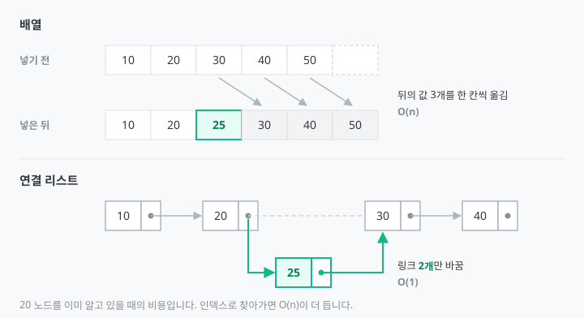
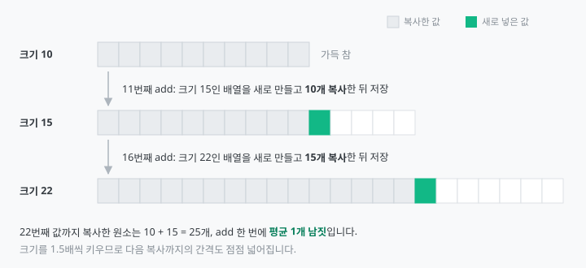

지난 글에서 연산 횟수로 알고리즘의 비용을 따지는 시간 복잡도를 정리했습니다. 이번에는 그 기준으로 가장 기본적인 자료구조인 배열과 연결 리스트를 비교해 보겠습니다. 둘 다 값을 순서대로 담지만 메모리에 놓이는 방식이 달라서 빠른 연산과 느린 연산이 서로 엇갈립니다.

## 메모리에 놓이는 방식

배열은 같은 크기의 칸을 메모리에 빈틈없이 이어서 잡습니다. `int` 하나는 4바이트라서 `new int[5]`는 20바이트짜리 연속된 공간입니다. 첫 칸이 1000번지에서 시작하면 두 번째 칸은 1004번지, 세 번째 칸은 1008번지에 있습니다.

연결 리스트는 값 하나를 노드라는 작은 객체에 담고, 노드마다 다음 노드의 주소를 함께 저장합니다. 노드는 만들 때마다 메모리의 빈 곳에 따로 잡히므로 서로 멀리 떨어져 있을 수 있습니다. 순서는 각 노드에 적힌 다음 주소가 정합니다. 리스트 전체를 쓰려면 첫 노드(head)의 주소만 알고 있으면 됩니다. 다음 노드만 가리키면 단일 연결 리스트, 이전 노드까지 가리키면 이중 연결 리스트라고 부릅니다.

![배열은 1000번지부터 4바이트씩 이어진 칸에 값이 있어 arr[3]의 주소를 1000 + 3 × 4로 바로 계산하고, 연결 리스트는 흩어진 노드를 head부터 다음 주소를 따라 세 번 이동해야 네 번째 값 40에 닿는 그림](./assets/array-vs-linked-list/layout.svg)

## 인덱스 접근

배열에서 i번째 값의 주소는 `시작 주소 + i × 원소 크기`로 바로 나옵니다. `arr[3]`은 1000 + 3 × 4 = 1012번지입니다. 배열 길이가 10이든 1,000만이든 곱셈 한 번과 덧셈 한 번이면 되니 O(1)입니다.

연결 리스트에는 i번째 노드의 주소를 계산할 식이 없습니다. head에서 출발해 다음 주소를 i번 따라가야 하므로 O(n)입니다. 특정 값을 찾는 탐색은 둘 다 앞에서부터 하나씩 비교하는 O(n)입니다. 정렬되어 있다면 배열은 지난 글의 이진 탐색으로 O(log n)에 찾을 수 있지만, 연결 리스트는 가운데 노드까지 가는 데만 O(n)이 걸려서 이진 탐색의 이점이 사라집니다.

## 중간 삽입과 삭제

배열 중간에 값을 넣으려면 그 뒤의 값을 모두 한 칸씩 뒤로 밀어 자리를 만들어야 합니다. 뺄 때는 뒤의 값을 한 칸씩 당겨 빈자리를 메웁니다. 원소가 100만 개인 배열의 맨 앞에 넣으면 100만 개를 옮깁니다. 평균적으로 n/2개를 옮기니 O(n)이고, 맨 끝에서 넣고 빼면 옮길 값이 없어서 O(1)입니다.

연결 리스트는 값을 옮기지 않습니다. 새 노드를 만든 뒤 앞 노드가 새 노드를 가리키게 하고, 새 노드는 원래의 다음 노드를 가리키게 하면 끝입니다. 삭제는 앞 노드가 지울 노드를 건너뛰고 그다음 노드를 가리키게 바꿉니다. 리스트 길이와 상관없이 주소 두어 개만 고치므로 O(1)입니다.



연결 리스트의 O(1)은 넣을 자리의 앞 노드를 이미 알고 있을 때만 성립합니다. "세 번째 자리에 넣기"처럼 인덱스로 위치를 주면 그 노드까지 찾아가는 데 O(n)이 듭니다. 그래서 연결 리스트는 맨 앞에서 넣고 빼거나, 순회하다가 지금 보고 있는 자리에서 바로 넣고 뺄 때 유리합니다. 이중 연결 리스트가 마지막 노드(tail)도 들고 있으면 맨 뒤에서 넣고 빼는 것도 O(1)입니다.

| 연산                 | 배열     | 연결 리스트                 |
| -------------------- | -------- | --------------------------- |
| 인덱스 접근          | O(1)     | O(n)                        |
| 맨 앞 삽입·삭제      | O(n)     | O(1)                        |
| 맨 뒤 삽입·삭제      | O(1)     | O(1) (이중 연결, tail 보관) |
| 중간 삽입·삭제       | O(n)     | 찾기 O(n) + 연결 O(1)       |
| 정렬된 상태에서 탐색 | O(log n) | O(n)                        |

## 동적 배열

배열은 만들 때 크기가 정해지고 그 자리에서 늘릴 수 없습니다. 바로 뒤의 메모리를 다른 데이터가 쓰고 있을 수 있기 때문입니다. 넣을 개수를 미리 모를 때는 동적 배열을 씁니다. 내부에 여유 있는 배열을 두고 끝부터 채우다가, 가득 차면 더 큰 배열을 새로 만들어 기존 값을 전부 복사합니다.

Java의 `ArrayList`가 동적 배열입니다. OpenJDK에서는 기본 생성자로 만든 뒤 처음 `add`할 때 크기 10인 배열을 잡고, 가득 찰 때마다 1.5배로 늘립니다. 크기는 10, 15, 22, 33 순서로 커집니다.



복사가 일어나는 `add`는 O(n)이지만 그 뒤 한동안은 복사 없이 넣습니다. 22번째 값까지 넣는 동안 복사한 원소는 10 + 15 = 25개로, `add` 한 번에 1개 남짓입니다. 지난 글 끝에서 본 분할 상환 O(1)이 이것입니다. 두 배든 1.5배든 일정한 비율로 키우면 평균이 O(1)로 유지됩니다. 반대로 10칸씩처럼 고정된 개수만큼 늘리면 복사가 너무 자주 일어나서 n번 넣는 데 O(n²)이 걸립니다.

넣을 개수를 미리 알면 처음부터 크기를 지정해 복사를 아예 없앨 수 있습니다.

```java
List<Order> orders = new ArrayList<>(rows.size());
```

## 캐시 지역성

빅오로는 둘 다 O(n)인 전체 순회도 실제로 재 보면 배열이 훨씬 빠릅니다. CPU 캐시 때문입니다.

CPU는 메모리를 읽을 때 필요한 값 주변까지 한 덩어리로 캐시에 가져옵니다. 이 단위를 캐시 라인이라고 하고 보통 64바이트입니다. `int` 배열이면 한 번에 16개가 같이 들어오니 첫 값을 읽은 뒤 다음 15개는 캐시에서 바로 꺼냅니다. 순서대로 읽는 패턴이 보이면 다음 덩어리를 미리 가져오기도 합니다. 방금 읽은 곳 근처를 곧 다시 읽는 성질을 공간 지역성이라고 하는데, 배열은 이 성질의 덕을 그대로 봅니다.

연결 리스트의 노드는 메모리 곳곳에 흩어져 있어서 다음 노드로 갈 때마다 캐시에 없을 가능성이 큽니다. 다음 주소를 읽어야 그다음 위치를 알 수 있으니 미리 가져오기도 어렵습니다. 캐시에 없는 값을 메인 메모리에서 가져오는 데는 L1 캐시에서 읽을 때보다 수십 배 넘게 걸립니다.

Java의 `ArrayList<Integer>`는 내부 배열에 `Integer` 객체의 참조만 이어져 있고 객체는 힙의 다른 곳에 있습니다. 그래도 노드를 하나씩 따라가는 것보다는 캐시를 잘 씁니다.

## ArrayList와 LinkedList

Java의 `LinkedList`는 이중 연결 리스트입니다. 노드마다 값과 앞뒤 노드의 참조를 갖고, 리스트는 첫 노드와 마지막 노드를 기억합니다. `get(index)`는 인덱스가 앞쪽 절반이면 앞에서, 뒤쪽 절반이면 뒤에서부터 따라가지만 그래도 O(n)입니다. 이걸 모르고 인덱스로 반복하면 O(n²)이 됩니다.

```java
List<Integer> list = new LinkedList<>(source);
long sum = 0;
for (int i = 0; i < list.size(); i++) {
    sum += list.get(i); // 매번 노드를 따라감
}
```

원소가 10만 개면 노드를 따라가는 횟수가 25억 번 정도입니다. 향상된 for 문이나 `Iterator`로 돌면 한 칸씩 다음 노드로 넘어가므로 O(n)에 끝납니다.

메모리도 더 듭니다. 64비트 JVM에서 압축 참조를 쓰면 `ArrayList`는 원소마다 참조 4바이트가 들지만, `LinkedList`는 원소마다 객체 헤더와 참조 세 개(값, 이전, 다음)를 담은 24바이트짜리 노드를 하나씩 만듭니다.

## 고르는 기준

보통은 `ArrayList`를 씁니다. 인덱스 접근이 O(1)이고, 끝에 넣는 것이 분할 상환 O(1)이고, 순회할 때 캐시도 잘 씁니다. 중간 삽입·삭제는 O(n)이지만 `System.arraycopy`로 연속된 메모리를 한꺼번에 옮겨서 생각보다 빠릅니다. `LinkedList`도 그 자리까지 노드를 따라가야 하니 중간 삽입이 잦다는 이유만으로 바꾸면 오히려 느려지는 경우가 많습니다.

양 끝에서 넣고 빼는 큐나 스택이 필요하면 `ArrayDeque`가 맞습니다. 원형 배열로 양 끝 삽입·삭제를 분할 상환 O(1)에 처리하고, 공식 문서에도 큐로 쓸 때 `LinkedList`보다 빠를 가능성이 높다고 적혀 있습니다.

연결 리스트가 잘 맞는 곳은 노드를 직접 들고 있으면서 그 자리에서 자주 떼고 붙이는 경우입니다. 최근에 쓴 항목을 맨 앞으로 옮기고 가장 오래된 항목을 맨 뒤에서 버리는 LRU 캐시가 대표적입니다. 해시 테이블로 노드를 O(1)에 찾고, 이중 연결 리스트에서 그 노드를 떼어 맨 앞에 붙이는 것도 O(1)입니다. Java의 `LinkedHashMap`도 내부에 이중 연결 리스트를 두고 넣은 순서나 접근 순서를 유지합니다.

## 정리

배열은 연속된 메모리에 값을 두어 인덱스 접근이 O(1)이고 캐시를 잘 쓰지만, 중간에 넣고 빼려면 뒤의 값을 옮겨야 해서 O(n)입니다. 연결 리스트는 노드가 다음 노드를 가리키는 구조라 위치를 알면 삽입·삭제가 O(1)이지만, 인덱스로 찾아가는 데 O(n)이 걸리고 노드마다 메모리를 더 씁니다. 동적 배열은 가득 차면 일정 비율로 큰 배열에 옮겨 담아 끝 삽입을 분할 상환 O(1)로 유지합니다. Java에서는 대부분 `ArrayList`를, 큐와 스택에는 `ArrayDeque`를 쓰고, `LinkedList`를 쓴다면 반복문에서 `get(i)`를 부르지 않도록 주의합니다.

다음 글에서는 List와 Set의 차이를 보겠습니다.
