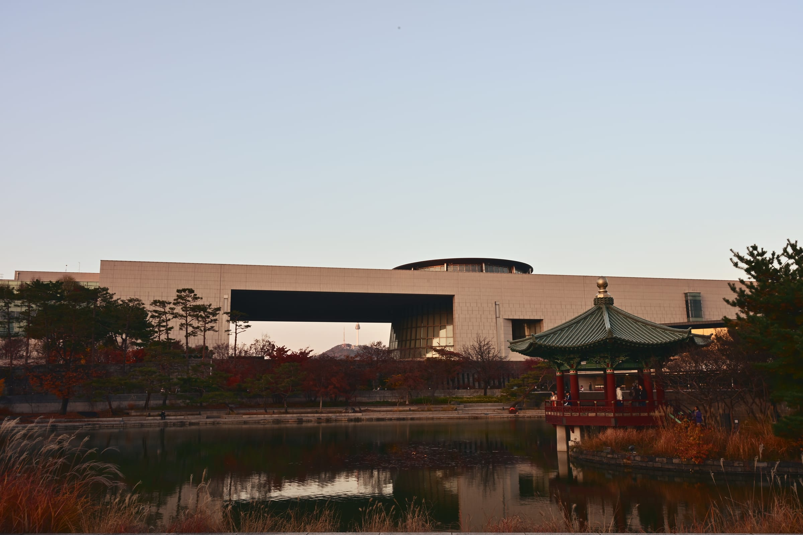

11월 15일, 해가 지기 직전에 국립중앙박물관에 다녀왔습니다. 전시를 보고 나오니 하늘이 옅은 분홍빛으로 바뀌기 시작해서 거울못 쪽으로 걸어 내려갔습니다.

연못가 정자인 청자정과 박물관 건물을 한 화면에 담고 싶었습니다. 건물 가운데 뚫린 계단 사이로 남산타워가 작게 보이는 자리를 찾아 섰습니다. 앞쪽 억새가 화면을 조금 가렸지만 가을 느낌이 나서 그대로 두었습니다.

단풍은 이미 절반쯤 떨어진 뒤였습니다. 그래도 남은 붉은 잎이 연못에 비쳐서 생각보다 색이 많이 남아 있었습니다.
