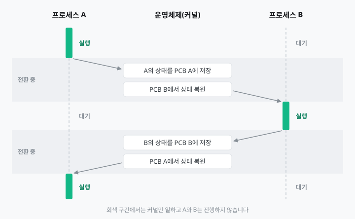
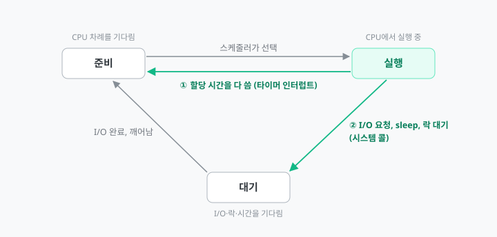

지난 글에서 프로세스와 스레드가 메모리를 어떻게 나눠 쓰는지 봤습니다. 이번에는 CPU가 이들을 번갈아 실행하는 방법을 정리합니다.

CPU 코어 하나는 한 번에 스레드 하나만 실행합니다. 코어가 8개인 노트북에도 프로세스는 수백 개가 떠 있고 스레드는 수천 개입니다. 그런데도 음악을 들으면서 브라우저와 IDE를 함께 쓸 수 있는 건 운영체제가 몇 밀리초 간격으로 실행할 스레드를 계속 바꾸기 때문입니다. 실행 중인 작업의 상태를 저장해 두고 다른 작업의 상태를 불러와 이어서 실행하는 일을 컨텍스트 스위칭이라고 합니다.

## 저장하는 정보

컨텍스트는 작업을 멈췄다가 그대로 이어 가는 데 필요한 실행 상태입니다. CPU 쪽에서 보면 레지스터 값이 전부입니다. 다음에 실행할 명령어 주소를 담은 PC, 스택 꼭대기를 가리키는 스택 포인터, 계산하던 값이 들어 있는 범용 레지스터, 직전 연산 결과를 나타내는 상태 플래그가 여기에 들어갑니다. 이 값들을 정확히 되돌려 놓으면 작업은 멈췄던 줄도 모르고 다음 명령어부터 실행합니다.

운영체제는 이 값을 PCB에 저장합니다. PCB에는 레지스터 값 말고도 작업을 관리하는 데 필요한 정보가 함께 들어 있습니다.

- **식별 정보와 상태:** 프로세스 ID, 실행 중인지 차례를 기다리는지 I/O를 기다리는지
- **CPU 상태:** PC와 레지스터 값
- **스케줄링 정보:** 우선순위, 지금까지 CPU를 쓴 시간
- **메모리 정보:** 이 프로세스의 페이지 테이블 위치
- **자원 정보:** 열어 둔 파일과 소켓 목록

리눅스에서는 `task_struct` 구조체가 이 역할을 합니다. 리눅스는 프로세스와 스레드를 따로 구분하지 않고 스레드마다 `task_struct`를 하나씩 둡니다. 같은 프로세스에 속한 스레드들은 메모리 정보와 열린 파일 목록을 따로 만들지 않고 하나를 함께 가리킵니다.

## 전환 과정

프로세스 A를 실행하다가 B로 넘어가는 과정은 다섯 단계로 나뉩니다.

1. 인터럽트나 시스템 콜로 CPU가 커널 모드로 들어가고 A는 그 자리에서 멈춥니다.
2. 커널이 A의 레지스터 값을 PCB A에 저장하고 A의 상태를 준비나 대기로 바꿉니다.
3. 스케줄러가 다음에 실행할 작업으로 B를 고릅니다.
4. PCB B에 저장해 둔 레지스터 값을 CPU에 다시 올립니다. 다른 프로세스로 넘어가는 경우라 페이지 테이블도 B의 것으로 바꿉니다.
5. 사용자 모드로 돌아가면 B는 지난번에 멈춘 명령어부터 이어서 실행합니다.



2번부터 4번까지는 커널이 자기 일을 하는 시간이라 A도 B도 한 줄도 진행하지 못합니다. 전환이 잦을수록 CPU 시간에서 이 몫이 커집니다.

## 전환이 일어나는 시점

실행 중인 작업이 CPU를 내놓는 경우는 크게 세 가지입니다.

### 타이머 인터럽트

운영체제는 작업마다 한 번에 CPU를 쓸 수 있는 시간을 정해 두는데, 이를 타임 슬라이스라고 합니다. 하드웨어 타이머가 주기적으로 인터럽트를 걸면 커널은 지금 작업이 받은 시간을 다 썼는지 확인합니다. 다 썼으면 그 작업을 준비 상태로 돌려보내고 다른 작업을 실행합니다. 어떤 프로그램이 무한 루프를 돌아도 다른 프로그램이 멈추지 않는 이유입니다. 작업이 원하지 않아도 운영체제가 CPU를 빼앗기 때문에 이 방식을 선점이라고 부릅니다.

### I/O 대기

파일을 읽거나 네트워크 응답을 기다리는 작업은 데이터가 올 때까지 할 일이 없습니다. SSD에서 한 번 읽는 데 100마이크로초가 걸린다고 하면, 3GHz CPU에서는 그동안 30만 사이클이 지나갑니다. 그래서 `read()` 같은 시스템 콜이 바로 끝나지 않으면 커널은 그 작업을 대기 상태로 바꾸고 CPU를 다른 작업에 줍니다. 데이터가 도착하면 장치가 인터럽트를 걸고, 기다리던 작업은 준비 상태로 돌아가 다시 차례를 기다립니다.

### 시스템 콜

I/O 말고도 작업이 스스로 CPU를 내놓는 시스템 콜이 있습니다. `sleep()`으로 잠들거나, 다른 스레드가 쥔 락이 풀리기를 기다리거나, `sched_yield()`로 차례를 양보하는 경우입니다.

시스템 콜을 호출할 때마다 컨텍스트 스위칭이 일어나지는 않습니다. `getpid()`처럼 커널에 들어갔다가 결과를 바로 들고 나오는 호출은 사용자 모드에서 커널 모드로 바뀌었다가 같은 작업으로 돌아올 뿐입니다. 이것을 모드 전환이라고 하며, 실행하는 작업 자체가 바뀌는 컨텍스트 스위칭보다 훨씬 가볍습니다.



리눅스는 이 두 갈래를 프로세스마다 따로 셉니다.

```bash
$ grep ctxt_switches /proc/1234/status
voluntary_ctxt_switches:        15032
nonvoluntary_ctxt_switches:     87
```

`voluntary`는 I/O나 락을 기다리면서 스스로 CPU를 내놓은 횟수이고, `nonvoluntary`는 시간을 다 써서 빼앗긴 횟수입니다. 위 숫자는 예시입니다. 웹 서버처럼 I/O가 많은 프로그램은 앞의 숫자가 크고, 다른 작업과 CPU를 나눠 쓰는 계산 위주 프로그램은 뒤의 숫자가 늘어납니다. 시스템 전체의 초당 전환 횟수는 `vmstat 1`을 실행했을 때 나오는 `cs` 열에서 볼 수 있습니다.

## 프로세스 전환과 스레드 전환

레지스터를 저장하고 복원하는 일은 프로세스끼리 바꾸든 같은 프로세스의 스레드끼리 바꾸든 똑같습니다. 비용 차이는 메모리 쪽에서 생깁니다.

### 주소 공간

프로세스마다 주소 공간이 따로 있어서 같은 가상 주소라도 A에서는 A의 데이터를, B에서는 B의 데이터를 가리킵니다. 가상 주소를 물리 주소로 바꾸는 표가 페이지 테이블이고, CPU는 지금 쓰는 페이지 테이블의 위치를 레지스터 하나에 들고 있습니다. x86에서는 CR3 레지스터입니다. 다른 프로세스로 넘어갈 때는 이 값을 B의 페이지 테이블로 바꿔야 합니다. 같은 프로세스의 스레드는 주소 공간을 함께 쓰니 이 단계가 필요 없습니다.

### TLB

주소를 바꿀 때마다 메모리에 있는 페이지 테이블을 읽으면 너무 느립니다. 그래서 CPU는 최근에 바꾼 주소를 TLB(Translation Lookaside Buffer)라는 작은 캐시에 수십에서 수천 개 담아 둡니다. TLB 항목은 특정 주소 공간에서만 맞는 값이라 페이지 테이블이 바뀌면 쓸 수 없습니다. 예전 CPU는 프로세스를 바꿀 때마다 TLB를 통째로 비웠고, 새 프로세스는 한동안 주소를 바꿀 때마다 페이지 테이블을 다시 읽어야 했습니다.

요즘 CPU는 TLB 항목에 주소 공간 번호를 붙여서(x86의 PCID, ARM의 ASID) 비우지 않고도 프로세스별 항목을 구분합니다. 그래도 TLB는 작아서 B가 다시 실행될 즈음이면 B의 항목이 다른 프로세스의 항목에 밀려나 있는 경우가 많습니다.

### 캐시

L1, L2, L3 같은 CPU 캐시는 전환할 때 비우지 않습니다. 문제는 캐시에 남아 있는 데이터가 방금 전까지 실행하던 A의 것이라는 점입니다. B는 처음 메모리에 접근할 때마다 캐시 미스를 내고 메인 메모리까지 다녀옵니다. L1 캐시는 몇 사이클이면 읽지만 메인 메모리는 수백 사이클이 걸립니다.

같은 프로세스의 스레드는 코드와 힙을 함께 쓰므로 앞 스레드가 캐시에 올려 둔 데이터를 다음 스레드가 그대로 쓰는 경우가 많습니다.


레지스터를 바꾸고 스케줄러를 실행하는 데 드는 시간은 보통 마이크로초 단위입니다. 여기에 전환 직후 TLB와 캐시를 다시 채우는 동안 느려지는 시간이 더해지는데, 이 몫은 작업이 쓰는 메모리가 클수록 커집니다. 프로세스 간 전환이 스레드 간 전환보다 느린 것도 주로 이 때문입니다.

## 비용과 줄이는 방법

전환 한 번은 짧아도 횟수가 쌓이면 무시할 수 없습니다. 코어 하나에서 1초에 10만 번 전환하고 한 번에 5마이크로초가 든다고 하면 1초 중 0.5초, 코어 시간의 절반이 전환에 쓰입니다.

전환을 줄이는 첫 번째 방법은 스레드 수를 작업 성격에 맞추는 것입니다. 계산만 하는 작업은 스레드를 코어 수보다 많이 만들어도 동시에 실행되는 수는 코어 수를 넘지 못하고, 남는 스레드는 전환만 늘립니다. 이런 작업은 스레드를 코어 수 정도로 둡니다. I/O를 기다리는 시간이 긴 작업은 한 스레드가 기다리는 동안 다른 스레드가 CPU를 쓸 수 있으니 더 많이 둬도 됩니다. 웹 요청은 DB나 외부 API를 기다리는 시간이 길어서 톰캣도 코어 수보다 훨씬 많은 스레드(기본 최대 200개)를 둡니다.

```java file="Pools.java"
int cores = Runtime.getRuntime().availableProcessors();

// 계산 위주 작업: 코어 수만큼
ExecutorService cpuPool = Executors.newFixedThreadPool(cores);

// I/O 위주 작업: 작업마다 가상 스레드 (Java 21+)
ExecutorService ioPool = Executors.newVirtualThreadPerTaskExecutor();
```

락 경합도 줄여야 합니다. 여러 스레드가 락 하나를 두고 다투면 기다리는 스레드마다 잠들었다 깨어나는 전환이 생깁니다. 락을 쥐고 있는 구간을 짧게 하거나 데이터를 나눠 서로 다른 락을 쓰게 하면 기다리는 일이 줄어듭니다. `ConcurrentHashMap`은 맵 전체에 락을 하나 거는 대신 버킷마다 따로 동기화해서 서로 다른 키를 쓰는 스레드끼리는 기다리지 않습니다.

스레드 수 자체를 줄이는 구조도 있습니다. Nginx의 워커 프로세스나 Node.js는 스레드 하나로 이벤트 루프를 돌면서 연결 수천 개를 처리합니다. 연결마다 스레드를 두는 방식보다 전환이 훨씬 적습니다. 이 구조는 논블로킹 I/O 위에서 동작하는데, 이 부분은 다음 글에서 다룹니다.

Java 21부터 쓸 수 있는 가상 스레드는 JVM이 적은 수의 OS 스레드 위에서 직접 바꿔 가며 실행합니다. 가상 스레드가 I/O를 기다리면 JVM이 그 가상 스레드를 OS 스레드에서 내리고 다른 가상 스레드를 올립니다. 이 전환은 커널을 거치지 않아서 OS 스레드끼리 바꾸는 것보다 가볍습니다.

## 정리

컨텍스트 스위칭은 CPU에서 실행 중인 작업을 바꾸는 일입니다. 운영체제는 지금 작업의 레지스터와 PC를 PCB에 저장하고 다음 작업의 값을 불러옵니다. 시간을 다 쓴 작업은 타이머 인터럽트로 CPU를 빼앗기고, I/O나 락을 기다리는 작업은 시스템 콜을 거쳐 스스로 CPU를 내놓습니다. 다른 프로세스로 넘어가면 페이지 테이블이 바뀌고 TLB와 캐시도 새로 채워야 해서 같은 프로세스의 스레드끼리 바꿀 때보다 비쌉니다. 전환을 줄이려면 스레드 수를 작업에 맞추고 락 경합을 줄이며, 필요하면 이벤트 루프나 가상 스레드를 씁니다.

다음 글에서는 동기와 비동기, 블로킹과 논블로킹을 보겠습니다.
