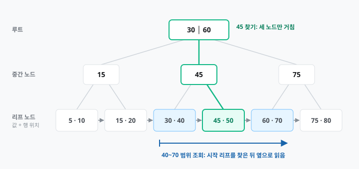
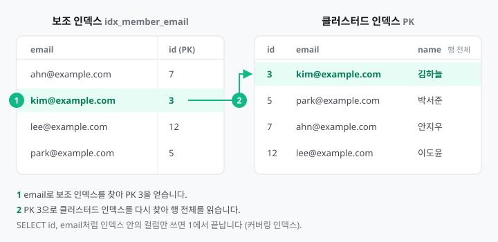

조회가 느릴 때 가장 먼저 확인하는 것이 인덱스입니다. 책 뒤에 붙은 찾아보기처럼, 인덱스는 컬럼 값과 그 값이 있는 위치를 정렬해서 따로 저장해 둔 자료구조입니다. 예시는 MySQL의 InnoDB를 기준으로 들겠습니다.

## 인덱스가 없을 때

회원 테이블에서 이메일로 한 명을 찾는다고 해 보겠습니다.

```sql
CREATE TABLE member (
    id         BIGINT PRIMARY KEY AUTO_INCREMENT,
    email      VARCHAR(100) NOT NULL,
    name       VARCHAR(50)  NOT NULL,
    created_at DATETIME     NOT NULL
);

SELECT * FROM member WHERE email = 'kim@example.com';
```

`email`에 인덱스가 없으면 데이터베이스는 그 이메일이 어느 행에 있는지 알 수 없습니다. 첫 행부터 마지막 행까지 읽으면서 하나씩 비교해야 합니다. 이것을 풀 테이블 스캔이라고 합니다. 행이 100만 개면 100만 개를 다 읽습니다. 앞쪽에서 원하는 행을 찾더라도 같은 이메일이 또 없다는 보장이 없으니 끝까지 읽습니다.

`email`에 인덱스를 만들면 정렬된 인덱스에서 값을 찾고 바로 해당 행으로 갑니다. 읽는 양이 테이블 크기와 거의 상관없이 페이지 몇 개로 줄어듭니다.

```sql
CREATE INDEX idx_member_email ON member (email);
```

## B+Tree

대부분의 관계형 데이터베이스는 인덱스를 B+Tree로 만듭니다. B+Tree는 노드 하나가 여러 자식을 갖는 균형 트리입니다.

- 루트와 중간 노드에는 길을 안내하는 키만 있습니다. 찾는 값이 어느 범위에 속하는지 보고 아래 노드로 내려갑니다.
- 실제 값과 행의 위치는 맨 아래 리프 노드에만 있습니다.
- 리프 노드끼리는 옆으로 연결되어 있습니다.
- 모든 리프가 같은 깊이에 있어서 어떤 값을 찾든 거치는 노드 수가 같습니다.



InnoDB는 디스크의 데이터를 16KB 크기의 페이지 단위로 읽고 씁니다. B+Tree의 노드 하나가 페이지 하나입니다. 중간 노드에는 키만 들어가니 한 페이지에 키를 수백 개씩 담을 수 있고, 노드 하나가 자식을 수백 개 가리킵니다. 그래서 행이 수천만 개여도 트리 높이는 보통 3~4 정도이고, 값 하나를 찾는 데 페이지를 서너 번만 읽으면 됩니다.

다른 자료구조와 비교해 보면 B+Tree를 쓰는 이유가 보입니다.

- **해시 테이블:** 같은 값을 찾는 데는 O(1)로 더 빠릅니다. 하지만 값이 정렬되어 있지 않아서 `BETWEEN`, `>`, `ORDER BY` 같은 범위 조회와 정렬에는 쓸 수 없습니다.
- **이진 탐색 트리:** 노드마다 자식이 둘뿐이라 트리가 깊어집니다. 100만 건이면 높이가 20을 넘고, 노드를 하나 내려갈 때마다 디스크를 읽을 수 있습니다. 균형이 깨지면 더 깊어집니다.
- **B+Tree:** 자식이 많아 트리가 얕습니다. 리프가 정렬된 채로 연결되어 있어서 범위 조회는 시작 지점만 찾은 뒤 리프를 옆으로 따라가며 읽으면 됩니다.

## 클러스터드 인덱스와 보조 인덱스

InnoDB 테이블의 인덱스는 두 종류로 나뉩니다.

클러스터드 인덱스는 기본 키(PK)로 만든 B+Tree입니다. 이 트리의 리프 노드에 행 데이터 전체가 들어갑니다. 테이블 자체가 PK 순서로 정렬된 B+Tree인 셈이라 테이블마다 하나만 있습니다. PK를 정하지 않으면 NOT NULL인 첫 번째 UNIQUE 인덱스를 쓰고, 그것도 없으면 InnoDB가 숨겨진 행 ID를 만들어 씁니다.

보조 인덱스는 그 밖에 따로 만든 인덱스입니다. 앞에서 만든 `idx_member_email`이 여기에 해당합니다. 보조 인덱스의 리프에는 행 데이터가 아니라 인덱스 컬럼 값과 그 행의 PK 값이 들어 있습니다.



그래서 보조 인덱스로 행 전체를 가져오려면 트리를 두 번 탑니다. `idx_member_email`에서 이메일로 PK를 찾고, 그 PK로 클러스터드 인덱스를 다시 찾아 행을 읽습니다.

필요한 컬럼이 모두 보조 인덱스 안에 있으면 두 번째 탐색을 건너뜁니다. 이런 경우를 커버링 인덱스라고 합니다. `idx_member_email`에는 `email`과 PK인 `id`가 들어 있으니 아래 쿼리는 인덱스만 읽고 끝납니다.

```sql
SELECT id, email FROM member WHERE email = 'kim@example.com';
```

PK 값은 모든 보조 인덱스에 복사되어 들어갑니다. PK 컬럼이 크면 보조 인덱스도 그만큼 커집니다.

## 실행 계획으로 확인하기

쿼리 앞에 `EXPLAIN`을 붙이면 인덱스를 쓰는지 확인할 수 있습니다. 위 `member` 테이블에서 세 쿼리를 비교하면 이렇습니다.

| 쿼리                                   | type | key              | Extra       |
| -------------------------------------- | ---- | ---------------- | ----------- |
| `SELECT * ... WHERE name = ?`          | ALL  | NULL             | Using where |
| `SELECT * ... WHERE email = ?`         | ref  | idx_member_email | NULL        |
| `SELECT id, email ... WHERE email = ?` | ref  | idx_member_email | Using index |

`type`이 `ALL`이면 풀 테이블 스캔입니다. `ref`는 인덱스로 같은 값을 찾았다는 뜻이고, `key`에는 실제로 쓴 인덱스 이름이 나옵니다. `Extra`의 `Using index`는 커버링 인덱스로 처리했다는 표시입니다.

## 인덱스의 비용

인덱스는 조회를 빠르게 하는 대신 쓰기를 느리게 합니다. 행을 INSERT하면 테이블뿐 아니라 그 테이블의 모든 인덱스에도 값을 넣어야 합니다. 정렬 순서를 지켜야 하니 페이지가 가득 차면 페이지를 쪼개는 작업도 생깁니다. 인덱스 컬럼을 UPDATE하거나 행을 DELETE할 때도 인덱스를 함께 고칩니다. 인덱스 자체도 디스크와 메모리를 차지합니다.

그래서 모든 컬럼에 인덱스를 걸지 않고, 자주 쓰는 조회 조건을 보고 고릅니다. WHERE, JOIN, ORDER BY에 자주 나오고 값이 다양한 컬럼이 후보입니다.

## 인덱스가 쓰이지 않는 경우

인덱스가 있어도 쿼리를 어떻게 쓰느냐에 따라 쓰이지 않을 수 있습니다.

- **컬럼을 가공한 조건:** `WHERE YEAR(created_at) = 2026`처럼 컬럼에 함수를 씌우면 인덱스에 저장된 값과 바로 비교할 수 없습니다. `WHERE created_at >= '2026-01-01' AND created_at < '2027-01-01'`처럼 컬럼은 그대로 두고 범위 조건으로 바꿉니다.
- **앞쪽 와일드카드 LIKE:** `LIKE 'kim%'`는 정렬된 인덱스에서 kim으로 시작하는 구간을 찾으면 됩니다. `LIKE '%kim'`은 시작 글자를 모르니 전부 확인해야 합니다.
- **타입이 다른 비교:** 문자열 컬럼 `phone`을 `WHERE phone = 01012345678`처럼 숫자와 비교하면 MySQL이 컬럼 값을 숫자로 바꿔 가며 비교하느라 인덱스를 쓰지 못합니다.
- **복합 인덱스의 순서:** `(last_name, first_name)` 인덱스는 `last_name`으로 먼저 정렬하고, 같은 `last_name` 안에서 `first_name`으로 정렬합니다. `WHERE first_name = ?`만 있으면 첫 번째 정렬 기준이 빠져서 인덱스를 제대로 쓰지 못합니다. 복합 인덱스는 왼쪽 컬럼부터 조건에 들어가야 합니다.
- **값의 종류가 적은 컬럼:** 성별처럼 값이 몇 가지뿐인 컬럼은 조건을 걸어도 테이블의 상당 부분이 걸립니다. 인덱스와 클러스터드 인덱스를 오가느니 테이블을 한 번에 읽는 편이 빠르다고 옵티마이저가 판단하면 인덱스를 쓰지 않습니다.

## 정리

인덱스는 컬럼 값을 정렬해 둔 B+Tree이고, 덕분에 풀 테이블 스캔 없이 페이지 몇 개만 읽고 원하는 행을 찾습니다. InnoDB에서는 PK로 만든 클러스터드 인덱스에 행 데이터가 들어 있고, 보조 인덱스는 PK를 거쳐 행을 찾습니다. 인덱스를 늘리면 쓰기가 느려지고 공간도 더 들기 때문에 자주 쓰는 조회 조건에 맞춰 만듭니다. 컬럼을 가공하거나 복합 인덱스 순서를 어기는 쿼리는 인덱스를 살리지 못하니 피합니다.

다음 글에서는 여러 쿼리를 하나의 작업 단위로 묶는 트랜잭션을 보겠습니다.
