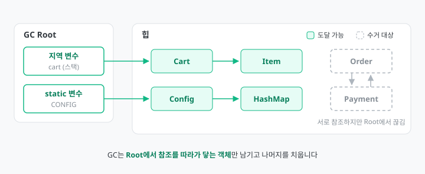
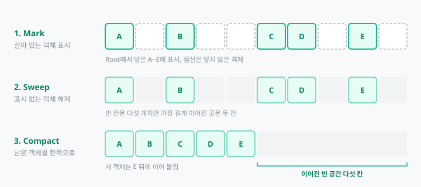
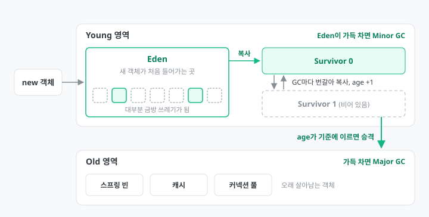

지난 글에서 `new`로 만든 객체는 JVM의 힙에 들어가고, 실행 엔진의 GC가 쓰지 않는 객체를 정리한다고 했습니다. 이번에는 GC가 어떤 객체를 쓰레기로 판단하고 어떤 순서로 치우는지, 그동안 애플리케이션에는 무슨 일이 생기는지 보겠습니다. 설명은 HotSpot JVM을 기준으로 합니다.

## GC가 필요한 이유

C에서는 `malloc`으로 받은 메모리를 다 쓰면 `free`로 직접 돌려줍니다. 돌려주는 걸 잊으면 메모리 사용량이 계속 늘고, 이미 돌려준 메모리에 다시 접근하면 엉뚱한 값을 읽거나 프로그램이 죽습니다.

자바에는 `new`만 있고 메모리를 해제하는 문법이 없습니다. 쓰지 않는 객체는 GC가 찾아서 치우니 이런 버그가 생기지 않습니다. 대신 GC도 CPU를 쓰고, 언제 돌지는 JVM이 정합니다. `System.gc()`를 호출해도 GC를 요청할 뿐 바로 실행된다는 보장은 없습니다.

자바에서도 메모리 누수는 생깁니다. GC는 더는 참조되지 않는 객체만 치우기 때문에, 다 쓴 객체를 `static` 컬렉션에 넣어 두고 빼지 않으면 그 객체들은 프로그램이 끝날 때까지 남습니다.

## 도달 가능성과 GC Root

GC는 GC Root에서 출발해 참조를 따라갑니다. 따라가서 닿는 객체는 살아 있는 객체이고, 어떤 경로로도 닿지 않는 객체는 치워도 되는 객체입니다. GC Root가 되는 것은 대표적으로 세 가지입니다.

- 실행 중인 스레드의 JVM 스택에 있는 지역 변수와 매개변수
- 로드된 클래스의 static 변수
- JNI로 부른 네이티브 코드가 들고 있는 참조

```java file="OrderService.java"
void order() {
    Cart cart = new Cart();     // 스택의 cart가 힙의 Cart를 가리킴
    cart.add(new Item("책"));   // Cart가 Item을 가리킴
    cart = null;                // Cart와 Item 모두 Root에서 닿지 않음
}
```

`cart = null` 이후에는 Cart 객체로 가는 경로가 없습니다. Item은 Cart가 여전히 참조하고 있지만 Cart에 닿을 수 없으니 Item에도 닿을 수 없습니다. 둘 다 다음 GC 때 치워집니다. `null`을 넣지 않아도 메서드가 끝나 스택 프레임이 빠지면 같은 상태가 됩니다.



객체마다 자기를 가리키는 참조 개수를 세다가 0이 되면 지우는 참조 카운팅 방식도 있습니다. 이 방식에서는 두 객체가 서로를 가리키면 개수가 1 밑으로 내려가지 않아 영영 지우지 못합니다. 도달 가능성으로 판단하면 그림의 Order와 Payment처럼 서로 참조하고 있어도 Root에서 끊겨 있으면 함께 치울 수 있습니다.

## Mark, Sweep, Compact

살아 있는 객체를 가려냈으면 나머지를 치웁니다. 가장 기본이 되는 방식은 세 단계로 이루어집니다.

1. **Mark:** GC Root부터 참조를 따라가며 닿는 객체에 표시합니다.
2. **Sweep:** 힙을 훑으면서 표시가 없는 객체가 차지하던 공간을 빈 공간으로 돌립니다.
3. **Compact:** 살아남은 객체를 힙의 한쪽 끝으로 몰아 붙입니다.

Sweep까지만 하면 빈 공간이 살아 있는 객체 사이사이에 흩어집니다. 빈 공간을 다 합치면 100MB여도 가장 길게 이어진 곳이 5MB라면 10MB짜리 배열은 들어갈 자리가 없습니다. 이를 단편화라고 합니다. Compact를 하면 빈 공간이 한 덩어리로 모이고, 새 객체는 마지막 객체 뒤에 붙이기만 하면 됩니다. 대신 옮긴 객체를 가리키던 참조를 모두 새 주소로 고쳐야 해서 시간이 더 듭니다.



## Stop-the-World

GC가 참조를 따라가며 표시하는 도중에 애플리케이션이 참조를 바꾸면 문제가 생깁니다. 확인을 마친 객체에 아직 확인하지 않은 객체가 연결되고 원래 경로가 끊기면, GC는 그 객체를 보지 못하고 쓰레기로 판단할 수 있습니다. Compact로 객체를 옮기는 중에 애플리케이션이 옛 주소를 읽어도 안 됩니다.

그래서 GC는 작업의 전부나 일부를 하는 동안 애플리케이션 스레드를 모두 멈춥니다. 이를 Stop-the-World라고 합니다. 서버가 힙 전체를 정리하느라 몇 초씩 멈추면 그사이 들어온 요청은 응답이 늦어지거나 타임아웃이 납니다. GC 튜닝은 대부분 이 멈춤을 짧고 드물게 만드는 일입니다.

## 약한 세대 가설

HotSpot의 GC는 힙을 객체의 나이에 따라 나눠 관리합니다. 근거는 약한 세대 가설(Weak Generational Hypothesis)이라는 경험적 관찰입니다.

- 대부분의 객체는 만들어지고 얼마 지나지 않아 쓰이지 않게 됩니다.
- 오래된 객체가 새로 만든 객체를 참조하는 경우는 드뭅니다.

웹 서버라면 요청 하나를 처리하며 만든 DTO나 임시 문자열은 응답을 보내고 나면 필요 없어집니다. 반면 스프링 빈이나 캐시, 커넥션 풀은 서버가 꺼질 때까지 살아 있습니다. 새 객체만 따로 모아 그곳을 자주 정리하면 오래 살 객체를 매번 다시 확인하지 않고도 쓰레기 대부분을 치울 수 있습니다.

## Young 영역과 Old 영역

힙은 Young 영역과 Old 영역으로 나뉘고, Young 영역은 다시 Eden 하나와 Survivor 두 개로 나뉩니다.

새 객체는 Eden에 만들어집니다. Eden이 가득 차면 Young 영역만 정리하는 Minor GC가 일어납니다. Eden과 사용 중인 Survivor에서 살아 있는 객체를 비어 있는 다른 Survivor로 복사하고, 원래 공간은 통째로 비웁니다. 그래서 두 Survivor 중 하나는 늘 비어 있습니다. 복사하면서 객체가 빈틈없이 놓이니 Young 영역에는 Compact가 따로 필요 없습니다. Young 영역은 작고 살아남는 객체도 적어서 Minor GC는 짧게 끝납니다.

객체는 Minor GC에서 살아남을 때마다 나이(age)가 1씩 늘어납니다. 나이가 기준에 이르면 Old 영역으로 옮겨지는데, 이를 승격(promotion)이라고 합니다. 기준은 JVM이 Survivor 사용량을 보며 조절하고, 그 최댓값은 `-XX:MaxTenuringThreshold`로 정합니다. 기본값은 15입니다. Survivor 공간이 모자라면 나이가 덜 찬 객체도 Old 영역으로 넘어갑니다.



Old 영역이 가득 차면 Old 영역을 정리하는 Major GC가 일어납니다. Old 영역은 크고 살아 있는 객체가 많아서 Mark-Sweep-Compact에 시간이 오래 걸리고 멈춤도 깁니다. 힙 전체를 정리하는 것은 Full GC라고 부르는데, 문서에 따라 Major GC와 Full GC를 섞어 쓰기도 합니다.

Old 객체가 Young 객체를 가리키는 경우도 있어서 Minor GC는 이런 참조를 놓치면 안 됩니다. HotSpot은 그런 참조가 생긴 Old 영역의 구역을 카드 테이블에 표시해 두고, Minor GC 때 그 구역만 확인합니다. 세대 가설의 두 번째 관찰대로 이런 참조는 드물어서 Old 영역 전체를 훑을 필요가 없습니다.

## 대표적인 GC

HotSpot JVM에는 GC가 여러 개 들어 있고 실행 옵션으로 고를 수 있습니다. 차이는 멈춤을 다루는 방식에 있습니다.

**Serial GC**(`-XX:+UseSerialGC`)는 GC 스레드 하나로 모든 작업을 합니다. 구조가 단순하고 메모리를 적게 쓰지만 힙이 크면 멈춤이 길어집니다. CPU가 하나이거나 메모리가 작은 환경에서는 JVM이 기본으로 Serial GC를 고릅니다.

**Parallel GC**(`-XX:+UseParallelGC`)는 같은 일을 여러 스레드로 나눠 합니다. 여러 코어를 함께 써서 멈춤이 짧아지고, 전체 처리량을 높이는 쪽에 맞춰져 있습니다. Java 8까지 서버 환경의 기본 GC였습니다.

**G1 GC**(`-XX:+UseG1GC`)는 Java 9부터 기본 GC입니다. 힙을 Young과 Old 두 덩어리로 자르지 않고 같은 크기의 리전 여러 개로 나눈 뒤, 리전마다 Eden, Survivor, Old 역할을 맡깁니다. 표시 작업의 상당 부분은 애플리케이션과 동시에 진행하고, 정리할 때는 쓰레기가 많은 리전부터 치웁니다(Garbage First). 목표 멈춤 시간(`-XX:MaxGCPauseMillis`, 기본 200ms) 안에 끝낼 수 있을 만큼만 리전을 고릅니다.

**ZGC**(`-XX:+UseZGC`)는 Java 11에 실험 기능으로 들어와 Java 15에서 정식 기능이 되었습니다. 표시뿐 아니라 객체를 옮기는 작업까지 애플리케이션과 동시에 합니다. 애플리케이션을 멈추는 구간을 1ms 안쪽으로 유지하는 것이 목표이고, 힙이 수백 GB로 커져도 멈춤 시간은 거의 늘지 않습니다. Java 21부터는 ZGC도 세대를 나눠 관리할 수 있습니다.

지금 쓰는 GC는 `java -XX:+PrintCommandLineFlags -version`을 실행하면 출력에 `-XX:+UseG1GC`처럼 나옵니다.

## 정리

GC는 GC Root에서 참조를 따라가 닿지 않는 객체를 치웁니다. 살아 있는 객체에 표시하고(Mark), 나머지를 지우고(Sweep), 남은 객체를 모으는(Compact) 것이 기본 동작이고, 그사이 애플리케이션이 멈추는 Stop-the-World가 생깁니다. HotSpot은 대부분의 객체가 금방 쓰레기가 된다는 관찰에 따라 힙을 Young과 Old로 나눠, 작은 Young 영역은 자주 정리하고 Old 영역은 가끔 정리합니다. Serial, Parallel, G1, ZGC는 이 멈춤을 어떻게 줄이느냐에서 차이가 납니다.

다음 글에서는 자주 쓰는 자료구조를 모아 둔 자바 컬렉션 프레임워크를 보겠습니다.
