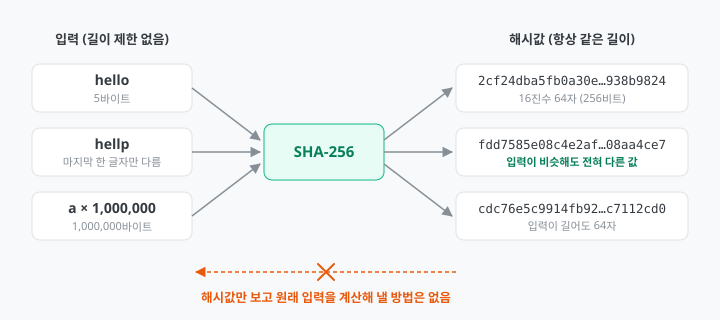
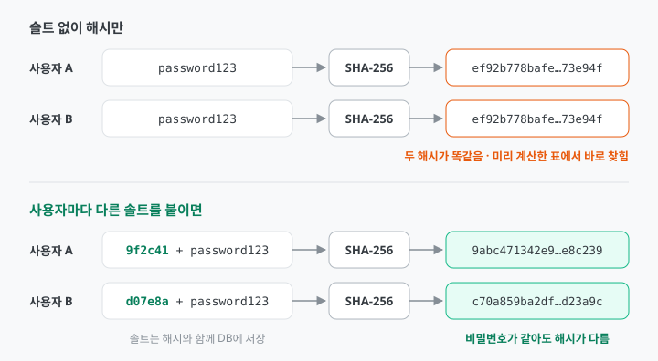
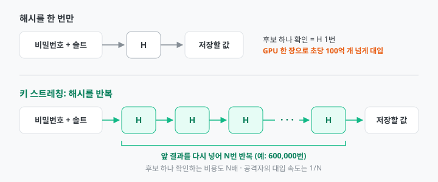

지난 글에서 본 대칭키와 비대칭키 암호화는 맞는 키만 있으면 암호문을 다시 평문으로 되돌릴 수 있었습니다. 이번에는 처음부터 되돌릴 수 없게 만드는 단방향 암호화를 보겠습니다. 단방향 암호화는 해시 함수로 구현합니다. 키도 없고 복호화도 없어서 엄밀히 말하면 암호화보다는 해싱이라고 부르는 쪽이 정확합니다.

## 해시 함수의 성질

해시 함수는 임의 길이의 입력을 받아 정해진 길이의 값을 돌려줍니다. 이 값을 해시값 또는 다이제스트라고 합니다. 보안에 쓰는 암호학적 해시 함수는 몇 가지 성질을 만족해야 합니다.

같은 입력은 언제나 같은 해시값을 냅니다. SHA-256에 `hello`를 넣으면 어느 컴퓨터에서 몇 번을 계산하든 `2cf24dba...938b9824`가 나옵니다. 그래서 원래 값을 몰라도 두 값이 같은지는 해시값끼리 비교해서 알 수 있습니다.

출력 길이는 입력 길이와 상관없이 고정입니다. SHA-256은 5바이트를 넣든 1GB 파일을 넣든 256비트, 16진수로 64자를 냅니다. 입력이 조금만 달라져도 결과는 완전히 달라집니다. `hello`의 마지막 글자 하나를 `p`로 바꾸면 해시값에서 비슷한 부분을 찾을 수 없습니다. 이 성질을 눈사태 효과라고 합니다.



해시값에서 원래 입력을 계산해 낼 수는 없습니다. 길이가 제한 없는 입력을 256비트로 줄이면서 정보가 버려지기 때문에 거꾸로 푸는 공식이 존재하지 않습니다. 원래 입력을 알아내려면 후보를 하나씩 넣어 보고 해시값이 같은지 확인하는 수밖에 없습니다.

충돌도 찾기 어려워야 합니다. 충돌은 서로 다른 두 입력이 같은 해시값을 내는 경우입니다. 입력은 끝없이 많고 출력은 2^256가지뿐이니 충돌 자체는 반드시 있습니다. 다만 그런 쌍을 현실적인 시간 안에 찾아낼 수는 없어야 합니다. SHA-256은 아직 충돌이 하나도 발견되지 않았습니다.

## 비밀번호 저장

해시가 가장 많이 쓰이는 곳은 비밀번호 저장입니다. 회원가입 때 서버는 비밀번호를 해시한 값만 DB에 저장합니다. 로그인할 때는 사용자가 입력한 비밀번호를 같은 방식으로 해시해서 저장된 값과 비교합니다. 같으면 맞는 비밀번호입니다.

이렇게 하면 DB가 통째로 유출돼도 비밀번호가 그대로 드러나지 않습니다. 대칭키로 암호화해서 저장하는 방법도 있지만, 키가 같은 서버에 있으니 DB와 함께 키까지 털리면 전부 복호화됩니다. 해시는 풀 키 자체가 없습니다. 서버조차 사용자의 비밀번호를 모르기 때문에 대부분의 서비스가 비밀번호 찾기 대신 재설정만 제공합니다.

## 레인보우 테이블과 솔트

비밀번호를 SHA-256으로 한 번 해시해서 저장하는 것만으로는 부족합니다. 같은 비밀번호는 항상 같은 해시값이 나오기 때문입니다. 공격자는 자주 쓰는 비밀번호 수억 개의 해시값을 미리 계산해 두고, 유출된 해시값을 그 표에서 찾기만 하면 됩니다. 이런 사전 계산 표 가운데 해시 체인을 이용해 저장 공간을 크게 줄인 것을 레인보우 테이블이라고 합니다. `password123`의 SHA-256 값은 이미 이런 표에 다 들어 있다고 봐야 합니다. DB 안에서 해시값이 같은 계정끼리는 비밀번호도 같다는 사실까지 드러납니다.

이 문제는 솔트로 막습니다. 솔트는 사용자마다 새로 만드는 무작위 값입니다. 비밀번호에 솔트를 붙여서 해시하고, 솔트는 해시값 옆에 그대로 저장합니다. 솔트는 비밀이 아니어도 됩니다. 로그인할 때 저장된 솔트를 꺼내 입력한 비밀번호에 다시 붙여 해시하면 됩니다.



솔트가 16바이트면 같은 비밀번호도 2^128가지 다른 해시값을 가질 수 있습니다. 공격자가 미리 만들어 둔 표는 쓸모가 없어지고, 솔트마다 계산을 처음부터 다시 해야 합니다.

## 키 스트레칭

솔트가 있어도 막지 못하는 공격이 있습니다. 특정 계정 하나를 골라 그 솔트를 붙인 후보 비밀번호를 하나씩 대입하는 무차별 대입입니다. SHA-256 같은 범용 해시는 빠르게 계산되도록 설계됐습니다. 최신 GPU 한 장이면 SHA-256을 초당 100억 번 넘게 계산합니다. 짧거나 흔한 비밀번호는 금방 맞혀집니다.

키 스트레칭은 해시 계산을 일부러 느리게 만드는 방법입니다. 해시한 결과를 다시 해시 함수에 넣는 일을 수십만 번 반복해서 최종 값을 얻습니다.



반복 횟수가 60만 번이면 후보 하나를 확인하는 비용도 60만 배가 됩니다. 초당 100억 개를 확인하던 공격자는 초당 약 1만 7천 개밖에 확인하지 못합니다. 정상 사용자는 로그인할 때 한 번만 계산하니 0.1초 정도 걸려도 불편을 거의 느끼지 않습니다.

## MD5와 SHA-1을 쓰지 않는 이유

MD5(128비트)와 SHA-1(160비트)은 충돌 저항이 이미 깨졌습니다. MD5는 2004년에 충돌을 만드는 방법이 발표됐고, 지금은 일반 PC로 몇 초면 충돌 쌍을 만듭니다. SHA-1은 2017년에 Google과 CWI 연구진이 내용이 다른데 SHA-1 값이 같은 PDF 파일 두 개를 공개했습니다. 그래서 인증서 서명처럼 충돌이 곧 위조로 이어지는 곳에서는 둘 다 퇴출됐습니다.

비밀번호에 맞지 않는 이유는 충돌보다 속도 쪽이 큽니다. 둘 다 SHA-256보다도 빨라서 GPU로 MD5는 초당 1,000억 번 넘게 계산할 수 있습니다. 솔트를 붙여도 무차별 대입에 오래 버티지 못합니다. 같은 이유로 SHA-256을 한 번 쓰는 것도 비밀번호 저장에는 맞지 않습니다.

## bcrypt, PBKDF2, Argon2

비밀번호 저장에는 처음부터 느리게 만든 전용 함수를 씁니다. 셋 다 솔트와 키 스트레칭이 기본으로 들어 있고, 비용을 조절하는 값이 있어서 하드웨어가 빨라지면 그 값을 올리면 됩니다.

PBKDF2는 HMAC-SHA256 같은 함수를 정해진 횟수만큼 반복합니다. NIST가 권장하는 방식이라 FIPS 인증이 필요한 환경에서 많이 씁니다. OWASP는 PBKDF2-HMAC-SHA256을 쓸 때 반복 횟수를 60만 번 이상으로 권장합니다.

bcrypt는 1999년에 나온 함수로, 비용 값(cost)이 1 늘 때마다 계산량이 두 배가 됩니다. 결과 문자열 안에 알고리즘 버전, 비용, 솔트가 함께 들어 있어서 솔트를 따로 저장할 필요가 없습니다. 입력은 72바이트까지만 쓰기 때문에 그보다 긴 비밀번호는 뒷부분이 계산에 들어가지 않습니다.

Argon2는 2015년 비밀번호 해시 공모전(Password Hashing Competition)에서 뽑힌 함수입니다. 계산 시간뿐 아니라 메모리도 많이 쓰게 만들 수 있습니다. GPU나 전용 칩은 연산 유닛은 많지만 유닛마다 쓸 수 있는 메모리가 적어서, 메모리를 많이 요구하면 병렬로 대입하기 어려워집니다. 세 가지 변형 중 Argon2id를 쓰는 것이 일반적인 권장입니다.

Spring Security에서는 `BCryptPasswordEncoder`로 bcrypt를 씁니다.

```java file="PasswordExample.java"
PasswordEncoder encoder = new BCryptPasswordEncoder(); // 기본 비용 10

String hash = encoder.encode("password123");
// $2a$10$ + 솔트 22자 + 해시 31자, 총 60자

encoder.matches("password123", hash); // true
```

`encode()`는 호출할 때마다 솔트를 새로 만들기 때문에 같은 비밀번호를 두 번 넣어도 결과가 다릅니다. 그래서 저장된 값과 비교할 때 입력값을 다시 `encode()`해서 문자열끼리 비교하면 일치하지 않습니다. `matches()`는 저장된 값의 앞부분에서 비용과 솔트를 읽어 같은 조건으로 계산한 뒤 비교합니다.

## 무결성 확인

해시는 데이터가 바뀌지 않았는지 확인하는 데도 씁니다. 리눅스 배포판이나 JDK 다운로드 페이지에는 파일과 함께 SHA-256 값이 적혀 있습니다. 받은 파일을 `shasum -a 256`으로 해시해서 적힌 값과 같으면 전송 중에 깨지거나 바뀐 부분이 없다는 뜻입니다. 1비트만 달라도 해시값이 완전히 달라지니 비교 한 번으로 충분합니다. Git이 커밋과 파일을 해시값으로 구분하는 것도 같은 원리입니다.

다만 해시값 자체를 공격자가 함께 바꿀 수 있다면 소용이 없습니다. 지난 글에서 본 전자 서명이 메시지의 해시값에 개인키로 서명하는 것도 이 때문입니다. 비밀 키를 섞어 해시하는 HMAC도 같은 문제를 풉니다. 이 용도에서는 비밀번호 저장과 달리 해시가 빠를수록 좋습니다.

## 정리

해시 함수는 같은 입력에 같은 출력을, 입력 길이와 상관없이 고정 길이로 내고, 결과에서 입력을 되돌릴 수 없고, 충돌을 찾기 어려워야 합니다. 비밀번호는 해시해서 저장하되 사용자마다 솔트를 붙여 사전 계산 공격을 막고, 키 스트레칭으로 계산을 느리게 만들어 무차별 대입을 늦춥니다. MD5, SHA-1, SHA-256처럼 빠른 범용 해시 대신 bcrypt, PBKDF2, Argon2 같은 전용 함수를 씁니다. 파일이나 메시지의 무결성을 확인할 때는 빠른 해시를 그대로 씁니다.

다음 글에서는 서명으로 위변조를 막는 토큰, JWT를 보겠습니다.
