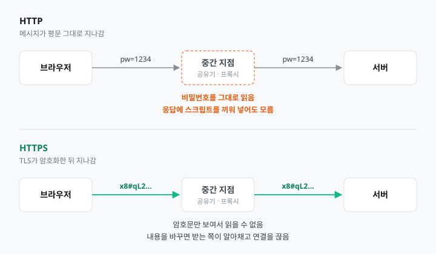
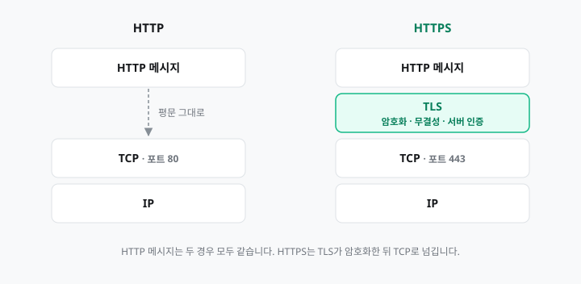
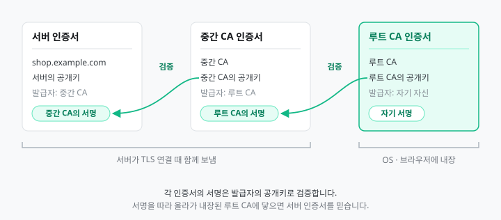

지난 글에서 TCP가 연결을 맺고 끊는 과정을 봤습니다. 브라우저가 웹 페이지를 받아 올 때는 이렇게 맺은 TCP 연결 위로 HTTP 메시지를 주고받습니다. 이번에는 HTTP가 어떻게 동작하는지, 그리고 HTTP에 TLS를 더한 HTTPS가 무엇을 바꾸는지 보겠습니다.

## 요청과 응답

HTTP는 클라이언트가 요청을 보내면 서버가 응답 하나를 돌려주는 방식으로 동작합니다. 서버가 먼저 말을 거는 일은 없습니다. HTTP/1.1 메시지는 사람이 읽을 수 있는 텍스트라서, 로그인 폼을 제출하면 TCP 연결로 이런 글자가 그대로 나갑니다.

```http
POST /login HTTP/1.1
Host: shop.example.com
Content-Type: application/x-www-form-urlencoded
Content-Length: 26

username=kim&password=1234
```

첫 줄은 메서드(`POST`), 경로(`/login`), 버전이고 그 아래로 헤더가 이어집니다. 빈 줄 다음이 본문입니다. 서버는 첫 줄에 상태 코드를 담아 응답합니다.

```http
HTTP/1.1 302 Found
Location: /
Set-Cookie: SESSION=8f3a2c; HttpOnly
```

HTTP/2부터는 메시지를 바이너리 프레임으로 나눠 보내지만 메서드, 헤더, 본문으로 이루어진 구성은 같습니다.

### 무상태

HTTP 서버는 요청을 처리하고 나면 그 클라이언트를 기억하지 않습니다. 방금 로그인한 사용자가 다음 요청을 보내도 프로토콜만 보면 서버에게는 처음 보는 요청입니다. 이런 성질을 무상태(stateless)라고 합니다.

로그인을 유지하려면 클라이언트가 요청마다 자기가 누구인지 담아 보내야 합니다. 위 응답의 `Set-Cookie`를 받은 브라우저는 이후 요청에 `Cookie: SESSION=8f3a2c` 헤더를 붙이고, 서버는 이 값으로 세션 저장소에서 사용자를 찾습니다. 토큰 방식이라면 `Authorization` 헤더에 토큰을 넣습니다.

번거로워 보여도 서버를 늘리기는 쉬워집니다. 처리에 필요한 정보가 요청 안에 다 들어 있으니 로드 밸런서가 요청을 어느 서버로 보내도 됩니다. 다만 세션을 서버 메모리에 두면 그 서버만 사용자를 알기 때문에, 서버가 여러 대라면 세션을 Redis 같은 공용 저장소에 둡니다.

연결도 처음에는 요청마다 새로 맺었습니다. HTTP/1.0은 응답을 보내면 TCP 연결을 끊는 것이 기본이라 HTML 하나와 이미지 열 장을 받으려면 handshake를 열한 번 했습니다. HTTP/1.1부터는 연결을 유지해서 다음 요청에 다시 쓰는 keep-alive가 기본입니다. 지난 글에서 TIME_WAIT를 줄이는 방법으로 든 것이 이것입니다.

## 평문 전송의 위험

HTTP 메시지는 암호화되지 않은 채로 나갑니다. 브라우저에서 서버까지 가는 동안 패킷은 카페 공유기, 통신사 장비, 회사 프록시 같은 여러 곳을 지납니다. 이 중 한 곳에서라도 패킷을 들여다보면 위 로그인 요청의 `password=1234`가 그대로 보입니다.

이 때문에 HTTP에는 세 가지 문제가 생깁니다.

- **도청:** 중간에서 내용을 읽을 수 있습니다. 비밀번호와 개인 정보가 드러나고, 세션 쿠키를 훔치면 비밀번호를 몰라도 그 사용자로 로그인한 상태가 됩니다.
- **변조:** 중간에서 내용을 바꿔도 받는 쪽은 알 수 없습니다. 응답 HTML에 광고나 악성 스크립트를 끼워 넣거나 내려받는 파일을 바꿔치기할 수 있습니다.
- **위장:** 상대가 진짜 서버인지 확인할 방법이 없습니다. DNS 응답을 속여 가짜 서버로 보내면 사용자는 그 서버에 비밀번호를 입력합니다.



## HTTPS가 더하는 것

HTTPS는 HTTP 메시지를 TLS로 감싸서 보냅니다. HTTP 메시지 모양은 그대로이고 HTTP와 TCP 사이에 TLS 계층이 하나 들어갑니다. 브라우저가 만든 요청을 TLS가 암호화해서 TCP로 넘기면, 서버 쪽 TLS가 복호화해서 원래 메시지를 HTTP 서버에 건넵니다.



TLS의 옛 이름이 SSL입니다. SSL 3.0 다음 버전부터 TLS로 이름이 바뀌었고, SSL과 TLS 1.0, 1.1은 보안 문제로 폐기되어 지금은 TLS 1.2와 1.3을 씁니다. SSL 인증서라는 말은 그 습관이 남은 것입니다.

TLS가 더하는 기능은 앞의 세 문제와 하나씩 짝이 맞습니다.

### 암호화

데이터는 연결마다 새로 정한 세션 키로 암호화합니다. 세션 키는 대칭키라서 AES-GCM이나 ChaCha20-Poly1305로 빠르게 암호화할 수 있고, 이 키를 정할 때는 비대칭키 방식의 키 교환을 씁니다. 두 방식을 섞어 쓰는 이유는 대칭키·비대칭키 암호화 글에서 정리했습니다.

암호화되는 범위는 HTTP 메시지 전체입니다. 경로와 쿼리 문자열, 헤더, 쿠키, 본문이 모두 들어갑니다. IP 주소와 포트는 패킷을 배달하는 데 필요해서 그대로 보입니다. 접속하는 도메인 이름도 DNS 조회와 TLS 연결의 첫 메시지(SNI)에 평문으로 드러나는 경우가 많습니다. 그래서 HTTPS를 써도 `shop.example.com`에 접속했다는 사실은 알 수 있지만, 어느 페이지를 보고 무엇을 입력했는지는 알 수 없습니다.

### 무결성

TLS는 데이터를 레코드라는 조각으로 나눠 암호화하고, 레코드마다 인증 태그를 붙입니다. 태그는 세션 키가 있어야 만들 수 있어서 중간에서 한 바이트만 바꿔도 받는 쪽의 태그 검증이 실패합니다. 이런 레코드를 받으면 TLS는 연결을 끊고, 변조된 내용은 HTTP까지 올라가지 않습니다. TLS 1.3은 암호화와 변조 검사를 한 번에 하는 AEAD 방식만 허용합니다. AES-GCM이 그 예입니다.

### 서버 인증

암호화만으로는 부족합니다. 중간에 끼어든 공격자가 서버인 척하고 자기 키로 키 교환을 하면, 브라우저는 공격자와 안전하게 암호화된 통신을 하는 셈이 됩니다. 그래서 TLS는 키 교환을 하면서 상대가 정말 그 도메인의 서버인지도 확인합니다. 서버는 인증서를 보내고, 인증서에 든 공개키의 짝인 개인키로 handshake 내용에 서명해서 자기가 인증서의 주인이라는 걸 보여 줍니다.

## 인증서와 CA

인증서에는 도메인 이름, 서버의 공개키, 유효 기간, 발급한 기관이 들어 있고 발급 기관의 서명이 붙어 있습니다. 인증서를 발급하는 기관을 CA(Certificate Authority)라고 합니다. CA는 신청한 사람이 정말 그 도메인을 관리하는지 확인한 뒤 자기 개인키로 인증서에 서명합니다. 확인은 CA가 정해 준 값을 그 도메인의 특정 URL이나 DNS 레코드에 올려 보게 하는 식으로 합니다.

서명을 검증하려면 브라우저에 CA의 공개키가 있어야 합니다. 보통은 루트 CA가 서버 인증서에 바로 서명하지 않고, 루트 CA가 서명한 중간 CA가 서버 인증서에 서명합니다. 루트 CA 인증서는 운영체제와 브라우저에 미리 들어 있습니다. 서버가 자기 인증서와 중간 CA 인증서를 함께 보내면 브라우저는 서명을 하나씩 따라 올라가 자기가 가진 루트 CA까지 닿는지 확인합니다. 이렇게 이어진 인증서들을 인증서 체인이라고 합니다.



체인 외에도 브라우저는 인증서의 도메인이 접속한 주소와 맞는지, 유효 기간이 지나지 않았는지 확인합니다. 하나라도 어긋나면 경고 화면을 띄우고 접속을 막습니다. 개발할 때 직접 만든 자체 서명 인증서에 경고가 뜨는 것도 그 인증서가 스스로 서명했을 뿐 브라우저가 믿는 루트 CA 목록에 없기 때문입니다.

인증서는 Let's Encrypt에서 무료로 받을 수 있습니다. Let's Encrypt 인증서는 유효 기간이 90일이라 손으로 갱신하지 않고 certbot 같은 ACME 클라이언트로 자동 갱신을 걸어 둡니다.

## 포트 80과 443

URL에 포트를 적지 않으면 `http://`는 80번, `https://`는 443번 포트로 접속합니다. 서버는 보통 두 포트를 모두 열어 두고, 80번으로 들어온 요청은 같은 주소의 `https://`로 리다이렉트합니다. 스프링 애플리케이션이 직접 TLS를 처리하기보다 앞단의 Nginx나 로드 밸런서가 TLS를 풀고 내부로는 HTTP로 넘기는 구성이 많습니다. Nginx에서는 두 포트를 서버 블록 두 개로 나눕니다.

```nginx
server {
    listen 80;
    server_name shop.example.com;
    return 301 https://$host$request_uri;
}

server {
    listen 443 ssl;
    server_name shop.example.com;
    ssl_certificate     /etc/letsencrypt/live/shop.example.com/fullchain.pem;
    ssl_certificate_key /etc/letsencrypt/live/shop.example.com/privkey.pem;

    location / {
        proxy_pass http://127.0.0.1:8080;
    }
}
```

`fullchain.pem`에는 서버 인증서와 중간 CA 인증서가 함께 들어 있습니다. 서버 인증서만 담긴 `cert.pem`을 지정하면 브라우저에서는 잘 열리는데 Java 클라이언트나 curl에서는 검증 오류가 나기도 합니다. 브라우저는 빠진 중간 인증서를 스스로 채우기도 하지만 다른 클라이언트는 대부분 그러지 않습니다.

리다이렉트만으로는 첫 요청이 여전히 HTTP로 나갑니다. 이 순간을 노리는 공격을 막으려고 HSTS를 씁니다. HTTPS 응답에 `Strict-Transport-Security: max-age=31536000` 헤더를 넣으면 브라우저는 그 뒤 1년 동안 이 도메인에 HTTP로 요청하지 않고 처음부터 HTTPS로 접속합니다.

## HTTPS의 비용

HTTPS는 TCP handshake 뒤에 TLS handshake를 한 번 더 해서 연결이 늦게 열립니다. TLS 1.2는 왕복이 2번, TLS 1.3은 1번 더 듭니다. 암호화 연산은 요즘 CPU가 AES를 하드웨어로 처리해서 거의 부담이 되지 않습니다. 게다가 브라우저는 HTTP/2를 HTTPS에서만 지원하고, 서비스 워커처럼 HTTPS 페이지에서만 열리는 기능도 있습니다. 지금은 HTTP로만 서비스할 이유가 거의 없습니다.

## 정리

HTTP는 요청 하나에 응답 하나를 주고받는 무상태 프로토콜이라 상태가 필요하면 쿠키나 토큰을 요청마다 실어 보냅니다. 메시지가 평문이라 중간에서 읽을 수 있고, 바꿔도 모르고, 가짜 서버를 가려낼 수도 없습니다. HTTPS는 HTTP와 TCP 사이에 TLS를 넣어 세션 키로 암호화하고, 레코드마다 붙인 인증 태그로 변조를 잡고, 인증서로 서버를 확인합니다. 인증서는 CA가 서명하고, 브라우저는 체인을 따라 미리 가진 루트 CA까지 검증합니다. 기본 포트는 HTTP가 80, HTTPS가 443입니다.

다음 글에서는 HTTPS 연결을 시작할 때 인증서를 주고받고 세션 키를 정하는 TLS(SSL) handshake를 보겠습니다.
