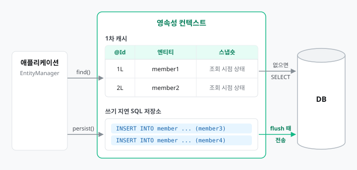
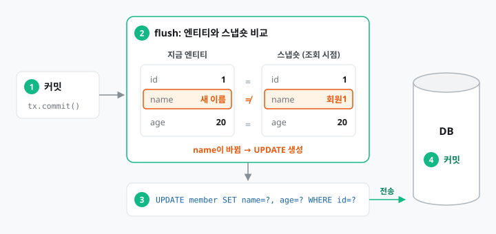

JPA를 쓰다 보면 `save()`를 부르지 않았는데 UPDATE가 나가거나, 같은 엔티티를 두 번 조회했는데 SELECT는 한 번만 찍히는 걸 보게 됩니다. 둘 다 영속성 컨텍스트가 하는 일입니다.

## 영속성 컨텍스트

영속성 컨텍스트는 엔티티를 담아 두고 관리하는 공간입니다. 애플리케이션과 데이터베이스 사이에 놓여서, 조회한 엔티티와 저장할 엔티티를 잠시 보관했다가 정해진 시점에 데이터베이스와 맞춥니다. 코드에서는 `EntityManager`를 통해 이 공간을 씁니다.

스프링에서는 보통 트랜잭션 하나에 영속성 컨텍스트 하나가 붙습니다. `@Transactional` 메서드가 시작될 때 만들어지고 트랜잭션이 끝나면 닫힙니다. 여러 스레드가 같은 `EntityManager`를 주입받아도 실제로는 트랜잭션마다 다른 영속성 컨텍스트를 씁니다. 다만 Spring Boot는 OSIV(Open Session In View) 설정이 기본으로 켜져 있어서, 웹 요청에서는 응답을 마칠 때까지 영속성 컨텍스트가 열려 있습니다.

## 엔티티의 상태

엔티티는 영속성 컨텍스트와의 관계에 따라 네 가지 상태를 가집니다.

- **비영속:** `new`로 만들기만 하고 영속성 컨텍스트와 아무 관계가 없는 상태입니다.
- **영속:** `persist()`로 저장했거나 `find()`로 조회해서 영속성 컨텍스트가 관리하는 상태입니다.
- **준영속:** 관리되다가 떨어져 나온 상태입니다. 영속성 컨텍스트가 닫히거나 `detach()`, `clear()`를 부르면 이렇게 됩니다.
- **삭제:** `remove()`로 삭제하기로 한 상태입니다. flush 때 DELETE가 나갑니다.

아래에서 다룰 동작은 모두 영속 상태의 엔티티에만 일어납니다.

## 1차 캐시

영속성 컨텍스트 안에는 `@Id` 값을 키로, 엔티티를 값으로 하는 맵이 있습니다. 이 맵을 1차 캐시라고 부릅니다. `find()`를 부르면 먼저 1차 캐시를 보고, 없을 때만 데이터베이스에 SELECT를 보냅니다. 데이터베이스에서 읽어 온 엔티티는 1차 캐시에 넣어 둡니다.

```java file="FirstLevelCache.java"
tx.begin();

Member a = em.find(Member.class, 1L); // SELECT 실행 후 1차 캐시에 저장
Member b = em.find(Member.class, 1L); // 1차 캐시에서 꺼냄, SQL 없음

tx.commit();
```

이 캐시는 영속성 컨텍스트마다 따로 있습니다. 스프링에서는 트랜잭션이 끝나면 함께 사라지므로 여러 요청이 나눠 쓰는 애플리케이션 캐시와는 다릅니다. 한 트랜잭션 안에서 같은 엔티티를 여러 번 조회할 때 SQL을 아끼는 정도입니다.

## 동일성 보장

위 코드에서 `a == b`는 `true`입니다. 두 번째 조회가 1차 캐시에 있던 같은 객체를 돌려주기 때문입니다. 같은 영속성 컨텍스트 안에서는 같은 `@Id`로 조회한 엔티티가 항상 같은 인스턴스입니다.

그래서 한 트랜잭션 안에서 `find()`로 같은 엔티티를 다시 읽으면, 그사이 다른 트랜잭션이 그 행을 바꿔 커밋했더라도 처음 읽은 객체를 그대로 받습니다. 데이터베이스 격리 수준이 READ COMMITTED여도 애플리케이션 쪽에서는 REPEATABLE READ처럼 같은 값을 보게 됩니다.

## 쓰기 지연

`persist()`를 불러도 INSERT가 바로 나가지 않습니다. 엔티티는 1차 캐시에 들어가고, INSERT SQL은 영속성 컨텍스트 안의 쓰기 지연 SQL 저장소에 쌓입니다. 쌓인 SQL은 flush 때 데이터베이스로 보냅니다.

```java file="WriteBehind.java"
tx.begin();

em.persist(new Member(3L, "회원3"));
em.persist(new Member(4L, "회원4"));
// 아직 INSERT는 나가지 않음

tx.commit(); // flush → INSERT 2개 전송 → 커밋
```

이렇게 모아 두면 여러 SQL을 JDBC 배치로 묶어 한 번에 보낼 수 있습니다. Hibernate에서는 `hibernate.jdbc.batch_size`를 설정하면 됩니다.

예외가 하나 있습니다. 기본 키를 `@GeneratedValue(strategy = GenerationType.IDENTITY)`로 만들면 `persist()`를 부르는 순간 INSERT가 나갑니다. 이 방식은 데이터베이스가 INSERT를 하면서 ID를 정하므로, 1차 캐시의 키로 쓸 ID를 얻으려면 INSERT부터 해야 하기 때문입니다. 이 경우에는 INSERT를 배치로 묶을 수도 없습니다.



## 변경 감지

엔티티를 수정할 때는 `update()` 같은 메서드를 따로 부르지 않습니다. 필드 값만 바꾸면 됩니다.

```java file="DirtyChecking.java"
tx.begin();

Member member = em.find(Member.class, 1L);
member.setName("새 이름"); // 저장 메서드를 부르지 않음

tx.commit(); // flush 때 UPDATE 실행
```

스프링 데이터 JPA에서도 같습니다. 트랜잭션 안에서 조회한 엔티티의 값을 바꾸면 `save()` 없이도 반영됩니다.

```java file="MemberService.java"
@Transactional
public void rename(Long id, String name) {
    Member member = memberRepository.findById(id).orElseThrow();
    member.changeName(name);
}
```

영속성 컨텍스트는 엔티티를 1차 캐시에 처음 넣을 때 그 상태를 복사한 스냅숏도 함께 저장합니다. flush 때 엔티티와 스냅숏을 필드마다 비교하고, 달라진 엔티티가 있으면 UPDATE SQL을 만들어 쓰기 지연 SQL 저장소에 넣은 뒤 데이터베이스로 보냅니다.



Hibernate는 기본으로 바뀐 필드만이 아니라 모든 컬럼을 UPDATE합니다. SQL 모양이 항상 같아서 미리 만들어 두고 다시 쓸 수 있기 때문입니다. 컬럼이 아주 많은 테이블이라면 엔티티에 `@DynamicUpdate`를 붙여 바뀐 컬럼만 보내게 할 수 있습니다.

준영속 상태의 엔티티는 변경 감지 대상이 아닙니다. 트랜잭션이 끝난 뒤에 값을 바꿔도 UPDATE는 나가지 않습니다.

## 지연 로딩

연관된 엔티티를 바로 조회하지 않고, 실제로 쓸 때 조회하는 방식입니다. `@ManyToOne(fetch = FetchType.LAZY)`처럼 설정하면 `Member`를 조회할 때 `team` 필드에는 진짜 `Team` 대신 프록시 객체가 들어갑니다. 프록시의 메서드를 처음 부르면 그때 영속성 컨텍스트를 통해 SELECT가 나갑니다.

```java file="LazyLoading.java"
Member member = em.find(Member.class, 1L); // MEMBER만 SELECT
Team team = member.getTeam();              // 프록시, 아직 SQL 없음
team.getName();                            // 이때 TEAM SELECT
```

프록시를 초기화하려면 영속성 컨텍스트가 열려 있어야 합니다. 트랜잭션이 끝나 엔티티가 준영속이 된 뒤에 처음 접근하면 `LazyInitializationException`이 납니다.

`@ManyToOne`과 `@OneToOne`은 기본값이 즉시 로딩(EAGER)이고, `@OneToMany`와 `@ManyToMany`는 지연 로딩(LAZY)입니다. 즉시 로딩은 예상하지 못한 쿼리를 만들기 쉬워서 보통 연관관계를 모두 LAZY로 두고, 함께 필요할 때는 fetch join으로 한 번에 조회합니다.

## flush가 일어나는 시점

flush는 영속성 컨텍스트의 변경 내용을 데이터베이스에 반영하는 일입니다. 쓰기 지연 SQL 저장소에 쌓인 SQL과 변경 감지로 만든 UPDATE를 보냅니다. flush를 해도 영속성 컨텍스트는 비워지지 않습니다. 1차 캐시는 그대로 남고, 데이터베이스와 내용만 맞춥니다.

flush는 다음 경우에 일어납니다.

- `em.flush()`를 직접 부를 때
- 트랜잭션을 커밋할 때 (커밋 직전에 자동으로 호출)
- JPQL 쿼리를 실행하기 직전 (기본 flush 모드인 AUTO일 때)

JPQL은 1차 캐시를 거치지 않고 SQL로 바뀌어 바로 데이터베이스로 갑니다. 그 전에 flush를 하지 않으면 방금 `persist()`한 엔티티가 조회 결과에서 빠질 수 있어서 쿼리 직전에 flush합니다.

## 정리

| 기능        | 하는 일                                     |
| ----------- | ------------------------------------------- |
| 1차 캐시    | 같은 엔티티를 다시 조회하면 SQL 없이 돌려줌 |
| 동일성 보장 | 같은 ID로 조회한 엔티티는 같은 인스턴스     |
| 쓰기 지연   | SQL을 모았다가 flush 때 보냄                |
| 변경 감지   | 스냅숏과 비교해 바뀐 엔티티를 UPDATE        |
| 지연 로딩   | 연관 엔티티를 실제로 쓸 때 조회             |

다섯 가지 모두 영속 상태의 엔티티에만 적용됩니다. 스프링에서는 영속성 컨텍스트가 트랜잭션과 함께 열리고 닫히므로, 이 동작들이 어디까지 이어지는지는 트랜잭션 범위를 보면 알 수 있습니다.

다음 글에서는 트랜잭션 안에서 다른 트랜잭션 메서드를 호출할 때 어떻게 동작할지 정하는 트랜잭션 전파(Propagation)를 보겠습니다.
