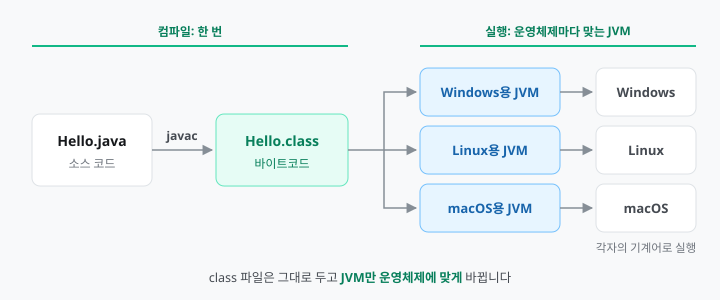
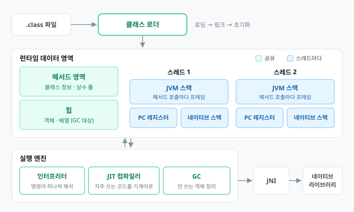

자바로 짠 코드는 운영체제 위에서 바로 실행되지 않습니다. 중간에 JVM(Java Virtual Machine)이라는 프로그램이 한 겹 끼어 있습니다. 자바의 메모리 구조도, GC도 JVM 안에서 일어나는 일이라 Java 공부는 JVM부터 시작합니다.

## 컴파일과 실행

C로 짠 프로그램은 컴파일하면 특정 운영체제와 CPU에서 돌아가는 기계어가 됩니다. 윈도우용으로 컴파일한 실행 파일은 리눅스에서 돌지 않습니다.

자바는 두 단계를 거칩니다. 먼저 `javac`가 `.java` 소스 코드를 `.class` 파일로 컴파일합니다. 이 파일에 담긴 것은 특정 CPU의 기계어가 아니라 JVM이 읽는 명령어인 바이트코드입니다. 실행할 때는 JVM이 바이트코드를 읽어 그 컴퓨터의 기계어로 바꿔 가며 실행합니다.

```bash
javac Hello.java   # Hello.class 생성
java Hello         # JVM이 Hello.class를 실행
```

JVM은 운영체제마다 따로 만들어져 있습니다. 그래서 같은 `.class` 파일을 윈도우, 리눅스, macOS에 그대로 가져가도 각자의 JVM이 실행해 줍니다. 자바를 두고 "한 번 작성하면 어디서나 실행된다(Write Once, Run Anywhere)"고 하는 이유입니다.



대신 프로그램과 운영체제 사이에 JVM이 하나 더 있으니 처음 실행할 때는 기계어로 바로 컴파일한 프로그램보다 느립니다. 이 차이를 줄이는 장치가 뒤에서 볼 JIT 컴파일러입니다.

## JVM의 구성

JVM은 크게 세 부분으로 나뉩니다.

- **클래스 로더:** `.class` 파일을 읽어 메모리에 올립니다.
- **런타임 데이터 영역:** 프로그램이 실행되는 동안 쓰는 메모리입니다.
- **실행 엔진:** 메모리에 올라온 바이트코드를 실제로 실행합니다.

여기에 C나 C++로 짠 네이티브 코드를 부르는 통로인 JNI(Java Native Interface)가 붙어 있습니다.



## 클래스 로더

JVM은 프로그램이 시작될 때 모든 클래스를 한꺼번에 올리지 않습니다. 클래스가 처음 쓰이는 순간에 클래스 로더가 찾아서 올립니다. 이 과정은 세 단계로 나뉩니다.

1. **로딩:** `.class` 파일을 찾아 읽고 클래스 정보를 메서드 영역에 저장합니다.
2. **링크:** 바이트코드가 규칙에 맞는지 검증하고, static 변수에 쓸 메모리를 잡아 기본값(0, `null` 등)으로 채웁니다. 코드 안의 심볼 참조를 실제 메모리 주소로 바꾸는 작업도 링크에 속합니다.
3. **초기화:** static 변수에 코드에 적힌 값을 넣고 static 블록을 실행합니다.

클래스 로더는 여러 개가 계층을 이룹니다. 맨 위에는 자바 기본 클래스를 올리는 부트스트랩 클래스 로더가 있고, 그 아래 플랫폼 클래스 로더(Java 8까지는 확장 클래스 로더), 우리가 만든 클래스를 올리는 애플리케이션 클래스 로더가 있습니다. 클래스를 찾을 때는 먼저 위쪽 로더에 맡기고, 위에서 찾지 못했을 때만 직접 찾습니다. 그래서 누가 `java.lang.String`이라는 이름으로 클래스를 만들어 두어도 자바 기본 `String`이 먼저 올라갑니다.

## 런타임 데이터 영역

JVM도 운영체제 입장에서는 프로세스 하나입니다. 운영체제에게서 받은 메모리를 다시 용도별로 나눠 씁니다. 프로세스 안의 스레드처럼, 모든 스레드가 함께 쓰는 영역과 스레드마다 따로 갖는 영역이 있습니다.

모든 스레드가 함께 쓰는 영역은 두 곳입니다.

- **메서드 영역:** 클래스 이름, 필드와 메서드 정보, 메서드의 바이트코드, 상수 풀처럼 클래스 단위의 정보가 들어갑니다. HotSpot JVM은 Java 8부터 이 영역을 Metaspace라는 이름으로 네이티브 메모리에 둡니다. 그전에는 PermGen이라는 크기가 정해진 공간에 두었습니다.
- **힙:** `new`로 만든 객체와 배열이 들어갑니다. 더 이상 쓰지 않는 객체는 GC가 정리합니다.

스레드마다 따로 갖는 영역은 세 곳입니다.

- **JVM 스택:** 메서드를 호출할 때마다 프레임이 하나씩 쌓입니다. 프레임에는 지역 변수와 매개변수, 계산 중인 값을 잠시 올려 두는 피연산자 스택이 들어 있습니다. 메서드가 끝나면 프레임이 빠집니다. 재귀 호출이 끝나지 않으면 프레임이 계속 쌓이다가 `StackOverflowError`가 납니다.
- **PC 레지스터:** 지금 실행 중인 바이트코드 명령어의 위치를 가리킵니다.
- **네이티브 메서드 스택:** JNI로 부른 네이티브 코드가 실행될 때 씁니다.

지역 변수는 각 스레드의 스택에 있어서 다른 스레드가 볼 수 없습니다. 반면 힙의 객체는 여러 스레드가 동시에 건드릴 수 있습니다. 자바에서 동시성 문제가 생기는 곳은 대부분 힙입니다.

## 실행 엔진

실행 엔진은 바이트코드를 기계어로 바꿔 실행합니다. 방법은 두 가지입니다.

인터프리터는 바이트코드를 명령어 하나씩 읽어 바로 실행합니다. 바로 시작할 수 있지만, 같은 메서드를 백 번 부르면 백 번 다시 해석합니다.

JIT(Just-In-Time) 컴파일러는 자주 실행되는 메서드를 통째로 기계어로 컴파일해 두고, 다음부터는 컴파일된 기계어를 바로 실행합니다. 실행 중에 메서드 호출 횟수와 반복문 횟수를 세다가 기준을 넘은 코드(핫스팟)를 골라 컴파일합니다. 오라클이 만든 기본 JVM의 이름이 HotSpot인 것도 여기서 왔습니다.

HotSpot JVM은 JIT 컴파일러를 두 개 씁니다. 빨리 컴파일하는 C1으로 먼저 기계어를 만들고, 그중에서도 정말 많이 쓰이는 코드는 시간을 더 들여 최적화하는 C2로 다시 컴파일합니다. 처음에는 인터프리터로 돌다가 자주 쓰이는 코드부터 점점 빨라지는 셈이라, 자바 서버는 막 띄웠을 때보다 한동안 요청을 받은 뒤에 더 빠릅니다. 이를 워밍업이라고 합니다.

실행 엔진에는 힙에서 쓰지 않는 객체를 찾아 정리하는 GC(가비지 컬렉터)도 들어 있습니다.

## 바이트코드 살펴보기

`javap -c`로 `.class` 파일에 든 바이트코드를 볼 수 있습니다.

```java file="Calc.java"
public class Calc {
    public static int add(int a, int b) {
        return a + b;
    }
}
```

```text
$ javac Calc.java && javap -c Calc
  ...
  public static int add(int, int);
    Code:
       0: iload_0
       1: iload_1
       2: iadd
       3: ireturn
```

`iload_0`과 `iload_1`이 지역 변수 0번(`a`)과 1번(`b`)을 피연산자 스택에 올립니다. `iadd`는 스택에서 두 값을 꺼내 더하고 결과를 다시 올리고, `ireturn`은 스택 맨 위의 값을 돌려줍니다. 앞에서 본 JVM 스택의 프레임, 그 안의 지역 변수와 피연산자 스택이 이렇게 쓰입니다. 바이트코드는 CPU 레지스터 대신 이 스택으로 계산하기 때문에 레지스터 구성이 다른 CPU에서도 같은 바이트코드를 쓸 수 있습니다.

## 정리

자바 코드는 `javac`로 바이트코드가 되고, 운영체제마다 있는 JVM이 그 바이트코드를 실행합니다. JVM 안에서는 클래스 로더가 클래스를 처음 쓰일 때 올립니다. 런타임 데이터 영역은 메모리를 공유 영역(메서드 영역, 힙)과 스레드별 영역(JVM 스택, PC 레지스터, 네이티브 메서드 스택)으로 나눠 관리합니다. 실행 엔진은 인터프리터로 시작해서 자주 쓰는 코드를 JIT 컴파일러로 기계어로 바꿔 가며 속도를 올립니다.

다음 글에서는 힙을 정리하는 GC가 왜 필요하고 어떻게 동작하는지 보겠습니다.
