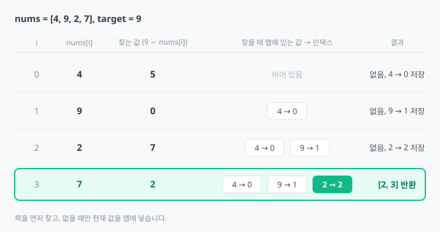

Blind 75 목록에 있는 LeetCode 1번 Two Sum을 Java로 풀었습니다. 난이도는 Easy입니다.

## 문제

정수 배열 `nums`와 정수 `target`이 주어집니다. 더해서 `target`이 되는 두 원소를 찾아 그 인덱스를 반환합니다. 답은 정확히 하나만 있고, 같은 원소를 두 번 쓸 수는 없습니다.

예를 들어 `nums = [2, 7, 11, 15]`, `target = 9`이면 2와 7을 더해 9가 되므로 `[0, 1]`을 반환합니다.

## 모든 쌍을 더해 보기

처음에는 이중 반복문으로 모든 쌍을 더해 봤습니다.

```java
for (int i = 0; i < nums.length; i++) {
    for (int j = i + 1; j < nums.length; j++) {
        if (nums[i] + nums[j] == target) {
            return new int[] {i, j};
        }
    }
}
```

이 방법으로도 통과는 합니다. 하지만 원소가 n개면 비교할 쌍이 n(n-1)/2개라서 시간 복잡도가 O(n²)입니다. 원소가 1만 개면 5천만 번 가까이 비교합니다.

## 짝을 HashMap에서 찾기

`nums[i]`와 더해서 `target`이 되는 값은 `target - nums[i]` 하나로 정해져 있습니다. 그러니 매번 나머지 원소를 다 뒤질 필요 없이, 이 값이 앞에서 나왔는지만 확인하면 됩니다.

지나온 값은 `값 → 인덱스` 형태로 HashMap에 저장해 둡니다. HashMap 조회는 평균 O(1)이라서 배열을 한 번만 훑으면 답을 찾을 수 있습니다.



`nums = [4, 9, 2, 7]`, `target = 9`로 따라가 보면 앞의 세 값은 짝이 아직 맵에 없어서 맵에 넣고 넘어갑니다. 마지막 7의 짝인 2는 인덱스 2로 이미 맵에 있으므로 `[2, 3]`을 반환합니다.

```java file="P0001_TwoSum.java"
class P0001_TwoSum {
    public int[] twoSum(int[] nums, int target) {
        Map<Integer, Integer> map = new HashMap<>();

        for (int i = 0; i < nums.length; i++) {
            int need = target - nums[i];
            Integer idx = map.get(need);
            if (idx != null) {
                return new int[] {idx, i};
            }
            map.put(nums[i], i);
        }
        return new int[0];
    }
}
```

## 찾은 다음에 넣는 이유

반복문 안에서 짝을 먼저 찾고, 없을 때만 현재 값을 맵에 넣습니다. 이 순서 덕분에 두 경우가 따로 처리하지 않아도 맞게 돌아갑니다.

- **같은 원소를 두 번 쓰지 않습니다.** `nums = [3, 2, 4]`, `target = 6`에서 3을 먼저 넣고 찾으면 3의 짝인 3이 맵에 있어서 `[0, 0]`을 반환해 버립니다. 찾은 다음에 넣으면 찾는 시점의 맵에는 자기 자신이 없습니다.
- **같은 값이 두 번 나와도 됩니다.** `nums = [3, 3]`, `target = 6`이면 첫 번째 3은 짝이 없어서 맵에 들어가고, 두 번째 3이 그 3을 찾아 `[0, 1]`을 반환합니다.

짝이 있는지는 `containsKey`로 확인하지 않고 `get`의 결과가 `null`인지로 확인했습니다. `containsKey`로 확인한 뒤 `get`으로 꺼내면 해시 조회를 두 번 하지만, 이렇게 하면 한 번으로 끝납니다. 이때 결과를 `int`로 받으면 `null`을 꺼낼 때 `NullPointerException`이 나므로 `Integer`로 받아야 합니다.

## 복잡도

- **시간:** O(n)입니다. 배열을 한 번 훑으면서 원소마다 HashMap 조회와 저장을 한 번씩 합니다.
- **공간:** O(n)입니다. 마지막 원소에서 답을 찾으면 그 앞의 n-1개가 모두 맵에 들어 있습니다.

## 정리

짝이 계산으로 정해지는 문제는 지나온 값을 HashMap에 저장해 두고 짝을 찾으면 이중 반복문을 한 번의 순회로 줄일 수 있습니다. 대신 맵에 저장하는 만큼 메모리를 더 씁니다.

## 링크

- [LeetCode 1. Two Sum](https://leetcode.com/problems/two-sum/)
- [풀이 코드 (GitHub)](https://github.com/Artiffect/leetcode/blob/main/src/array/P0001_TwoSum.java)
