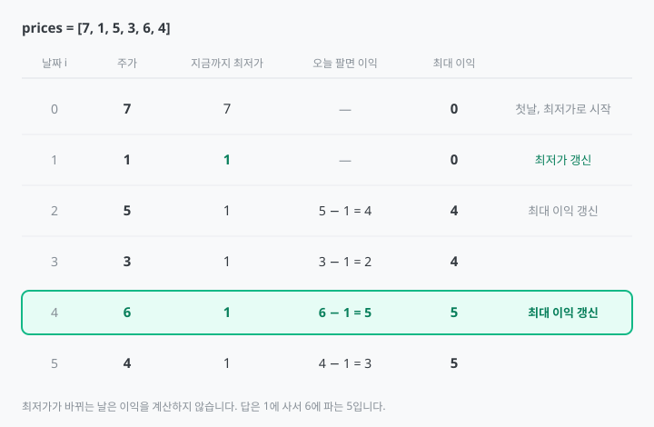

Blind 75 목록에 있는 LeetCode 121번 Best Time to Buy and Sell Stock을 Java로 풀었습니다. 난이도는 Easy입니다.

## 문제

날짜별 주가가 담긴 배열 `prices`가 주어집니다. 하루를 골라 주식을 사고, 그보다 뒤의 다른 날에 팔아서 얻을 수 있는 최대 이익을 구합니다. 이익을 낼 수 없으면 0을 반환합니다.

예를 들어 `prices = [7, 1, 5, 3, 6, 4]`이면 1에 사서 6에 팔 때 이익이 5로 가장 큽니다. 7에 팔고 1에 사는 것처럼 파는 날이 사는 날보다 앞설 수는 없습니다.

## 모든 날짜 쌍 비교하기

처음 떠올린 방법은 사는 날 `i`와 파는 날 `j`(`i < j`)의 모든 쌍을 비교하는 것입니다.

```java
int maxProfit = 0;
for (int i = 0; i < prices.length; i++) {
    for (int j = i + 1; j < prices.length; j++) {
        maxProfit = Math.max(maxProfit, prices[j] - prices[i]);
    }
}
```

답은 맞지만 시간 복잡도가 O(n²)입니다. 이 문제는 `prices`가 최대 10만 개라서 쌍이 50억 개 가까이 됩니다.

## 지금까지의 최저가만 기억하기

오늘 판다고 정하면 가장 좋은 사는 날은 오늘 이전에서 주가가 가장 낮았던 날입니다. 그러니 날짜 쌍을 다 볼 필요 없이, 앞에서부터 훑으면서 지금까지의 최저가 하나만 기억하면 됩니다. 날마다 "오늘 팔면 얼마 남는지"를 계산해 최대 이익을 갱신합니다.

최저가는 지나온 날에서만 고르니, 사는 날이 파는 날보다 앞이어야 한다는 조건도 따로 확인하지 않아도 지켜집니다.



```java file="P0121_BestTimeToBuyAndSellStock.java"
class P0121_BestTimeToBuyAndSellStock {
    public int maxProfit(int[] prices) {
        int minPrice = prices[0];
        int maxProfit = 0;

        for (int i = 1; i < prices.length; i++) {
            int price = prices[i];
            if (price < minPrice) {
                minPrice = price;
            } else {
                int profit = price - minPrice;
                if (profit > maxProfit) {
                    maxProfit = profit;
                }
            }
        }

        return maxProfit;
    }
}
```

## 최저가가 바뀌는 날은 이익을 계산하지 않는 이유

오늘 주가가 지금까지의 최저가보다 낮으면 최저가만 바꾸고 넘어갑니다. 이런 날은 이전 최저가에 사서 오늘 팔면 손해이고, 오늘 사서 오늘 팔 수는 없으니 계산해 봐야 최대 이익이 바뀌지 않습니다. 그래서 `else`로 나눠 이익 계산을 건너뛰었습니다.

`minPrice`는 첫날 주가로 시작하고 반복은 둘째 날부터 돕니다. 문제 조건상 `prices`는 1개 이상이라 `prices[0]`을 바로 읽어도 됩니다. 하루뿐이면 반복문을 돌지 않고 0을 반환합니다.

## 복잡도

- **시간:** O(n)입니다. 배열을 한 번 훑습니다.
- **공간:** O(1)입니다. 최저가와 최대 이익, 변수 두 개만 씁니다.

## 정리

매번 지금까지 가장 좋은 선택 하나만 들고 가는 방식이라 그리디로 분류됩니다. 모든 조합을 보는 대신 "오늘을 기준으로 과거에서 무엇이 필요한가"를 따지면, 필요한 값을 변수 하나에 들고 다니며 한 번의 순회로 끝낼 수 있습니다.

## 링크

- [LeetCode 121. Best Time to Buy and Sell Stock](https://leetcode.com/problems/best-time-to-buy-and-sell-stock/)
- [풀이 코드 (GitHub)](https://github.com/Artiffect/leetcode/blob/main/src/array/P0121_BestTimeToBuyAndSellStock.java)
