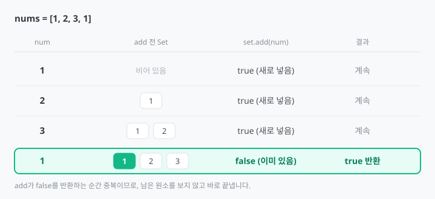

Blind 75 목록에 있는 LeetCode 217번 Contains Duplicate를 Java로 풀었습니다. 난이도는 Easy입니다.

## 문제

정수 배열 `nums`에 같은 값이 두 번 이상 나오면 `true`, 모든 값이 서로 다르면 `false`를 반환합니다.

예를 들어 `nums = [1, 2, 3, 1]`은 1이 두 번 나오므로 `true`이고, `nums = [1, 2, 3, 4]`는 `false`입니다.

## 처음 떠올린 방법

가장 단순한 방법은 이중 반복문으로 모든 쌍을 비교하는 것인데, 시간 복잡도가 O(n²)입니다.

조금 나은 방법은 정렬입니다. 정렬하면 같은 값끼리 붙어 있게 되니 바로 옆 값과만 비교하면 됩니다.

```java
Arrays.sort(nums);
for (int i = 1; i < nums.length; i++) {
    if (nums[i] == nums[i - 1]) {
        return true;
    }
}
return false;
```

정렬 때문에 O(n log n)이 걸립니다. 따로 자료구조를 만들지 않는 대신 입력 배열의 순서가 바뀝니다.

## HashSet에 넣으면서 확인하기

앞에서 본 값을 HashSet에 모아 두면, 지금 값이 이미 나왔는지 평균 O(1)로 확인할 수 있습니다. 배열을 한 번 훑으면서 넣다가 이미 있는 값이 나오면 바로 `true`를 반환합니다.



```java file="P0217_ContainsDuplicate.java"
class P0217_ContainsDuplicate {
    public boolean containsDuplicate(int[] nums) {
        Set<Integer> set = new HashSet<>();

        for (int num : nums) {
            if (!set.add(num)) {
                return true;
            }
        }

        return false;
    }
}
```

## `contains` 대신 `add`의 반환값 쓰기

`Set.add()`는 값을 새로 넣었으면 `true`, 이미 있어서 넣지 않았으면 `false`를 반환합니다. 그래서 `contains()`로 확인한 뒤 `add()`로 넣는 대신, `add()`를 한 번 부르고 그 결과만 보면 됩니다. 해시 조회가 두 번에서 한 번으로 줄어듭니다.

```java
// 조회 두 번
if (set.contains(num)) {
    return true;
}
set.add(num);

// 조회 한 번
if (!set.add(num)) {
    return true;
}
```

중복을 찾는 즉시 반환하니, 중복이 앞쪽에 있으면 배열을 끝까지 보지 않고 끝납니다.

## 두 방법 비교

| 방법    | 시간       | 추가 공간          | 입력 배열   |
| ------- | ---------- | ------------------ | ----------- |
| 정렬    | O(n log n) | 따로 만들지 않음   | 순서가 바뀜 |
| HashSet | O(n)       | O(n), 값을 다 담음 | 그대로      |

HashSet은 빠른 대신 값을 담을 메모리를 더 쓰고, 정렬은 느린 대신 메모리를 거의 쓰지 않습니다. 메모리가 넉넉하고 입력 배열을 건드리면 안 되는 상황이면 HashSet이 맞습니다.

## 정리

"이미 나온 값인가"를 묻는 문제는 HashSet에 넣으면서 확인하면 한 번의 순회로 끝납니다. 이때 `add()`의 반환값을 쓰면 확인과 저장을 한 번에 할 수 있습니다.

## 링크

- [LeetCode 217. Contains Duplicate](https://leetcode.com/problems/contains-duplicate/)
- [풀이 코드 (GitHub)](https://github.com/Artiffect/leetcode/blob/main/src/array/P0217_ContainsDuplicate.java)
