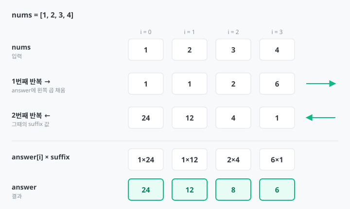

Blind 75 목록에 있는 LeetCode 238번 Product of Array Except Self를 Java로 풀었습니다. 난이도는 Medium입니다.

## 문제

정수 배열 `nums`가 주어지면, 각 위치 `i`에 `nums[i]`를 뺀 나머지 원소를 모두 곱한 값을 담은 배열 `answer`를 반환합니다. 나눗셈은 쓸 수 없고, 시간 복잡도는 O(n)이어야 합니다. 추가 과제로 출력 배열을 빼고 추가 공간을 O(1)로 줄여 보라는 조건이 붙어 있습니다.

예를 들어 `nums = [1, 2, 3, 4]`이면 `answer = [24, 12, 8, 6]`입니다. `answer[0]`은 2 × 3 × 4 = 24이고, `answer[2]`는 1 × 2 × 4 = 8입니다.

## 처음 떠올린 방법

전체 곱을 구해 `nums[i]`로 나누면 간단하지만 나눗셈이 금지돼 있습니다. 나눗셈을 쓸 수 있다고 해도 배열에 0이 있으면 0으로 나눌 수 없어서 따로 처리해야 합니다.

다음으로 떠올린 방법은 곱을 왼쪽과 오른쪽으로 나누는 것입니다.

```
answer[i] = (nums[0] × … × nums[i-1]) × (nums[i+1] × … × nums[n-1])
            └── i의 왼쪽 원소들의 곱 ──┘   └── i의 오른쪽 원소들의 곱 ──┘
```

`left[i]`에 왼쪽 누적 곱, `right[i]`에 오른쪽 누적 곱을 미리 채워 두고 `answer[i] = left[i] * right[i]`로 계산하면 O(n)에 풀립니다. 다만 배열 두 개를 더 만드니 추가 공간이 O(n)입니다.

## 출력 배열을 재활용하기

`left`, `right` 배열 없이도 같은 계산을 할 수 있습니다.

1. 앞에서부터 돌면서 `answer[i]`에 왼쪽 누적 곱을 먼저 채웁니다.
2. 뒤에서부터 돌면서 오른쪽 누적 곱을 변수 `suffix` 하나에 쌓고, `answer[i]`에 곱해 덮어씁니다.

첫 번째 반복이 끝나면 `answer`가 `left` 배열 역할을 합니다. 두 번째 반복에서는 오른쪽 누적 곱이 한 번에 하나씩만 필요하니 배열 대신 변수 하나면 됩니다.



```java file="P0238_ProductOfArrayExceptSelf.java"
class P0238_ProductOfArrayExceptSelf {
    public int[] productExceptSelf(int[] nums) {
        int n = nums.length;
        int[] answer = new int[n];

        int prefix = 1;
        for (int i = 0; i < n; i++) {
            answer[i] = prefix;
            prefix *= nums[i];
        }

        int suffix = 1;
        for (int i = n - 1; i >= 0; i--) {
            answer[i] *= suffix;
            suffix *= nums[i];
        }

        return answer;
    }
}
```

## 먼저 반영하고 나서 곱하는 이유

두 반복 모두 지금 위치에 누적 곱을 먼저 반영하고, 그다음에 `nums[i]`를 누적 곱에 곱합니다. 이 순서라서 `answer[i]`에는 항상 `nums[i]`가 빠진 곱만 들어갑니다.

- **양 끝:** `prefix`와 `suffix`가 1에서 시작하니, `i = 0`의 왼쪽 곱과 `i = n - 1`의 오른쪽 곱은 자연스럽게 1이 됩니다.
- **0이 있을 때:** 나누지 않고 곱하기만 하니 0을 따로 처리하지 않아도 됩니다. `nums = [-1, 1, 0, -3, 3]`이면 0이 있는 자리만 0이 아닌 9가 나와 `[0, 0, 9, 0, 0]`이 됩니다.

## 막혔던 부분

왼쪽 곱과 오른쪽 곱으로 나누는 것까지는 떠올렸지만, 나눗셈 없이 추가 공간을 O(1)로 줄이는 방법이 까다로웠습니다. `answer`에 왼쪽 곱을 먼저 채워 두고, 뒤에서부터 돌며 `suffix` 변수 하나만 곱해서 덮어쓴다는 발상이 핵심이었습니다.

## 복잡도

- **시간:** O(n)입니다. 배열을 앞에서 한 번, 뒤에서 한 번 훑습니다.
- **공간:** 출력 배열을 빼면 O(1)입니다. `prefix`, `suffix` 변수 두 개만 더 씁니다.

## 정리

"나를 뺀 나머지"를 구하는 문제는 왼쪽 누적과 오른쪽 누적으로 나눠 생각하면 풀립니다. 누적 결과를 출력 배열에 먼저 담아 두고 반대쪽 누적은 변수 하나로 쌓으면 추가 배열 없이 끝낼 수 있습니다.

## 링크

- [LeetCode 238. Product of Array Except Self](https://leetcode.com/problems/product-of-array-except-self/)
- [풀이 코드 (GitHub)](https://github.com/Artiffect/leetcode/blob/main/src/array/P0238_ProductOfArrayExceptSelf.java)
