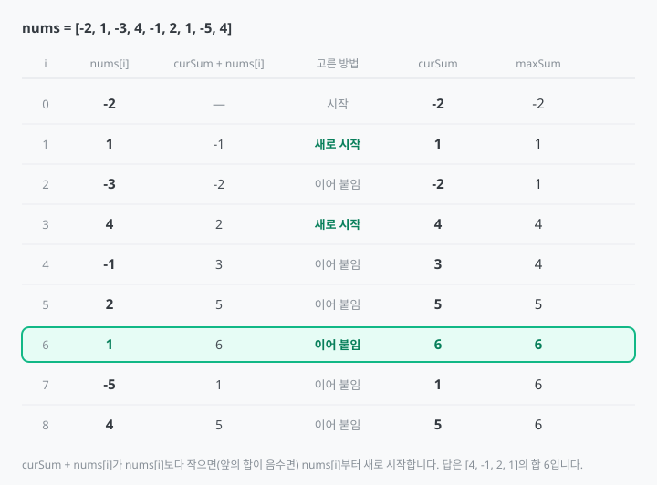

Blind 75 목록에 있는 LeetCode 53번 Maximum Subarray를 Java로 풀었습니다. 난이도는 Medium입니다.

## 문제

음수가 섞인 정수 배열 `nums`가 주어집니다. 원소를 1개 이상 포함하는 연속 부분 배열 중에서 합이 가장 큰 것을 찾아 그 합을 반환합니다.

예를 들어 `nums = [-2, 1, -3, 4, -1, 2, 1, -5, 4]`이면 `[4, -1, 2, 1]`의 합 6이 가장 큽니다. 연속이어야 하므로 4와 마지막 4처럼 떨어진 원소만 골라 더할 수는 없습니다.

## 모든 구간의 합 구하기

처음에는 시작점과 끝점을 정해 모든 구간의 합을 구하는 방법만 떠올랐습니다. 시작점을 고정하고 끝점을 하나씩 늘리면서 합을 누적하면 구간마다 처음부터 더하지 않아도 됩니다.

```java
int maxSum = nums[0];
for (int i = 0; i < nums.length; i++) {
    int sum = 0;
    for (int j = i; j < nums.length; j++) {
        sum += nums[j];
        maxSum = Math.max(maxSum, sum);
    }
}
```

그래도 구간이 n(n+1)/2개라서 시간 복잡도가 O(n²)입니다. 이 문제는 `nums`가 최대 10만 개라서 구간이 50억 개를 넘습니다.

## 앞의 합이 음수면 버리기

구간의 시작점 대신 끝점을 기준으로 생각해 보겠습니다. `i`에서 끝나는 연속 부분 배열 중 합이 가장 큰 것은 둘 중 하나입니다.

- `nums[i]` 하나만 쓰는 경우
- `i - 1`에서 끝나는 가장 큰 부분 배열 뒤에 `nums[i]`를 붙이는 경우

둘 중 더 큰 쪽을 고르면 됩니다. 붙이는 쪽이 손해인 경우는 앞의 합이 음수일 때뿐입니다. 음수를 더하면 `nums[i]` 혼자일 때보다 작아지니, 그때는 앞을 버리고 `nums[i]`부터 새로 시작합니다.

```
curSum = max(nums[i], curSum + nums[i])
```

`i`에서의 답을 `i - 1`에서의 답으로 구하니 동적 계획법(DP)입니다. 바로 앞의 값 하나만 있으면 되므로 배열 없이 변수 `curSum` 하나로 이어 갈 수 있습니다. 이 방법을 카데인 알고리즘(Kadane's Algorithm)이라고 부릅니다.



```java file="P0053_MaximumSubarray.java"
class P0053_MaximumSubarray {
    public int maxSubArray(int[] nums) {
        int curSum = nums[0];
        int maxSum = nums[0];

        for (int i = 1; i < nums.length; i++) {
            curSum = Math.max(nums[i], curSum + nums[i]);
            maxSum = Math.max(maxSum, curSum);
        }

        return maxSum;
    }
}
```

## 두 변수의 역할

- **`curSum`:** 지금 위치에서 끝나는 구간의 최대 합입니다. 앞의 합이 음수면 `nums[i]`로 다시 시작합니다.
- **`maxSum`:** 지금까지 나온 `curSum` 중 가장 큰 값입니다. 다시 시작하지 않고 더 큰 값이 나올 때만 바뀝니다.

`curSum`은 중간에 작아지기도 해서 마지막 값이 답이 아닐 수 있습니다. 위 예시에서도 `curSum`은 마지막에 5지만, 답은 그 전에 기록해 둔 6입니다. 그래서 최고 기록을 `maxSum`에 따로 남깁니다.

두 변수는 0이 아니라 `nums[0]`으로 시작합니다. 원소가 모두 음수일 수 있기 때문입니다. `nums = [-3, -1, -2]`의 답은 -1인데, `maxSum`을 0으로 시작하면 어떤 구간도 0보다 크지 않아서 원소를 하나도 고르지 않은 0을 반환해 버립니다.

## 막혔던 부분

모든 구간을 보는 O(n²) 방법만 떠올라서 O(n)으로 줄이는 데 힌트가 필요했습니다. 앞의 합이 음수면 버리고 새로 시작한다는 발상과, `curSum`을 다시 시작해도 `maxSum`은 그대로 두는 구조를 잡는 부분이 어려웠습니다.

## 복잡도

- **시간:** O(n)입니다. 배열을 한 번 훑습니다.
- **공간:** O(1)입니다. `curSum`과 `maxSum` 변수 두 개만 씁니다.

## 정리

연속 구간의 최대 합은 "여기서 끝나는 최대 합"을 앞에서부터 이어 가면 한 번의 순회로 구할 수 있습니다. 앞의 합이 음수면 버리고 새로 시작하고, 최고 기록은 따로 남겨 둡니다.

## 링크

- [LeetCode 53. Maximum Subarray](https://leetcode.com/problems/maximum-subarray/)
- [풀이 코드 (GitHub)](https://github.com/Artiffect/leetcode/blob/main/src/array/P0053_MaximumSubarray.java)
