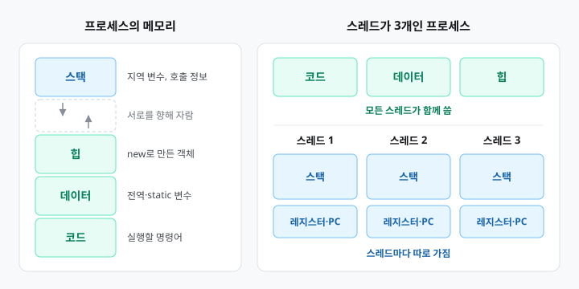
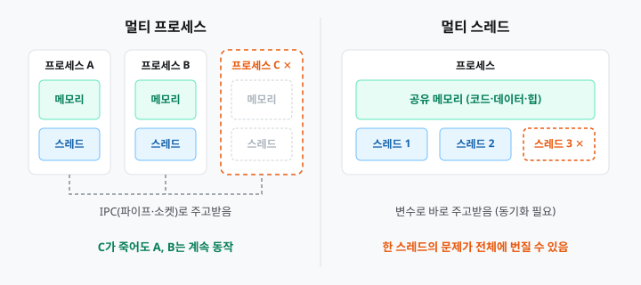

운영체제 공부는 프로세스와 스레드부터 시작합니다. 앞으로 볼 컨텍스트 스위칭, 동기화, 교착 상태가 모두 이 두 개념 위에서 이야기되기 때문입니다.

## 프로그램과 프로세스

디스크에 저장된 실행 파일은 프로그램입니다. 그 자체로는 아무 일도 하지 않는 파일입니다. 프로그램을 실행하면 운영체제가 메모리를 내주고 코드를 올려서 CPU가 실행할 수 있게 만듭니다. 이렇게 실행 중인 프로그램을 프로세스라고 합니다.

같은 프로그램을 여러 번 실행하면 프로세스도 여러 개 생깁니다. 메모장을 두 개 띄우면 프로그램은 하나지만 프로세스는 두 개입니다. 둘은 서로의 메모리를 볼 수 없습니다. 운영체제가 프로세스마다 독립된 주소 공간을 주기 때문입니다.

운영체제는 프로세스마다 PCB(Process Control Block)라는 기록을 둡니다. 프로세스 ID, 현재 상태, 어디까지 실행했는지, 어떤 메모리와 파일을 쓰고 있는지가 여기에 적힙니다. CPU를 다른 프로세스에 넘겼다가 돌아올 때 이 기록을 보고 이어서 실행합니다. 이 전환 과정은 다음 글에서 따로 다루겠습니다.

## 프로세스의 메모리

프로세스가 받는 메모리는 용도에 따라 네 영역으로 나뉩니다.

- **코드:** 실행할 기계어 명령어가 들어갑니다. 실행 중에 바뀌지 않아서 읽기 전용으로 둡니다.
- **데이터:** 전역 변수와 static 변수가 들어갑니다. 프로그램이 시작할 때 생겨서 끝날 때까지 남습니다.
- **힙:** 실행 중에 필요할 때 할당하는 영역입니다. C의 `malloc`, Java의 `new`로 만든 객체가 여기에 생깁니다.
- **스택:** 함수를 호출할 때마다 지역 변수, 매개변수, 돌아갈 주소가 쌓이고 함수가 끝나면 사라집니다.

힙과 스택은 실행 중에 크기가 변합니다. 보통 힙은 낮은 주소에서 위로, 스택은 높은 주소에서 아래로 자라면서 가운데 빈 공간을 나눠 씁니다.

## 스레드

스레드는 프로세스 안에서 코드를 실행하는 흐름입니다. 프로세스가 만들어질 때 스레드가 하나 생기고, 필요하면 더 만들 수 있습니다.

같은 프로세스의 스레드는 코드, 데이터, 힙을 함께 씁니다. 스레드마다 따로 갖는 것은 스택과 레지스터입니다. 레지스터에는 다음에 실행할 명령어의 위치를 가리키는 PC(프로그램 카운터)도 들어 있습니다. 스레드마다 실행 중인 함수가 다르고 어디까지 실행했는지도 다르니 이 둘은 나눠 쓸 수 없습니다.



그래서 스레드끼리는 힙에 있는 객체를 그냥 같이 읽고 씁니다. 프로세스끼리는 이렇게 할 수 없어서 운영체제가 마련해 준 통로를 거쳐야 합니다.

## 코드로 보면

Java에서 스레드 두 개가 같은 객체를 쓰게 해 보겠습니다.

```java file="SharedCounter.java"
public class SharedCounter {
    static class Counter {
        int value;
    }

    public static void main(String[] args) throws InterruptedException {
        Counter counter = new Counter(); // 힙에 하나만 생김

        Runnable task = () -> {
            int local = 0; // 스레드마다 자기 스택에 따로 생김
            for (int i = 0; i < 100_000; i++) {
                local++;
                counter.value++;
            }
            System.out.println(Thread.currentThread().getName() + " local=" + local);
        };

        Thread t1 = new Thread(task);
        Thread t2 = new Thread(task);
        t1.start();
        t2.start();
        t1.join();
        t2.join();

        System.out.println("counter=" + counter.value);
    }
}
```

`local`은 스레드마다 자기 스택에 따로 생기므로 두 스레드 모두 100000을 출력합니다. `counter`는 힙에 있는 객체 하나를 같이 쓰므로 두 스레드가 더한 값이 한곳에 모입니다.

그런데 실행해 보면 `counter`가 200000보다 작게 나올 때가 많습니다. `value++`는 값을 읽고, 1을 더하고, 다시 쓰는 세 단계로 나뉘는데 그 사이에 다른 스레드가 끼어들기 때문입니다. 메모리를 공유하면 이런 문제가 따라옵니다. 해결 방법은 동기화를 다룰 때 보겠습니다.

새 프로세스를 만들면 메모리를 전혀 공유하지 않습니다.

```java file="NewProcess.java"
Process process = new ProcessBuilder("ls", "-l").start();
try (BufferedReader reader = process.inputReader()) {
    reader.lines().forEach(System.out::println);
}
```

`ls`는 별도의 프로세스로 실행됩니다. 그 결과는 변수로 받을 수 없고, 운영체제가 두 프로세스 사이에 연결해 준 파이프에서 읽어야 합니다.

## 멀티 프로세스와 멀티 스레드

여러 일을 동시에 처리하려면 프로세스를 여러 개 띄우거나, 한 프로세스 안에 스레드를 여러 개 둡니다.



멀티 프로세스는 프로세스마다 메모리가 나뉘어 있어서 하나가 죽어도 나머지는 영향을 받지 않습니다. 대신 프로세스를 만드는 비용이 크고, 데이터를 주고받으려면 파이프, 소켓, 공유 메모리 같은 IPC(프로세스 간 통신)를 써야 합니다. CPU를 다른 프로세스로 넘길 때 주소 공간까지 바꿔야 해서 전환 비용도 큽니다.

멀티 스레드는 메모리를 공유하니 만들기 가볍고 데이터를 주고받기도 쉽습니다. 같은 프로세스 안의 스레드끼리 전환할 때는 주소 공간을 바꿀 필요가 없어 더 빠릅니다. 대신 앞의 예제처럼 같은 데이터를 동시에 건드리면 값이 꼬이므로 동기화를 신경 써야 합니다.

한 스레드의 문제가 프로세스 전체로 번지기도 합니다. C나 C++에서 스레드 하나가 잘못된 메모리에 접근하면 프로세스가 통째로 종료됩니다. Java는 예외가 난 스레드만 끝나지만, 그 스레드가 공유 객체를 고치다 만 상태로 남길 수 있습니다. 메모리가 부족해지면 모든 스레드가 함께 영향을 받습니다.

| 항목        | 멀티 프로세스             | 멀티 스레드                  |
| ----------- | ------------------------- | ---------------------------- |
| 메모리      | 프로세스마다 따로         | 코드·데이터·힙 공유          |
| 생성 비용   | 큼                        | 작음                         |
| 데이터 교환 | IPC (파이프, 소켓 등)     | 공유 메모리로 바로           |
| 전환 비용   | 큼 (주소 공간 교체)       | 작음                         |
| 장애 범위   | 죽은 프로세스 하나로 끝남 | 프로세스 전체에 번질 수 있음 |
| 신경 쓸 점  | 통신 비용                 | 동기화                       |

## 실제로 쓰이는 곳

- **크롬:** 탭이나 사이트 단위로 렌더러 프로세스를 따로 띄웁니다. 한 탭이 멈추거나 죽어도 다른 탭은 그대로이고, 악성 사이트가 다른 사이트의 메모리를 들여다보기도 어렵습니다. 메모리를 더 쓰는 대신 안정성과 보안을 챙긴 구조입니다.
- **톰캣:** 프로세스(JVM) 하나 안에서 스레드 풀의 스레드가 요청을 하나씩 맡아 처리합니다. 기본 최대 스레드 수는 200개입니다. Spring Boot의 내장 서버가 이 방식으로 동작합니다.
- **Nginx:** 보통 CPU 코어 수만큼 워커 프로세스를 띄우고, 각 워커는 스레드 하나로 이벤트 루프를 돌며 많은 연결을 처리합니다. 프로세스를 나눠 장애를 격리하면서도 프로세스 수는 적게 유지합니다.

## 정리

프로세스는 실행 중인 프로그램이고 운영체제에게서 독립된 메모리를 받습니다. 스레드는 프로세스 안에서 코드를 실행하는 흐름입니다. 스택과 레지스터만 따로 갖고 코드, 데이터, 힙은 같은 프로세스의 다른 스레드와 함께 씁니다. 격리가 중요하면 멀티 프로세스를, 가볍게 많은 일을 나눠 처리해야 하면 멀티 스레드를 고릅니다. 크롬이나 Nginx처럼 둘을 섞어 쓰는 경우도 많습니다.

다음 글에서는 CPU가 프로세스와 스레드를 번갈아 실행하는 컨텍스트 스위칭을 보겠습니다.
