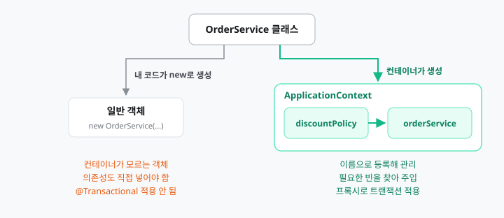
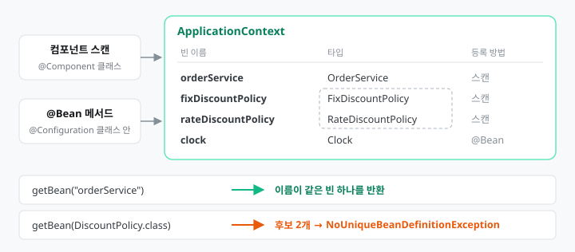
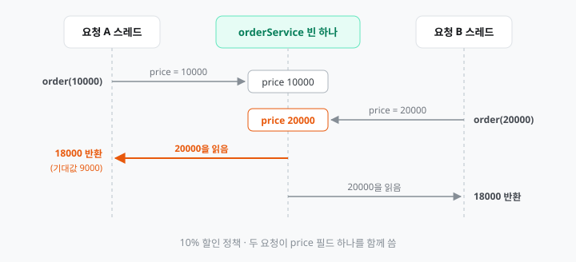

지난 글에서 스프링 IoC 컨테이너가 객체를 만들고 서로 연결해 준다고 했습니다. 이번에는 컨테이너가 관리하는 그 객체, 스프링 빈을 보겠습니다. 빈을 등록하고 이름으로 찾는 방법, 빈이 기본으로 싱글톤인 이유와 그래서 조심해야 할 점까지 정리합니다.

## 빈과 일반 객체

스프링 빈은 스프링 IoC 컨테이너가 만들고, 의존성을 넣어 주고, 관리하는 객체입니다. 빈이 될 클래스에 따로 필요한 조건은 없습니다. 지난 글의 `OrderService`도 스프링 인터페이스 하나 구현하지 않은 평범한 자바 클래스입니다. 같은 클래스라도 객체를 누가 만들었느냐에 따라 빈이 되기도 하고 일반 객체가 되기도 합니다.

```java
OrderService plain = new OrderService(new RateDiscountPolicy()); // 일반 객체
OrderService bean = context.getBean(OrderService.class);       // 빈
```

`new`로 만든 객체는 컨테이너가 존재를 모릅니다. 다른 빈에 주입할 수 없고, 그 객체가 쓸 의존성도 내가 직접 넣어야 합니다. `OrderService`의 메서드에 `@Transactional`을 붙여 두었다면 차이가 더 드러납니다. 스프링은 빈을 만들 때 트랜잭션을 처리하는 프록시로 감싸서 등록합니다. `new`로 만든 객체는 이 프록시를 거치지 않으니 애너테이션이 붙어 있어도 트랜잭션이 걸리지 않습니다.



## 빈 등록 방법

빈을 등록하는 방법은 지난 글에서 본 두 가지입니다. 하나는 클래스에 `@Component`를 붙이고 컴포넌트 스캔으로 찾게 하는 방법입니다. Spring Boot의 `@SpringBootApplication`에는 `@ComponentScan`이 들어 있어서, 이 애너테이션이 붙은 클래스의 패키지와 그 하위 패키지에서 `@Component`가 붙은 클래스를 찾아 빈으로 등록합니다. 메인 클래스가 `com.example.shop`에 있으면 `com.example.batch`에 둔 클래스는 스캔 범위 밖이라 등록되지 않습니다. `@Service`, `@Repository`, `@Controller`도 안에 `@Component`를 품고 있어서 같은 방식으로 등록됩니다.

다른 하나는 `@Configuration` 클래스에 `@Bean` 메서드를 만들어, 메서드가 돌려준 객체를 빈으로 등록하는 방법입니다. 소스 코드를 고칠 수 없는 라이브러리 클래스에는 `@Component`를 붙일 수 없으니 이 방법을 씁니다. JDK의 `Clock`을 빈으로 등록해 두면 테스트에서는 고정된 시각을 돌려주는 `Clock`으로 바꿔 끼울 수 있습니다.

```java file="TimeConfig.java"
@Configuration
public class TimeConfig {
    @Bean
    public Clock clock() {
        return Clock.system(ZoneId.of("Asia/Seoul"));
    }
}
```

보통 직접 만든 클래스는 `@Component` 계열로 등록하고, 외부 라이브러리 객체나 만들 때 설정값을 넣어야 하는 객체는 `@Bean`으로 등록합니다.

## BeanDefinition

컨테이너는 등록 방법마다 처리 코드를 따로 두지 않습니다. 컴포넌트 스캔으로 찾은 클래스든 `@Bean` 메서드든 XML에 적은 `<bean>`이든 일단 `BeanDefinition`이라는 빈 정의로 바꿔 둡니다. 빈 정의에는 어떤 클래스인지(`@Bean`이라면 어느 설정 클래스의 어떤 메서드로 만드는지), 스코프, 지연 초기화 여부, 초기화·소멸 메서드 이름 같은 정보가 담깁니다. 컨테이너는 이 정의만 보고 객체를 만들기 때문에 설정 방식이 새로 생겨도 그 방식을 `BeanDefinition`으로 바꾸는 부분만 있으면 됩니다.

등록된 빈 정의는 직접 꺼내 볼 수 있습니다. 지난 글의 `AppConfig`로 컨테이너를 만들었다면 이렇게 나옵니다.

```java file="Main.java"
AnnotationConfigApplicationContext context =
        new AnnotationConfigApplicationContext(AppConfig.class);
BeanDefinition definition = context.getBeanDefinition("orderService");

System.out.println(definition.getFactoryMethodName()); // orderService
System.out.println(definition.isSingleton());          // true
```

`orderService` 빈은 `AppConfig`의 `orderService()` 메서드로 만들고 스코프는 싱글톤이라는 내용이 정의에 들어 있습니다.

## 빈 이름과 조회

컨테이너 안에서 빈은 이름으로 구분합니다. 이름을 따로 주지 않으면 `@Component`로 등록한 빈은 클래스 이름의 첫 글자를 소문자로 바꾼 이름(`RateDiscountPolicy` → `rateDiscountPolicy`)을 쓰고, `@Bean`으로 등록한 빈은 메서드 이름을 씁니다. `@Component("ratePolicy")`나 `@Bean("ratePolicy")`로 이름을 직접 정할 수도 있습니다. 같은 이름의 빈이 두 번 등록되면 Spring Boot에서는 애플리케이션이 시작되지 않습니다. 2.1부터 같은 이름으로 빈 정의를 덮어쓰지 못하게 기본값이 바뀌었기 때문입니다.

빈을 꺼낼 때는 `getBean()`에 이름이나 타입, 또는 둘 다를 넘깁니다. 타입으로 찾을 때는 그 타입에 맞는 빈이 하나뿐이어야 합니다. `FixDiscountPolicy`와 `RateDiscountPolicy`를 둘 다 `@Component`로 등록해 두고 `getBean(DiscountPolicy.class)`를 부르면 후보가 둘이라 `NoUniqueBeanDefinitionException`이 납니다. 맞는 빈이 하나도 없으면 `NoSuchBeanDefinitionException`이 납니다.



생성자 주입도 타입으로 빈을 찾기 때문에 같은 문제가 생길 수 있습니다. 이때는 기본으로 쓸 구현에 `@Primary`를 붙이거나, 주입받는 쪽에 `@Qualifier`로 빈 이름을 적어 하나를 고릅니다.

## 기본 스코프는 싱글톤

스코프를 따로 정하지 않은 빈은 싱글톤입니다. 컨테이너는 빈 정의 하나에 객체를 하나만 만들어 두고, 주입할 때나 `getBean()`을 부를 때마다 그 객체를 돌려줍니다.

```java
OrderService a = context.getBean(OrderService.class);
OrderService b = context.getBean(OrderService.class);
System.out.println(a == b); // true
```

기본값이 싱글톤인 이유는 서버 애플리케이션이 객체를 쓰는 방식에 있습니다. 요청이 초당 1,000개 들어오는데 요청마다 `OrderService`와 그 의존 객체들을 새로 만들면, 1초에 객체 수천 개를 만들었다 버리게 되고 그만큼 GC도 바빠집니다. 서비스, 리포지토리, 컨트롤러는 요청마다 달라지는 값을 들고 있지 않으니 객체 하나를 모든 요청이 같이 써도 결과가 같습니다.

GoF의 싱글톤 패턴과는 방식이 다릅니다. 싱글톤 패턴은 생성자를 `private`으로 막고 `getInstance()` 같은 정적 메서드로 객체를 꺼내게 합니다. 그러면 쓰는 쪽이 구체 클래스에 묶이고, 테스트에서 다른 객체로 바꿔 넣기도 어렵습니다. 스프링에서는 평범한 클래스를 컨테이너가 하나만 만들어 관리하므로 클래스에 이런 코드가 필요 없습니다. 싱글톤의 범위도 JVM 전체가 아니고 컨테이너 하나 안의 빈 정의 하나입니다. 같은 클래스를 반환하는 `@Bean` 메서드를 두 개 만들면 객체도 두 개 생깁니다.

## 상태를 두지 않는 빈

싱글톤 빈 하나를 여러 요청이 동시에 씁니다. Spring Boot의 내장 톰캣은 기본으로 최대 200개 스레드로 요청을 처리하고, 이 스레드들이 같은 `OrderService` 객체의 메서드를 동시에 호출합니다. 그래서 요청마다 바뀌는 값을 빈의 필드에 저장하면 문제가 생깁니다.

```java file="OrderService.java"
@Service
public class OrderService {
    private final DiscountPolicy discountPolicy;
    private int price; // 모든 요청이 함께 쓰는 필드

    public OrderService(DiscountPolicy discountPolicy) {
        this.discountPolicy = discountPolicy;
    }

    public int order(int price) {
        this.price = price;
        // 재고 확인 같은 다른 작업
        return this.price - discountPolicy.discount(this.price);
    }
}
```

할인 정책이 10% 정률 할인이라고 하겠습니다. 요청 A가 `order(10000)`을 불러 필드에 10000을 넣습니다. A가 계산하기 전에 요청 B가 `order(20000)`을 불러 같은 필드를 20000으로 덮어씁니다. A는 20000으로 계산해서 9000 대신 18000을 돌려받습니다. 혼자 테스트할 때는 잘 되다가 요청이 몰릴 때만 틀리니 원인을 찾기도 어렵습니다.



고치려면 요청마다 달라지는 값을 필드에 두지 않으면 됩니다. 메서드 매개변수와 지역 변수는 스레드마다 자기 스택에 따로 생기므로 서로 섞이지 않습니다.

```java
public int order(int price) {
    return price - discountPolicy.discount(price);
}
```

`discountPolicy`처럼 생성할 때 한 번 주입받고 바뀌지 않는 `final` 필드는 괜찮습니다. 메서드에 `synchronized`를 걸어도 값은 섞이지 않지만, 그러면 모든 요청이 한 줄로 서서 차례를 기다립니다. 요청마다 다른 객체가 꼭 필요하다면 프로토타입이나 request 같은 다른 스코프를 쓸 수 있습니다. 스코프는 따로 정리하겠습니다.

## 정리

스프링 빈은 컨테이너가 만들고 의존성을 주입해 관리하는 객체입니다. 같은 클래스라도 `new`로 만들면 컨테이너가 모르는 일반 객체여서 주입이나 `@Transactional` 같은 기능이 적용되지 않습니다. 빈은 컴포넌트 스캔이나 `@Bean` 메서드로 등록하고, 컨테이너는 어느 쪽이든 `BeanDefinition`으로 바꿔 관리합니다. 빈 이름은 클래스나 메서드 이름에서 정해지고, 타입으로 조회했는데 후보가 둘 이상이면 예외가 납니다. 빈은 기본이 싱글톤이라 객체를 계속 새로 만들 필요가 없지만, 여러 스레드가 같은 객체를 쓰므로 요청마다 바뀌는 값을 필드에 두면 안 됩니다.

다음 글에서는 스프링 빈의 생성 과정을 보겠습니다.
