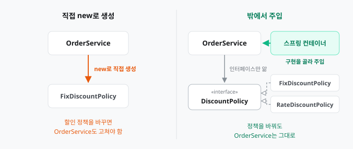
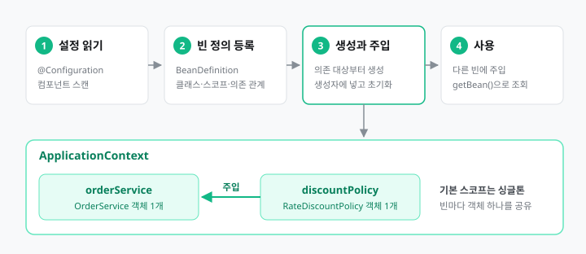

스프링의 MVC, 트랜잭션, AOP는 모두 IoC 컨테이너 위에서 동작합니다. 그래서 스프링 공부는 IoC와 DI부터 시작합니다.

## 객체를 직접 만들 때

주문 금액에서 할인 금액을 빼 주는 서비스를 생각해 보겠습니다. 할인 정책은 인터페이스로 만들어 두었습니다.

```java file="DiscountPolicy.java"
public interface DiscountPolicy {
    int discount(int price);
}
```

`OrderService`가 쓸 할인 정책을 직접 만들면 이렇게 됩니다.

```java file="OrderService.java"
public class OrderService {
    private final DiscountPolicy discountPolicy = new FixDiscountPolicy();

    public int order(int price) {
        return price - discountPolicy.discount(price);
    }
}
```

인터페이스를 쓰긴 했지만 어떤 구현을 쓸지는 여전히 `OrderService`가 정하고 있습니다. 정액 할인을 정률 할인(`RateDiscountPolicy`)으로 바꾸려면 `OrderService` 코드를 고쳐야 합니다. 주문 로직은 그대로인데도 그렇습니다. 테스트할 때 할인 금액이 고정된 가짜 정책을 넣고 싶어도 넣을 방법이 없습니다. 이렇게 한 클래스가 다른 클래스의 구체적인 구현에 묶여 있는 상태를 강하게 결합되어 있다고 합니다.

## 의존성 주입

`OrderService`가 할인 정책을 직접 만들지 않고 밖에서 받으면 이 문제가 풀립니다.

```java file="OrderService.java"
public class OrderService {
    private final DiscountPolicy discountPolicy;

    public OrderService(DiscountPolicy discountPolicy) {
        this.discountPolicy = discountPolicy;
    }

    public int order(int price) {
        return price - discountPolicy.discount(price);
    }
}
```

이제 `OrderService`는 `DiscountPolicy` 인터페이스만 압니다. 어떤 구현을 쓸지는 객체를 만드는 쪽에서 정합니다.

```java
OrderService service = new OrderService(new RateDiscountPolicy());

// 테스트에서는 항상 1000원을 할인하는 가짜 정책을 넣을 수 있습니다
OrderService testService = new OrderService(price -> 1000);
```

이렇게 객체가 쓰는 다른 객체(의존성)를 밖에서 넣어 주는 것을 의존성 주입(Dependency Injection, DI)이라고 합니다.



## 제어의 역전

DI를 하고 나면 누군가는 `new OrderService(new RateDiscountPolicy())`처럼 객체를 만들고 연결하는 일을 맡아야 합니다. 스프링에서는 이 일을 IoC 컨테이너가 합니다.

원래는 내 코드가 필요한 객체를 만들고, 언제 무엇을 부를지 정했습니다. 스프링을 쓰면 객체를 만들고 연결하는 흐름을 컨테이너가 쥐고, 내 코드는 무엇이 필요한지만 밝힙니다. 제어 흐름을 내 코드가 아니라 바깥이 갖는다는 뜻에서 이를 제어의 역전(Inversion of Control, IoC)이라고 합니다. 라이브러리는 내 코드가 부르고 프레임워크는 내 코드를 부른다는 말도 같은 이야기입니다.

IoC가 더 넓은 개념이고, DI는 IoC를 구현하는 방법 중 하나입니다. 스프링은 객체를 연결할 때 DI를 쓰기 때문에 IoC 컨테이너를 DI 컨테이너라고도 부릅니다.

## 스프링 IoC 컨테이너

스프링에서 IoC 컨테이너 역할을 하는 것이 `ApplicationContext`입니다. 컨테이너가 만들고 관리하는 객체를 빈(Bean)이라고 합니다.

컨테이너에 빈을 알려 주는 방법은 두 가지입니다. 하나는 설정 클래스에 `@Bean` 메서드로 직접 적는 방법입니다.

```java file="AppConfig.java"
@Configuration
public class AppConfig {
    @Bean
    public DiscountPolicy discountPolicy() {
        return new RateDiscountPolicy();
    }

    @Bean
    public OrderService orderService() {
        return new OrderService(discountPolicy());
    }
}
```

`@Configuration` 클래스는 스프링이 프록시로 감싸 둡니다. 그래서 `orderService()` 안에서 `discountPolicy()`를 불러도 새 객체가 만들어지지 않고 컨테이너에 등록된 빈이 돌아옵니다.

다른 하나는 클래스에 `@Component`를 붙이고 컴포넌트 스캔으로 찾게 하는 방법입니다. `@Service`, `@Repository`, `@Controller`도 안에 `@Component`를 품고 있어서 같은 방식으로 등록됩니다.

```java file="RateDiscountPolicy.java"
@Component
public class RateDiscountPolicy implements DiscountPolicy {
    @Override
    public int discount(int price) {
        return price * 10 / 100;
    }
}
```

```java file="OrderService.java"
@Service
public class OrderService {
    private final DiscountPolicy discountPolicy;

    // 생성자가 하나뿐이면 @Autowired를 생략해도 주입됩니다
    public OrderService(DiscountPolicy discountPolicy) {
        this.discountPolicy = discountPolicy;
    }
}
```

어느 쪽이든 `OrderService` 코드에는 `RateDiscountPolicy`라는 이름이 나오지 않습니다.

## 컨테이너가 빈을 준비하는 과정

컨테이너는 애플리케이션이 시작될 때 대략 이런 순서로 빈을 준비합니다.

1. **설정 읽기:** `@Configuration` 클래스와 컴포넌트 스캔 대상 패키지를 읽습니다.
2. **빈 정의 등록:** 빈마다 어떤 클래스인지, 스코프가 무엇인지, 무엇에 의존하는지를 담은 `BeanDefinition`을 만듭니다. 이 단계에서는 아직 객체를 만들지 않습니다.
3. **생성과 주입:** 빈 정의를 보고 객체를 만듭니다. `OrderService`를 만들려면 `DiscountPolicy`가 필요하니 의존 대상을 먼저 만들어 생성자에 넣습니다. 초기화 메서드가 있으면 그다음에 호출합니다.
4. **사용:** 준비된 빈은 다른 빈에 주입되거나 `getBean()`으로 꺼내 쓸 수 있습니다.



Spring Boot에서는 `SpringApplication.run()`이 이 과정을 대신 해 줍니다. 컨테이너를 직접 만들어 볼 수도 있습니다.

```java file="Main.java"
ApplicationContext context = new AnnotationConfigApplicationContext(AppConfig.class);
OrderService orderService = context.getBean(OrderService.class);
System.out.println(orderService.order(10000)); // 9000
```

빈은 기본적으로 싱글톤입니다. 컨테이너 하나에 빈마다 객체가 하나만 만들어지고, `getBean()`을 몇 번 불러도 같은 객체가 돌아옵니다. 요청마다 서비스 객체를 새로 만들지 않아도 되는 대신, 빈에 값을 저장하는 필드를 두면 여러 요청이 그 값을 함께 쓰게 되니 조심해야 합니다.

## 주입 방법

예제에서는 생성자로 주입했지만 세터나 필드에 `@Autowired`를 붙여 주입할 수도 있습니다. 생성자 주입을 쓰면 필드를 `final`로 둘 수 있고, 앞에서처럼 스프링 없이 `new`로 만들어 테스트할 수도 있어서 스프링 문서도 생성자 주입을 권장합니다. 방법별 차이는 DI 종류를 다룰 때 따로 정리하겠습니다.

## 정리

클래스가 쓸 객체를 직접 `new`로 만들면 구현이 바뀔 때마다 그 클래스를 고쳐야 하고 테스트도 어렵습니다. 의존성을 생성자 같은 통로로 밖에서 받으면(DI) 클래스는 인터페이스만 알면 됩니다. 객체를 만들고 연결하는 일을 내 코드 대신 컨테이너가 맡는 것이 제어의 역전(IoC)입니다. 스프링에서는 `ApplicationContext`가 설정을 읽어 `BeanDefinition`을 만들고, 그 정의대로 빈을 생성하고 주입해 둡니다.

다음 글에서는 컨테이너가 관리하는 객체인 스프링 빈을 자세히 보겠습니다.
