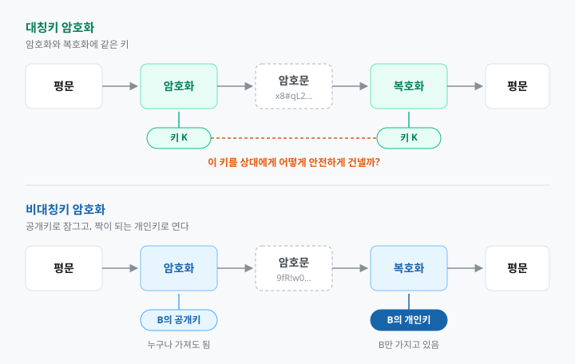
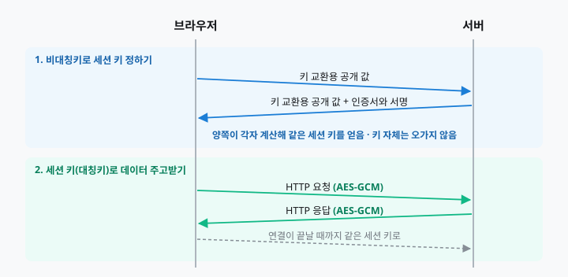

암호화는 평문을 키 없이는 읽을 수 없는 암호문으로 바꾸는 일이고, 복호화는 그 반대입니다. 암호화 방식은 암호화할 때와 복호화할 때 같은 키를 쓰는지에 따라 대칭키와 비대칭키로 나뉩니다.

## 대칭키 암호화

암호화와 복호화에 같은 키 하나를 씁니다. 자물쇠를 잠근 열쇠로 그대로 여는 것과 같습니다. 지금 가장 많이 쓰는 알고리즘은 AES이고, 키 길이는 128, 192, 256비트 중에서 고릅니다. 모바일 환경에서는 ChaCha20도 많이 씁니다.

대칭키 암호화는 빠릅니다. 연산이 단순하고, 요즘 CPU는 AES를 하드웨어 명령어(AES-NI 등)로 처리해서 큰 데이터도 부담 없이 암호화합니다.

문제는 키를 나누는 일입니다. 암호문을 보내려면 상대도 같은 키를 갖고 있어야 합니다. 그런데 그 키를 인터넷으로 그냥 보내면 중간에서 누군가 가로챌 수 있습니다. 안전한 통로를 만들려면 키가 필요한데, 키를 보내려면 안전한 통로가 필요한 셈입니다.

사람이 많아지면 키 관리도 어려워집니다. 두 사람마다 다른 키를 쓰려면 n명일 때 키가 n(n-1)/2개 필요합니다. 100명이면 4,950개입니다.

## 비대칭키 암호화

수학적으로 연결된 키 두 개를 한 쌍으로 씁니다. 하나는 누구에게 공개해도 되는 공개키이고, 다른 하나는 본인만 가지는 개인키입니다. 한 키로 암호화한 것은 짝이 되는 다른 키로만 풀 수 있습니다.

B에게 비밀 메시지를 보내려면 B의 공개키로 암호화해서 보냅니다. 이 암호문은 B의 개인키로만 풀 수 있어서 중간에 가로채도 읽을 수 없습니다. 공개키는 처음부터 공개된 값이라 몰래 전달할 필요가 없습니다. 대칭키의 키 전달 문제를 이렇게 피합니다.



대표적인 알고리즘은 RSA와 타원 곡선 암호(ECC)입니다. RSA는 큰 수를 소인수분해하기 어렵다는 점에, ECC는 타원 곡선 위의 이산 로그 문제가 어렵다는 점에 기대고 있습니다. ECC는 더 짧은 키로 비슷한 안전성을 냅니다. 256비트 ECC 키가 3072비트 RSA 키와 비슷한 수준으로 평가됩니다.

대신 비대칭키 암호화는 대칭키보다 훨씬 느리고, 한 번에 암호화할 수 있는 크기도 작습니다. 그래서 큰 데이터를 직접 암호화하는 데는 쓰지 않습니다.

## 코드로 보면

Java의 `javax.crypto`로 두 방식을 써 보겠습니다. 대칭키는 키 하나를 만들어 암호화와 복호화에 같이 씁니다.

```java file="AesExample.java"
KeyGenerator keyGen = KeyGenerator.getInstance("AES");
keyGen.init(256);
SecretKey key = keyGen.generateKey();

byte[] iv = new byte[12];
new SecureRandom().nextBytes(iv); // 암호화할 때마다 새로 만듦

Cipher cipher = Cipher.getInstance("AES/GCM/NoPadding");
cipher.init(Cipher.ENCRYPT_MODE, key, new GCMParameterSpec(128, iv));
byte[] encrypted = cipher.doFinal("hello".getBytes(StandardCharsets.UTF_8));

cipher.init(Cipher.DECRYPT_MODE, key, new GCMParameterSpec(128, iv)); // 같은 키
byte[] decrypted = cipher.doFinal(encrypted);
```

여기서 쓴 GCM 모드는 암호화와 함께 데이터가 변조되지 않았는지도 검사합니다. IV(초기화 벡터)는 같은 키로 암호화할 때마다 새로 만들어야 하고, 암호문과 함께 받는 쪽에 넘겨줍니다. IV는 비밀 값이 아니라서 같이 보내도 됩니다.

비대칭키는 키 쌍을 만들고 공개키로 암호화, 개인키로 복호화합니다.

```java file="RsaExample.java"
KeyPairGenerator keyPairGen = KeyPairGenerator.getInstance("RSA");
keyPairGen.initialize(2048);
KeyPair pair = keyPairGen.generateKeyPair();

Cipher cipher = Cipher.getInstance("RSA/ECB/OAEPWithSHA-256AndMGF1Padding");
cipher.init(Cipher.ENCRYPT_MODE, pair.getPublic()); // 공개키로 암호화
byte[] encrypted = cipher.doFinal("hello".getBytes(StandardCharsets.UTF_8));

cipher.init(Cipher.DECRYPT_MODE, pair.getPrivate()); // 개인키로 복호화
byte[] decrypted = cipher.doFinal(encrypted);
```

2048비트 RSA 키에 이 패딩(OAEP, SHA-256)을 쓰면 한 번에 190바이트까지만 암호화할 수 있습니다. 비대칭키를 데이터가 아니라 짧은 키를 주고받는 데 쓰는 이유이기도 합니다.

## 개인키로 하는 서명

키 쌍을 반대 방향으로 쓰면 전자 서명이 됩니다. 보내는 사람이 자기 개인키로 메시지에 서명하면, 받는 사람은 보낸 사람의 공개키로 서명을 검증합니다. 개인키는 본인만 가지고 있으니 검증이 통과하면 그 사람이 보낸 메시지이고, 중간에 내용이 바뀌지 않았다는 것까지 확인됩니다. 실제로는 메시지 전체가 아니라 메시지의 해시값에 서명합니다.

| 용도   | 만들 때              | 확인할 때            | 얻는 것                   |
| ------ | -------------------- | -------------------- | ------------------------- |
| 암호화 | 받는 사람의 공개키   | 받는 사람의 개인키   | 받는 사람만 읽을 수 있음  |
| 서명   | 보내는 사람의 개인키 | 보내는 사람의 공개키 | 보낸 사람 확인, 변조 확인 |

HTTPS 인증서도 서명으로 동작합니다. 인증 기관(CA)이 자기 개인키로 서버 인증서에 서명해 두면, 브라우저는 미리 가지고 있는 CA의 공개키로 그 서명을 검증합니다. 그래서 인증서에 든 공개키가 정말 그 도메인의 것인지 믿을 수 있습니다.

## 둘을 함께 쓰는 방식

실제 통신에서는 두 방식을 섞어 씁니다. 비대칭키로 대칭키를 안전하게 정한 다음, 데이터는 그 대칭키로 암호화합니다. 키 전달 문제는 비대칭키로 풀고, 속도는 대칭키로 챙깁니다.

HTTPS(TLS)가 이렇게 동작합니다. TLS 1.2까지는 클라이언트가 만든 비밀 값을 서버의 RSA 공개키로 암호화해서 보내는 방식도 쓰였습니다. 이 방식은 서버 개인키가 나중에 유출되면 녹화해 둔 과거 통신까지 풀립니다. 그래서 TLS 1.3에서는 빠지고 ECDHE 같은 키 교환을 씁니다. ECDHE에서는 양쪽이 공개해도 되는 값만 주고받고, 각자 계산해서 같은 세션 키를 얻습니다. 키 자체는 네트워크로 오가지 않습니다. 서버는 인증서와 서명으로 자기가 진짜 서버라는 걸 증명합니다.



세션 키가 정해지면 그 뒤 데이터는 AES-GCM이나 ChaCha20 같은 대칭키 암호로 주고받습니다. 연결 처음에 한 번만 비대칭키 연산을 하고, 나머지는 빠른 대칭키로 처리합니다.

## 정리

대칭키 암호화는 같은 키로 암호화와 복호화를 해서 빠르지만, 키를 안전하게 나누기 어렵습니다. 비대칭키 암호화는 공개키와 개인키 한 쌍을 써서 키 전달 문제가 없지만, 느리고 큰 데이터에는 맞지 않습니다. 키 쌍을 반대로 써서 개인키로 서명하고 공개키로 검증하면 보낸 사람과 변조 여부를 확인할 수 있습니다. HTTPS는 비대칭키로 세션 키를 정하고 실제 데이터는 대칭키로 암호화합니다.

다음 글에서는 되돌릴 수 없게 만드는 단방향 암호화, 해시를 보겠습니다.
