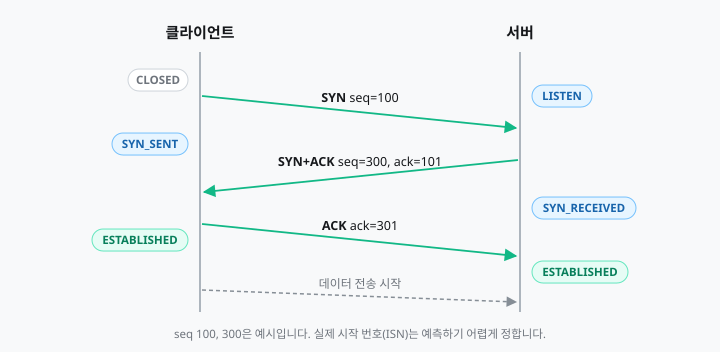
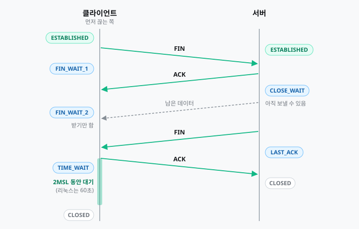

지난 글에서 TCP는 데이터를 보내기 전에 연결부터 맺는다고 했습니다. 이번에는 연결을 맺는 3-way handshake와 끊는 4-way handshake를 순서 번호, 연결 상태와 함께 보겠습니다.

## 연결을 맺는 3-way handshake

TCP 연결은 양쪽이 서로의 순서 번호를 알아야 시작할 수 있습니다. 순서 번호는 보내는 데이터의 바이트마다 매기는 번호이고, 받는 쪽은 이 번호를 보고 빠진 데이터를 찾거나 순서를 맞춥니다. 각자 몇 번부터 셀지 정한 첫 번호를 ISN(Initial Sequence Number)이라고 합니다.

handshake는 이 시작 번호를 주고받고, 상대가 받았는지 확인하는 과정입니다.

1. **SYN:** 클라이언트가 자기 시작 번호를 담아 SYN을 보냅니다. 아래 그림에서는 100입니다.
2. **SYN+ACK:** 서버는 `ack=101`로 100번까지 받았으니 101번부터 보내라고 답합니다. 같은 세그먼트에 자기 시작 번호 300을 담은 SYN도 함께 보냅니다.
3. **ACK:** 클라이언트가 `ack=301`로 서버의 시작 번호를 받았다고 알립니다.

SYN에는 데이터가 없지만 순서 번호를 하나 차지합니다. 그래서 100번 SYN에 대한 응답이 `ack=101`이 됩니다.



### 두 번이 아니라 세 번인 이유

두 번으로 끝내면 서버는 자기가 보낸 SYN+ACK가 클라이언트에 도착했는지 알 수 없습니다. 클라이언트의 시작 번호는 서버가 확인했지만, 서버의 시작 번호는 아무도 확인하지 않은 채로 연결이 열립니다. 양쪽 시작 번호를 모두 확인하려면 마지막 ACK가 필요합니다.

오래된 SYN도 문제가 됩니다. 네트워크에서 한참 헤매던 예전 SYN이 뒤늦게 서버에 도착할 수 있습니다. 두 번 만에 연결이 열린다면 서버는 이미 끝난 요청에 대해 연결을 열고 자원을 잡아 둡니다. 세 번째 단계가 있으면 클라이언트가 자기가 요청한 적 없는 연결이라는 걸 알아채고 RST로 거절할 수 있습니다.

### 시작 번호를 무작위로 정하는 이유

ISN을 매번 0부터 시작하면, 같은 주소와 포트로 연결을 다시 맺었을 때 이전 연결에서 늦게 도착한 세그먼트가 새 연결의 데이터로 섞일 수 있습니다. 번호를 예측할 수 있으면 공격자가 남의 연결에 가짜 세그먼트를 끼워 넣기도 쉬워집니다. 그래서 운영체제는 ISN을 예측하기 어렵게 정합니다.

## 연결 상태

TCP는 연결마다 지금 어느 단계에 있는지를 상태로 관리합니다. 연결을 맺을 때 거치는 상태는 이렇습니다.

| 상태         | 어느 쪽    | 의미                                           |
| ------------ | ---------- | ---------------------------------------------- |
| LISTEN       | 서버       | 연결 요청을 기다리는 중                        |
| SYN_SENT     | 클라이언트 | SYN을 보내고 응답을 기다리는 중                |
| SYN_RECEIVED | 서버       | SYN을 받고 SYN+ACK를 보낸 뒤 ACK를 기다리는 중 |
| ESTABLISHED  | 양쪽       | 연결이 맺어져 데이터를 주고받는 중             |

Java에서는 `ServerSocket`을 만들면 그 포트가 LISTEN 상태가 되고, 클라이언트에서 `new Socket(...)`을 호출하면 SYN이 나갑니다.

```java file="Server.java"
try (ServerSocket server = new ServerSocket(8080)) { // LISTEN
    Socket socket = server.accept(); // handshake가 끝난 연결을 하나 꺼냄
}
```

handshake는 운영체제 커널이 처리합니다. `accept()`가 handshake를 하는 게 아니라, 커널이 이미 ESTABLISHED로 만들어 둔 연결을 대기열에서 꺼내 옵니다.

## 연결을 끊는 4-way handshake

연결을 끊을 때는 FIN과 ACK를 두 번씩 주고받습니다. 아래에서는 클라이언트가 먼저 끊는다고 놓고 설명합니다. 실제로는 서버가 먼저 끊을 수도 있습니다.

1. **FIN:** 클라이언트가 더 보낼 데이터가 없다는 뜻으로 FIN을 보내고 FIN_WAIT_1 상태가 됩니다.
2. **ACK:** 서버가 FIN을 받았다고 ACK로 답하고 CLOSE_WAIT 상태가 됩니다. ACK를 받은 클라이언트는 FIN_WAIT_2 상태에서 서버의 FIN을 기다립니다.
3. **FIN:** 서버가 남은 데이터를 다 보내고 애플리케이션이 소켓을 닫으면 서버도 FIN을 보내고 LAST_ACK 상태가 됩니다.
4. **ACK:** 클라이언트가 ACK를 보내고 TIME_WAIT 상태로 들어갑니다. 이 ACK를 받은 서버는 연결을 완전히 닫습니다.



### 네 번이 필요한 이유

TCP 연결은 양방향입니다. 클라이언트에서 서버로 가는 방향과 서버에서 클라이언트로 가는 방향이 따로 있고, 끊을 때도 방향마다 따로 닫습니다. 클라이언트의 FIN은 자기는 더 보낼 게 없다는 뜻일 뿐이라 서버는 그 뒤에도 데이터를 보낼 수 있습니다. 이렇게 한쪽 방향만 닫힌 상태를 half-close라고 합니다.

서버는 FIN을 받자마자 ACK는 보낼 수 있지만, 자기 FIN은 남은 데이터를 다 보낸 뒤에야 보냅니다. 그래서 ACK와 FIN이 따로 나가 네 번이 됩니다. 서버에 보낼 데이터가 없으면 ACK와 FIN을 한 세그먼트에 묶어 보내서 세 번으로 끝나기도 합니다.

### TIME_WAIT

마지막 ACK를 보낸 클라이언트는 연결을 바로 지우지 않고 TIME_WAIT 상태에서 일정 시간 기다립니다. 이유는 두 가지입니다.

- **마지막 ACK가 유실될 수 있습니다.** 서버는 ACK를 받지 못하면 FIN을 다시 보냅니다. 클라이언트가 이미 연결을 지웠다면 이 FIN에 제대로 응답할 수 없습니다.
- **늦게 도착하는 세그먼트가 있을 수 있습니다.** 같은 주소와 포트로 곧바로 새 연결을 맺으면 이전 연결에서 늦게 온 세그먼트가 새 연결에 섞일 수 있습니다. 기다리는 동안 이런 세그먼트는 네트워크에서 사라집니다.

기다리는 시간은 2MSL입니다. MSL(Maximum Segment Lifetime)은 세그먼트가 네트워크에 머물 수 있는 최대 시간이고, 처음 TCP 명세(RFC 793)에서는 2분으로 정했습니다. 실제 값은 운영체제마다 다릅니다. 리눅스는 TIME_WAIT를 60초로 고정해 두었습니다.

## 서버에서 자주 보는 상태

연결 상태는 `ss -tan`이나 `netstat -an`으로 볼 수 있습니다. 서버를 운영하다 보면 두 상태가 쌓이는 경우를 자주 만납니다.

- **TIME_WAIT가 많을 때:** TIME_WAIT는 먼저 끊는 쪽에 남습니다. 서버가 다른 서버나 DB에 짧은 연결을 계속 새로 맺고 끊으면 TIME_WAIT가 쌓이고, 새 연결에 쓸 로컬 포트가 모자랄 수 있습니다. 연결을 재사용하는 커넥션 풀이나 HTTP keep-alive로 줄입니다.
- **CLOSE_WAIT가 많을 때:** 상대가 FIN을 보냈는데 우리 애플리케이션이 소켓을 닫지 않고 있다는 뜻입니다. 운영체제 설정보다는 코드에서 연결을 `close()`하지 않는 곳을 찾아야 합니다.

## SYN flooding

3-way handshake를 노린 공격도 있습니다. 서버는 SYN을 받으면 SYN+ACK를 보내고, 마지막 ACK가 올 때까지 그 연결 정보를 대기열에 들고 있습니다. 공격자가 출발지 주소를 속인 SYN을 대량으로 보내고 ACK는 보내지 않으면 대기열이 반쯤 열린 연결로 가득 찹니다. 그러면 정상 사용자의 연결 요청을 받지 못합니다.

대표적인 방어 방법은 SYN cookie입니다. 서버는 SYN을 받아도 대기열에 저장하지 않고, 연결에 필요한 정보를 SYN+ACK의 시작 번호 안에 담아 보냅니다. 정상 클라이언트가 ACK를 돌려보내면 그 번호를 검증한 뒤에 연결을 만듭니다.

## 정리

3-way handshake는 양쪽의 시작 번호를 주고받고 확인하는 과정입니다. 서버의 시작 번호까지 확인하고 오래된 SYN을 걸러 내려면 세 번이 필요합니다. 4-way handshake는 양방향 연결을 방향마다 따로 닫기 때문에 네 번입니다. 먼저 끊는 쪽은 마지막 ACK 유실과 늦게 온 세그먼트에 대비해 TIME_WAIT 상태로 2MSL을 기다립니다.

다음 글에서는 TCP 위에서 동작하는 HTTP와, 여기에 암호화를 더한 HTTPS를 보겠습니다.
