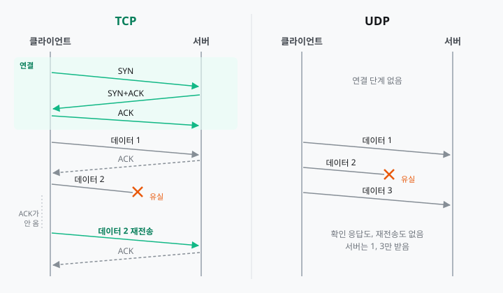
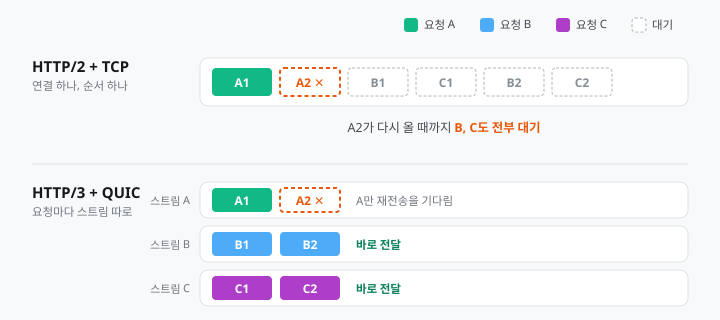

지난 글에서 브라우저가 서버와 TCP 연결을 맺는다고만 하고 넘어갔습니다. 이번에는 그 TCP를 UDP와 나란히 놓고 보겠습니다. 둘 다 전송 계층 프로토콜이라 IP가 찾아 준 상대 컴퓨터 안에서 포트 번호로 어느 프로그램에 데이터를 넘길지 정합니다. 차이는 데이터를 얼마나 꼼꼼히 챙겨서 보내느냐에 있습니다.

## TCP

TCP는 데이터를 보내기 전에 상대와 연결을 맺습니다. 3-way handshake로 양쪽이 주고받을 준비가 됐는지 확인한 다음에야 데이터가 오갑니다.

연결이 맺어지면 TCP는 보낸 데이터가 빠짐없이, 보낸 순서대로 도착하도록 챙깁니다.

- **순서 번호와 확인 응답(ACK):** 보내는 쪽은 바이트마다 순서 번호를 매기고 받는 쪽은 어디까지 받았는지 ACK로 알려 줍니다. 중간이 빠지거나 순서가 뒤바뀌어도 받는 쪽에서 다시 맞춥니다.
- **재전송:** 정해진 시간 안에 ACK가 오지 않으면 잃어버린 것으로 보고 다시 보냅니다.
- **흐름 제어:** 받는 쪽은 자기가 더 받을 수 있는 양(윈도우 크기)을 알려 줍니다. 보내는 쪽은 그 이상 몰아서 보내지 않습니다.
- **혼잡 제어:** 네트워크가 막힌 것 같으면 보내는 속도를 줄입니다. 처음에는 조금씩 보내다가 잘 도착하면 양을 늘려 갑니다.

애플리케이션 입장에서는 이 모든 일이 가려져 있어서 그냥 끊김 없는 바이트 흐름(스트림)을 읽고 쓰는 것처럼 보입니다.

## UDP

UDP는 연결을 맺지 않습니다. 보낼 데이터를 데이터그램 하나에 담아 바로 보내고 끝입니다. 상대가 받았는지 확인하지 않습니다. 잃어버려도 다시 보내지 않고 순서도 맞춰 주지 않습니다. 데이터가 깨졌는지 확인하는 체크섬 정도만 있습니다.

대신 가볍고 빠릅니다. 연결을 맺느라 왕복할 필요가 없고 ACK를 기다리지 않으니 지연이 적습니다. 헤더도 TCP의 절반에도 못 미칩니다.



| 항목        | TCP                   | UDP                     |
| ----------- | --------------------- | ----------------------- |
| 연결        | 연결을 맺고 시작      | 연결 없음               |
| 전달 보장   | ACK와 재전송으로 보장 | 보장하지 않음           |
| 순서        | 보낸 순서대로         | 도착하는 대로           |
| 데이터 단위 | 바이트 스트림         | 데이터그램(메시지 단위) |
| 헤더 크기   | 20~60바이트           | 8바이트                 |
| 속도 조절   | 흐름 제어, 혼잡 제어  | 없음                    |

## 코드로 보면

Java로 쓰면 차이가 더 잘 보입니다. TCP는 `Socket`으로 연결부터 맺고 스트림에 씁니다.

```java file="TcpClient.java"
try (Socket socket = new Socket("example.com", 80)) { // 여기서 3-way handshake
    OutputStream out = socket.getOutputStream();
    out.write("GET / HTTP/1.1\r\nHost: example.com\r\n\r\n".getBytes());
}
```

UDP는 `DatagramSocket`으로 패킷 하나를 만들어 던집니다. 연결 단계가 없고 상대 주소를 패킷마다 적습니다.

```java file="UdpClient.java"
try (DatagramSocket socket = new DatagramSocket()) {
    byte[] data = "hello".getBytes();
    InetAddress address = InetAddress.getByName("example.com");
    socket.send(new DatagramPacket(data, data.length, address, 9999));
}
```

## 어디에 쓰이나

데이터가 하나라도 빠지면 안 되는 곳에는 TCP를 씁니다. 웹 페이지(HTTP/1.1, HTTP/2), 파일 전송, 이메일(SMTP), SSH가 모두 TCP 위에서 동작합니다. 글자 하나가 빠진 HTML이나 일부가 깨진 파일은 쓸 수 없으니까요.

조금 잃어버려도 빨리 도착하는 게 더 중요한 곳에는 UDP를 씁니다.

- **DNS 조회:** 질문 하나, 답 하나로 끝나는 짧은 대화라 연결을 맺는 비용이 더 큽니다. 답이 안 오면 애플리케이션이 다시 물어보면 됩니다.
- **실시간 음성·영상 통화, 온라인 게임:** 0.5초 전 음성 조각을 재전송받아 봐야 이미 늦었습니다. 잠깐 끊기더라도 지금 데이터를 받는 편이 낫습니다.

## UDP 위에 신뢰성을 직접 만드는 경우

UDP가 신뢰성을 보장하지 않는다는 건 UDP 자체가 해 주지 않는다는 뜻입니다. 필요하면 그 위에서 애플리케이션이 직접 만들 수 있습니다.

대표적인 예가 HTTP/3가 쓰는 QUIC입니다. QUIC은 UDP 위에서 재전송, 순서 보장, 혼잡 제어를 직접 구현합니다. TCP를 두고 굳이 이렇게 하는 이유는 두 가지입니다.

- **TCP는 운영체제 안에 있어서 바꾸기 어렵습니다.** QUIC은 애플리케이션 쪽 라이브러리라서 브라우저나 서버를 업데이트하면 바로 개선할 수 있습니다.
- **TCP는 패킷 하나만 잃어버려도 뒤에 온 데이터가 전부 기다립니다.** 순서를 지켜 넘겨야 하기 때문입니다. HTTP/2는 연결 하나에 여러 요청을 섞어 보냅니다. 그런데 그중 한 요청의 패킷이 빠지면 상관없는 요청까지 함께 멈춥니다. QUIC은 요청마다 스트림을 따로 관리해서 빠진 스트림만 기다립니다.



여기에 연결 수립과 TLS 핸드셰이크를 한 번에 처리하는 장점까지 더해져서 연결도 더 빨리 맺어집니다.

## 정리

TCP는 연결을 맺고 순서 번호, ACK, 재전송으로 데이터를 빠짐없이 순서대로 전달합니다. 그만큼 느리고 무겁습니다. UDP는 확인 없이 바로 보내서 가볍고 빠르지만 전달을 보장하지 않습니다. 정확해야 하면 TCP, 빨라야 하면 UDP를 고릅니다. 둘 다 필요하면 QUIC처럼 UDP 위에 필요한 만큼 신뢰성을 얹기도 합니다.

다음 글에서는 TCP가 연결을 맺고 끊는 3-way handshake와 4-way handshake를 자세히 보겠습니다.
