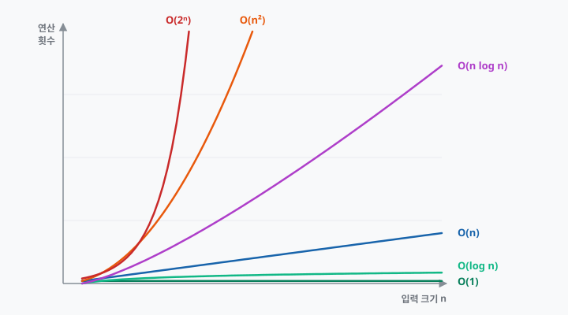
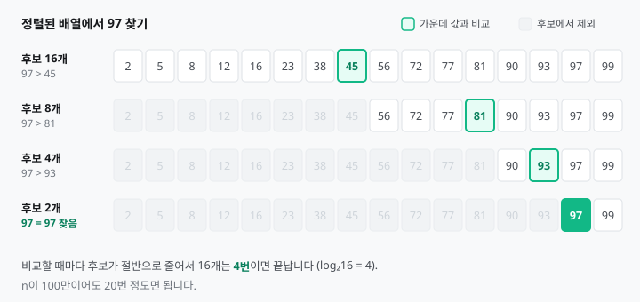

같은 문제를 푸는 코드라도 입력이 커지면 어떤 코드는 금방 끝나고 어떤 코드는 몇 시간이 걸립니다. 그 차이를 코드를 돌려 보기 전에 가늠하는 도구가 시간 복잡도입니다.

## 실행 시간 대신 연산 횟수

코드가 1초 걸렸다는 측정값은 컴퓨터마다 다르고, 같은 컴퓨터에서도 실행할 때마다 조금씩 달라집니다. 언어나 JVM 최적화에 따라서도 달라집니다. 그래서 알고리즘을 비교할 때는 입력 크기 n에 대해 비교, 대입, 덧셈 같은 기본 연산을 몇 번 하는지 셉니다.

배열에서 최댓값을 찾는 코드를 보겠습니다.

```java
int max = arr[0];
for (int i = 1; i < arr.length; i++) {
    if (arr[i] > max) {
        max = arr[i];
    }
}
```

배열 길이가 n이면 반복문이 n-1번 돌고 매번 비교를 한 번씩 합니다. 입력이 두 배가 되면 연산도 두 배가 됩니다. 시간 복잡도는 이렇게 입력이 커질 때 연산 횟수가 어떤 모양으로 늘어나는지를 나타냅니다.

## 빅오 표기법

연산 횟수를 정확히 세면 3n + 2, n² + 5n 같은 식이 나옵니다. 빅오 표기법은 여기서 n이 아주 커질 때 결과를 좌우하는 항만 남깁니다.

- 상수 계수는 뺍니다. 3n은 O(n)입니다.
- 가장 빨리 커지는 항만 남깁니다. n² + 5n은 O(n²)입니다. n이 10만이면 n²은 100억이고 5n은 50만이라 거의 영향이 없습니다.

빅오는 원래 "이보다 빨리 늘어나지는 않는다"는 상한을 뜻합니다. 하한은 Ω(오메가), 상한과 하한이 같을 때는 Θ(세타)로 따로 적습니다. 보통은 가장 나쁜 경우를 기준으로 빅오만 씁니다.

## 자주 보는 복잡도



### O(1)

입력 크기와 상관없이 연산 횟수가 일정합니다. 배열의 인덱스 접근이 대표적입니다. `HashMap`의 `get`도 평균적으로 O(1)입니다.

```java
int first = arr[0];
Integer count = map.get("apple");
```

### O(log n)

단계마다 남은 범위가 절반씩 줄어듭니다. 정렬된 배열에서 값을 찾는 이진 탐색이 그렇습니다.

```java file="BinarySearch.java"
int binarySearch(int[] arr, int target) {
    int lo = 0, hi = arr.length - 1;
    while (lo <= hi) {
        int mid = (lo + hi) / 2;
        if (arr[mid] == target) return mid;
        if (arr[mid] < target) lo = mid + 1;
        else hi = mid - 1;
    }
    return -1;
}
```



후보가 n개에서 1개가 될 때까지 절반으로 나누는 횟수가 log₂n이라서 O(log n)입니다.

### O(n)

입력을 한 번씩 훑습니다. 앞의 최댓값 찾기, 합계 구하기, 정렬되지 않은 배열에서 값 찾기가 여기에 속합니다.

### O(n log n)

효율적인 정렬 알고리즘이 보통 이 정도입니다. 병합 정렬은 배열을 절반씩 나누는 단계가 log n번이고, 단계마다 n개를 합칩니다. Java에서 객체를 정렬하는 `Collections.sort`와 `Arrays.sort`도 O(n log n)을 보장합니다.

```java
List<String> names = new ArrayList<>(input);
Collections.sort(names);
```

### O(n²)

이중 반복문으로 모든 쌍을 확인할 때 나옵니다.

```java
int count = 0;
for (int i = 0; i < n; i++) {
    for (int j = i + 1; j < n; j++) {
        if (arr[i] + arr[j] == target) count++;
    }
}
```

안쪽 반복은 n-1, n-2, …, 1번 돌아서 모두 n(n-1)/2번입니다. 상수와 낮은 차수 항을 빼면 O(n²)입니다.

### O(2ⁿ)

호출 한 번이 두 번의 호출로 갈라지는 재귀에서 나옵니다. 피보나치 수를 재귀로 그대로 구하면 같은 값을 계속 다시 계산합니다.

```java
int fib(int n) {
    if (n <= 1) return n;
    return fib(n - 1) + fib(n - 2);
}
```

정확히는 호출 수가 약 1.6ⁿ씩 늘어나지만, 빅오는 상한이므로 보통 O(2ⁿ)으로 적습니다. `fib(50)`만 해도 호출이 400억 번을 넘습니다.

## 복잡도를 계산하는 방법

코드를 보고 복잡도를 구할 때는 몇 가지 규칙을 씁니다.

- 반복문은 반복 횟수만큼 곱합니다. n번 도는 반복문 안에 n번 도는 반복문이 있으면 O(n²)입니다.
- 차례로 이어진 코드는 더한 뒤 큰 쪽만 남깁니다. O(n) 반복문 다음에 O(n²) 반복문이 오면 O(n²)입니다.
- 입력이 여러 개면 따로 적습니다. 길이 n과 m인 배열을 각각 한 번씩 훑으면 O(n + m), 모든 쌍을 비교하면 O(n × m)입니다.
- 범위를 절반씩 줄이거나 `i *= 2`처럼 두 배씩 건너뛰는 반복은 O(log n)입니다.
- 반복문 안에서 부르는 메서드도 셉니다. `ArrayList.contains`는 처음부터 찾아보는 O(n) 연산이라서 n번 도는 반복문 안에서 부르면 전체가 O(n²)이 됩니다.
- 재귀는 호출 횟수에 호출 한 번이 하는 일을 곱합니다. 피보나치처럼 두 갈래로 갈라지면 호출 수가 지수적으로 늘어납니다.

## 입력 크기로 가늠하기

코딩 테스트에서는 입력 크기를 보고 어떤 복잡도까지 시간 안에 들어오는지 먼저 따져 봅니다. 단순한 연산을 1초에 1억 번 정도 한다고 놓고 계산하는 경우가 많습니다. 언어와 연산 종류에 따라 크게 달라지는 대략적인 기준입니다.

| 입력 크기 n (제한 1초) | 들어오는 복잡도 |
| ---------------------- | --------------- |
| 10 이하                | O(n!)           |
| 20 안팎                | O(2ⁿ)           |
| 500 이하               | O(n³)           |
| 5,000 이하             | O(n²)           |
| 100만 이하             | O(n log n)      |
| 1,000만 안팎           | O(n)            |
| 그보다 큼              | O(log n), O(1)  |

n이 10만인데 O(n²)으로 짜면 연산이 100억 번이라 1초 안에 끝나기 어렵습니다. 이럴 때는 정렬이나 해시를 써서 O(n log n) 이하로 줄일 방법을 먼저 찾습니다.

## 공간 복잡도

메모리도 같은 방식으로 따집니다. 입력 말고 추가로 쓰는 메모리가 입력 크기에 따라 얼마나 늘어나는지를 봅니다. 크기 n인 배열을 하나 더 만들면 O(n), 변수 몇 개만 쓰면 O(1)입니다.

재귀는 호출이 끝나기 전까지 스택에 프레임이 쌓이므로 재귀 깊이만큼 공간을 씁니다. 앞의 피보나치는 호출 수가 지수적으로 늘지만 한 번에 쌓이는 깊이는 n이라서 공간 복잡도는 O(n)입니다.

## 분할 상환 분석

`ArrayList.add`는 보통 내부 배열 끝에 값을 넣기만 하므로 O(1)입니다. 그런데 내부 배열이 가득 차면 더 큰 배열(OpenJDK 기준 약 1.5배)을 새로 만들고 기존 원소를 전부 복사합니다. 이때는 한 번에 O(n)이 걸립니다.

복사는 배열이 찰 때만 일어나고, 배열이 커질수록 다음 복사까지의 간격도 넓어집니다. n번 add하는 동안 복사한 원소 수를 모두 더해도 n에 비례하는 정도라서, add 한 번에 드는 비용을 평균 내면 O(1)입니다. 가끔 생기는 비싼 연산을 전체에 나눠서 계산하는 이 방식을 분할 상환 분석이라고 하고, 결과는 분할 상환 O(1)이라고 부릅니다.

## 정리

시간 복잡도는 입력이 커질 때 연산 횟수가 늘어나는 모양을 나타내고, 빅오 표기법으로 가장 큰 항만 남겨 적습니다. O(1), O(log n), O(n), O(n log n), O(n²), O(2ⁿ) 순서로 뒤로 갈수록 입력이 커질 때 급격히 느려집니다. 계산할 때는 반복문은 곱하고, 이어진 코드는 큰 쪽만 남기고, 반복문 안의 메서드 호출까지 셉니다. 코딩 테스트에서는 입력 크기로 허용되는 복잡도를 먼저 정한 뒤 알고리즘을 고릅니다.

다음 글에서는 가장 기본적인 자료구조인 배열과 연결 리스트를 비교하겠습니다.
