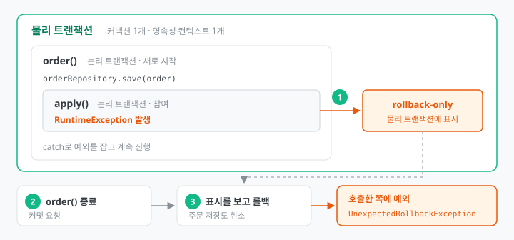
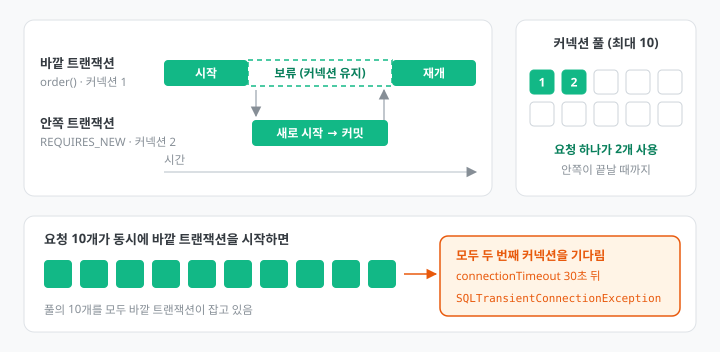
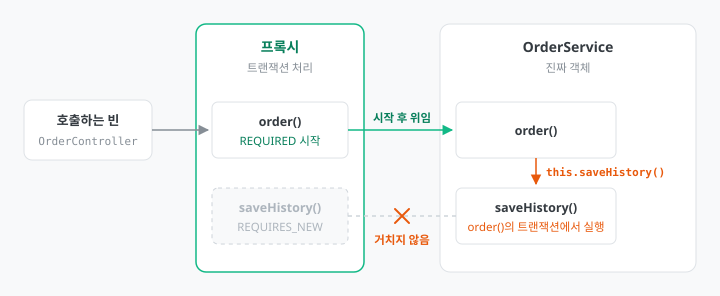

지난 글에서 스프링에서는 영속성 컨텍스트가 트랜잭션과 함께 열리고 닫힌다고 했습니다. 이번에는 `@Transactional` 메서드가 또 다른 `@Transactional` 메서드를 부를 때 트랜잭션이 어떻게 이어지는지 보겠습니다. 이 동작을 정하는 설정을 트랜잭션 전파(propagation)라고 합니다.

## 물리 트랜잭션과 논리 트랜잭션

주문을 저장하고 포인트를 차감하는 코드를 예로 들겠습니다. `OrderService`와 `PointService`는 서로 다른 빈이고, 두 메서드에 모두 `@Transactional`이 붙어 있습니다.

```java file="OrderService.java"
@Transactional
public void order(Long memberId, int price) {
    orderRepository.save(new Order(memberId, price));
    pointService.use(memberId, price); // 이 메서드도 @Transactional
}
```

`@Transactional`이 두 번 나오지만 데이터베이스 트랜잭션은 하나만 생깁니다. 커넥션에서 실제로 시작해 커밋이나 롤백으로 끝나는 데이터베이스 트랜잭션을 물리 트랜잭션, `@Transactional` 메서드 하나하나가 차지하는 범위를 논리 트랜잭션이라고 부릅니다. 위 코드는 물리 트랜잭션 하나 안에 논리 트랜잭션이 두 개 들어 있습니다.

전파 옵션은 메서드가 시작될 때 이미 진행 중인 트랜잭션이 있으면 어떻게 할지, 없으면 어떻게 할지를 정합니다. `@Transactional(propagation = Propagation.REQUIRES_NEW)`처럼 지정하고, 따로 적지 않으면 `REQUIRED`가 적용됩니다.

## REQUIRED

`REQUIRED`는 진행 중인 트랜잭션이 있으면 거기에 참여하고, 없으면 새로 시작합니다. 위 예에서 `order()`가 호출될 때는 트랜잭션이 없으니 새로 시작하고, `pointService.use()`는 이미 열린 트랜잭션에 참여합니다. 두 메서드가 같은 커넥션과 같은 영속성 컨텍스트를 쓰기 때문에 `order()`에서 조회한 회원을 `use()`에서 다시 조회하면 1차 캐시에서 꺼내 옵니다.

참여한 쪽은 커밋하지 않습니다. 트랜잭션을 처음 시작한 `order()`가 끝날 때 한 번만 커밋합니다. 포인트가 모자라 `use()`에서 예외가 나고 그 예외가 `order()` 밖까지 올라가면 주문 저장도 함께 롤백됩니다.

## 안쪽 롤백과 UnexpectedRollbackException

문제는 안쪽에서 난 예외를 바깥에서 잡을 때 생깁니다. 쿠폰 적용에 실패해도 주문은 진행하려고 이렇게 썼다고 해 보겠습니다.

```java file="OrderService.java"
@Transactional
public void order(Long memberId, Long couponId) {
    orderRepository.save(new Order(memberId));
    try {
        couponService.apply(couponId); // @Transactional, CouponException(런타임 예외)을 던짐
    } catch (CouponException e) {
        log.warn("쿠폰 없이 주문을 진행합니다", e);
    }
}
```

예외를 잡았으니 주문은 커밋될 것 같지만, 실제로는 `order()`가 끝날 때 `UnexpectedRollbackException`이 나고 주문도 저장되지 않습니다.

`apply()`를 감싼 트랜잭션 프록시는 런타임 예외를 받으면 롤백하려고 합니다. 그런데 `apply()`는 트랜잭션에 참여만 한 쪽이라 직접 롤백하지 못하고, 물리 트랜잭션에 rollback-only 표시만 남긴 채 예외를 다시 던집니다. 바깥에서 예외를 잡고 커밋을 요청해도 트랜잭션 매니저는 이 표시를 보고 롤백합니다. 커밋을 요청했는데 롤백됐다는 사실을 알리려고 던지는 예외가 `UnexpectedRollbackException`입니다.



표시는 예외가 안쪽 `@Transactional` 메서드의 경계를 빠져나올 때 남습니다. `apply()` 안에서 예외를 잡아 처리하면 표시가 생기지 않고, 스프링은 기본으로 런타임 예외와 `Error`에서만 롤백하므로 체크 예외도 표시를 남기지 않습니다. 쿠폰 실패와 상관없이 주문을 커밋하려면 쿠폰 쪽이 예외 대신 적용 결과를 반환하게 바꾸는 방법이 가장 단순합니다.

## REQUIRES_NEW

`REQUIRES_NEW`는 진행 중인 트랜잭션이 있어도 새 물리 트랜잭션을 시작합니다. 바깥 트랜잭션은 잠시 보류(suspend)해 두고, 커넥션 풀에서 커넥션을 하나 더 받아 새 트랜잭션을 엽니다. 안쪽 메서드가 끝나면 그 트랜잭션을 커밋하거나 롤백한 뒤 보류했던 바깥 트랜잭션을 다시 이어 갑니다.

두 트랜잭션은 커밋과 롤백을 따로 합니다. 주문이 실패해도 실패 기록은 남겨야 할 때 씁니다.

```java file="OrderHistoryService.java"
@Transactional(propagation = Propagation.REQUIRES_NEW)
public void saveFailure(Long memberId, String reason) {
    historyRepository.save(new OrderHistory(memberId, reason));
}
```

`order()`에서 예외가 났을 때 이 메서드를 부르고 예외를 다시 던지면, 실패 기록은 별도 트랜잭션으로 이미 커밋된 뒤라 주문이 롤백돼도 남습니다. JPA에서는 영속성 컨텍스트도 새로 만들어집니다. 바깥에서 조회한 엔티티는 안쪽의 1차 캐시에 없으므로 같은 엔티티를 조회하면 SELECT가 다시 나갑니다.

반대로 안쪽에서 난 예외는 안쪽 트랜잭션만 롤백하지만, 예외 자체는 호출한 쪽으로 올라갑니다. 바깥에서 잡지 않으면 바깥 트랜잭션도 롤백됩니다.

### 커넥션 두 개 점유

보류된 바깥 트랜잭션은 커넥션을 풀에 돌려주지 않고 쥔 채로 기다립니다. 그래서 `REQUIRES_NEW` 메서드가 실행되는 동안에는 요청 하나가 커넥션 두 개를 씁니다.

스프링 부트가 기본으로 쓰는 HikariCP의 최대 풀 크기는 10개입니다. 요청 10개가 동시에 들어와 바깥 트랜잭션에서 커넥션을 하나씩 잡은 상태로 `REQUIRES_NEW` 메서드에 들어가면, 두 번째 커넥션을 받을 수 있는 요청이 하나도 남지 않습니다. 모두 다른 요청이 커넥션을 돌려주길 기다리다가 `connectionTimeout`(기본 30초)이 지나면 `SQLTransientConnectionException`으로 실패합니다.



요청이 몰리는 경로에서 `REQUIRES_NEW`를 쓴다면 풀 크기를 넉넉하게 잡아야 합니다. 실패 기록처럼 나중에 해도 되는 일은 바깥 트랜잭션이 끝난 뒤에 호출하면 커넥션을 하나만 씁니다.

## 나머지 전파 옵션

| 옵션          | 진행 중인 트랜잭션이 있을 때         | 없을 때            |
| ------------- | ------------------------------------ | ------------------ |
| REQUIRED      | 참여                                 | 새로 시작          |
| REQUIRES_NEW  | 보류하고 새로 시작                   | 새로 시작          |
| SUPPORTS      | 참여                                 | 트랜잭션 없이 실행 |
| NOT_SUPPORTED | 보류하고 트랜잭션 없이 실행          | 트랜잭션 없이 실행 |
| MANDATORY     | 참여                                 | 예외               |
| NEVER         | 예외                                 | 트랜잭션 없이 실행 |
| NESTED        | 세이브포인트를 만들고 그 안에서 실행 | 새로 시작          |

`MANDATORY`와 `NEVER`는 조건이 맞지 않으면 `IllegalTransactionStateException`을 던집니다.

`NESTED`는 JDBC 세이브포인트를 써서, 안쪽이 실패하면 세이브포인트까지만 되돌리고 바깥은 계속 진행합니다. 다만 세이브포인트는 JDBC 커넥션에만 걸리고 영속성 컨텍스트의 엔티티 변경은 되돌리지 못합니다. 그래서 `JpaTransactionManager`는 기본으로 이를 허용하지 않고, 진행 중인 트랜잭션 안에서 `NESTED` 메서드를 부르면 `NestedTransactionNotSupportedException`이 납니다.

## 같은 클래스 안의 호출

`@Transactional`은 스프링이 빈을 감싸 만든 프록시가 처리합니다. 다른 빈에서 `orderService.order()`를 부르면 프록시가 먼저 트랜잭션을 시작하고 진짜 객체의 `order()`를 부릅니다. 같은 클래스 안의 호출은 이 프록시를 거치지 않습니다.

```java file="OrderService.java"
@Transactional
public void order(Long memberId, int price) {
    orderRepository.save(new Order(memberId, price));
    saveHistory(memberId); // this.saveHistory()
}

@Transactional(propagation = Propagation.REQUIRES_NEW)
public void saveHistory(Long memberId) {
    historyRepository.save(new OrderHistory(memberId));
}
```

`saveHistory(memberId)`는 `this.saveHistory(memberId)`이고, `this`는 진짜 객체입니다. 그래서 `REQUIRES_NEW`가 적용되지 않고 `saveHistory()`는 `order()`의 트랜잭션 안에서 실행됩니다. 오류도 경고도 없어서 주문이 롤백되며 기록까지 사라진 뒤에야 알아채기 쉽습니다. 트랜잭션이 없는 메서드에서 같은 클래스의 `@Transactional` 메서드를 부르면 트랜잭션이 아예 시작되지 않습니다.



보통은 `saveHistory()`를 `OrderHistoryService` 같은 다른 빈으로 옮기고 주입받아 불러서 해결합니다. `TransactionTemplate`으로 트랜잭션 범위를 코드에서 직접 정하는 방법도 있습니다.

## 정리

`@Transactional` 메서드 하나가 논리 트랜잭션 하나이고, 기본값인 `REQUIRED`에서는 여러 논리 트랜잭션이 물리 트랜잭션 하나를 나눠 씁니다. 커밋은 처음 시작한 쪽만 하고, 안쪽에서 롤백할 예외가 경계를 빠져나오면 바깥에서 그 예외를 잡더라도 전체가 롤백되며 `UnexpectedRollbackException`이 납니다. `REQUIRES_NEW`는 커넥션과 영속성 컨텍스트를 따로 받아 독립적으로 커밋하는 대신 실행되는 동안 커넥션 두 개를 잡습니다. 전파 설정은 프록시를 거칠 때만 적용되므로 같은 클래스 안의 호출에는 효과가 없습니다.

다음 글에서는 SQL을 직접 쓰는 대신 JPA를 쓰는 이유를 보겠습니다.
