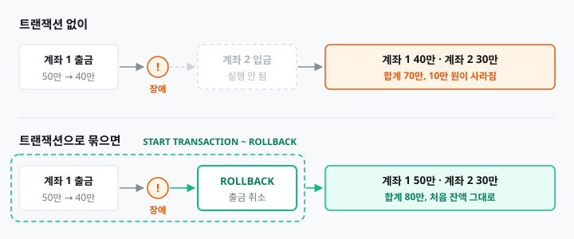
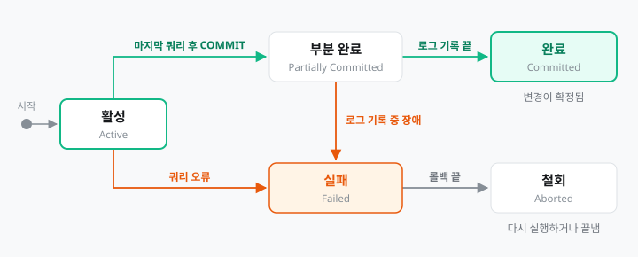
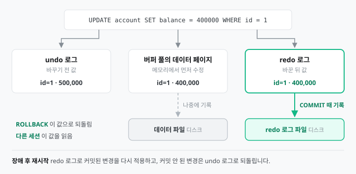

지난 글에서는 인덱스로 조회를 빠르게 만드는 방법을 봤습니다. 이번에는 여러 쿼리를 하나의 작업 단위로 묶는 트랜잭션을 보겠습니다. 예시는 이번에도 MySQL의 InnoDB를 기준으로 듭니다.

## 작업 단위로 묶는 이유

계좌 1에서 계좌 2로 10만 원을 보내는 이체를 생각해 보겠습니다. 계좌 1의 잔액은 50만 원, 계좌 2는 30만 원입니다. 이체는 쿼리 두 개로 이루어집니다.

```sql
UPDATE account SET balance = balance - 100000 WHERE id = 1;
UPDATE account SET balance = balance + 100000 WHERE id = 2;
```

첫 번째 UPDATE가 끝난 직후에 DB 서버가 죽거나 두 번째 UPDATE가 오류로 실패하면 계좌 1에서는 10만 원이 빠졌는데 계좌 2에는 들어가지 않습니다. 두 계좌를 합친 금액이 80만 원에서 70만 원이 되고, 10만 원은 어디에도 남지 않습니다.

이체는 두 쿼리가 모두 반영되거나 둘 다 반영되지 않아야 합니다. 이렇게 함께 성공하거나 함께 취소되어야 하는 쿼리 묶음을 트랜잭션이라고 합니다. 트랜잭션으로 묶으면 중간에 실패했을 때 앞에서 실행한 UPDATE까지 되돌려 두 계좌가 처음 잔액으로 돌아갑니다.



트랜잭션이 지켜야 하는 성질은 원자성(Atomicity), 일관성(Consistency), 격리성(Isolation), 지속성(Durability)의 앞 글자를 따서 ACID라고 부릅니다. 각 성질은 따로 볼 내용이 많아서 여기서는 이름만 적어 둡니다.

## COMMIT과 ROLLBACK

트랜잭션은 `START TRANSACTION`(또는 `BEGIN`)으로 시작해서 `COMMIT`이나 `ROLLBACK`으로 끝납니다.

```sql
START TRANSACTION;
UPDATE account SET balance = balance - 100000 WHERE id = 1;
UPDATE account SET balance = balance + 100000 WHERE id = 2;
COMMIT;
```

`COMMIT`은 트랜잭션 안에서 바꾼 내용을 확정합니다. 커밋하기 전까지 바뀐 잔액은 그 트랜잭션 안에서만 보이고, 다른 세션은 기본 설정에서 바뀌기 전 값을 읽습니다. 커밋한 뒤에는 되돌릴 수 없고, 다른 세션도 바뀐 값을 읽을 수 있게 됩니다.

`ROLLBACK`은 트랜잭션을 시작한 뒤에 바꾼 내용을 모두 취소합니다. 계좌 2가 없는 계좌라서 두 번째 UPDATE가 한 행도 바꾸지 못했다면 애플리케이션이 이를 확인하고 `ROLLBACK`을 보내 계좌 1의 출금도 없던 일로 만듭니다.

MySQL에서는 트랜잭션 안의 쿼리 하나가 오류를 내도 트랜잭션 전체가 저절로 롤백되지는 않습니다. 중복 키 오류 같은 경우에는 그 쿼리 하나만 취소되고 트랜잭션은 계속 열려 있습니다. 데드락처럼 트랜잭션 전체를 롤백하는 경우도 있지만, 보통은 애플리케이션이 오류를 보고 직접 `ROLLBACK`을 보내야 합니다. JDBC로 쓰면 이런 모양입니다.

```java file="TransferService.java"
try (Connection conn = dataSource.getConnection()) {
    conn.setAutoCommit(false); // 여기서부터 트랜잭션
    try {
        withdraw(conn, 1L, 100_000);
        deposit(conn, 2L, 100_000);
        conn.commit();
    } catch (SQLException e) {
        conn.rollback();
        throw e;
    }
}
```

Spring의 `@Transactional`은 이 시작, 커밋, 롤백 코드를 대신 넣어 줍니다.

## 트랜잭션 상태

트랜잭션은 시작부터 끝까지 다섯 가지 상태를 거칩니다.



트랜잭션이 시작되어 쿼리를 실행하는 동안은 활성(Active) 상태입니다. 이체 예에서는 두 UPDATE를 실행하는 동안입니다.

마지막 쿼리까지 실행하고 `COMMIT`을 보내면 부분 완료(Partially Committed) 상태가 됩니다. 쿼리는 다 끝났지만 변경을 아직 확정하지는 않은 단계입니다. 장애가 나도 이 변경을 복구할 수 있도록 데이터베이스가 로그를 디스크에 쓰는 일이 여기서 일어납니다. 로그 기록까지 끝나면 완료(Committed) 상태가 되고, 이때부터 변경은 확정됩니다.

활성 상태에서 쿼리가 실패하거나, 부분 완료 상태에서 로그를 쓰다가 장애가 나면 실패(Failed) 상태가 됩니다. 실패한 트랜잭션은 롤백을 거쳐 철회(Aborted) 상태가 되고, 데이터는 트랜잭션을 시작하기 전으로 돌아갑니다.

철회된 트랜잭션은 다시 실행하거나 그대로 끝냅니다. 데드락처럼 잠깐의 충돌 때문에 철회됐다면 다시 실행했을 때 성공할 수 있습니다. 잔액이 부족해서 철회됐다면 다시 실행해도 같은 결과가 나오니 끝냅니다.

## 자동 커밋

`START TRANSACTION` 없이 UPDATE 하나만 실행해도 결과는 바로 반영됩니다. MySQL은 자동 커밋(autocommit)이 기본으로 켜져 있어서 쿼리 하나하나를 각각의 트랜잭션으로 보고 실행이 끝나면 곧바로 커밋하기 때문입니다.

이 상태에서 이체 쿼리 두 개를 따로 보내면 첫 번째 UPDATE는 실행되자마자 커밋됩니다. 두 번째가 실패해도 첫 번째를 되돌릴 방법이 없습니다. 여러 쿼리를 묶으려면 `START TRANSACTION`으로 트랜잭션을 열거나 `SET autocommit = 0`으로 자동 커밋을 꺼야 합니다. `START TRANSACTION`은 `COMMIT`이나 `ROLLBACK`을 만날 때까지만 자동 커밋을 멈추고, 그 뒤에는 원래대로 돌아갑니다.

JDBC의 `Connection`도 처음 만들어지면 자동 커밋 모드입니다. 앞의 코드에서 `setAutoCommit(false)`를 먼저 부른 것도 그래서입니다.

`CREATE TABLE`, `ALTER TABLE` 같은 DDL은 자동 커밋을 꺼 두어도 실행하는 순간 그때까지의 트랜잭션을 커밋합니다. 트랜잭션 중간에 DDL을 섞으면 앞의 변경을 롤백할 수 없게 됩니다.

## undo 로그와 redo 로그

롤백과 장애 복구는 InnoDB가 남기는 두 가지 로그로 이루어집니다.

undo 로그에는 바꾸기 전의 값이 기록됩니다. 계좌 1의 잔액을 50만 원에서 40만 원으로 바꾸면 undo 로그에 50만 원이 남습니다. `ROLLBACK`을 하면 이 값으로 행을 되돌립니다. 커밋 전의 변경을 다른 세션이 볼 수 없는 것도 undo 로그 덕분입니다. 다른 세션이 이 행을 읽으면 undo 로그에 남은 이전 값을 보여 줍니다.

redo 로그에는 바꾼 뒤의 값이 기록됩니다. InnoDB는 행을 바꿀 때 메모리의 버퍼 풀에 있는 데이터 페이지부터 고치고, 그 페이지를 디스크의 데이터 파일에 쓰는 일은 나중으로 미룹니다. 커밋할 때마다 흩어진 페이지를 디스크에 쓰면 느리기 때문입니다. 대신 커밋할 때는 순서대로 이어 쓰기만 하면 되는 redo 로그를 디스크에 씁니다. `innodb_flush_log_at_trx_commit`의 기본값 1이 커밋마다 redo 로그를 디스크까지 내려 쓰라는 설정입니다.



커밋은 끝났는데 데이터 페이지를 디스크에 쓰기 전에 서버가 죽으면, 재시작할 때 redo 로그를 읽어 그 변경을 다시 적용합니다. 반대로 커밋하지 않은 트랜잭션의 변경이 디스크에 일부 써졌다면 undo 로그로 되돌립니다. undo 로그는 원자성을, redo 로그는 지속성을 지키는 장치인 셈입니다.

## 트랜잭션을 짧게 유지해야 하는 이유

트랜잭션이 열려 있는 동안 데이터베이스는 여러 자원을 붙잡고 있습니다. 주문 처리 트랜잭션에서 재고를 줄이는 UPDATE를 실행한 뒤 결제 API를 호출하고, 그 응답이 3초 뒤에 온다고 해 보겠습니다.

- **행 잠금:** UPDATE한 재고 행에는 커밋이나 롤백 때까지 잠금이 걸려 있습니다. 같은 상품을 주문하는 다른 트랜잭션은 3초 동안 줄을 서서 기다립니다. 기다림이 `innodb_lock_wait_timeout`(기본 50초)을 넘으면 오류가 납니다.
- **커넥션:** 트랜잭션은 커넥션 하나에 묶여 있어서 끝날 때까지 커넥션을 풀에 돌려주지 못합니다. HikariCP의 기본 풀 크기는 10개라서 이런 요청이 동시에 10개만 들어와도 그다음 요청은 DB 작업이 짧아도 커넥션을 기다려야 합니다.
- **undo 로그:** 오래 열린 트랜잭션이 예전 값을 읽을 수 있으니 InnoDB는 그 시점 이후의 undo 로그를 지우지 못합니다. undo 로그가 쌓이면 다른 조회도 이전 값을 찾느라 느려지고, 롤백을 하게 되면 되돌릴 양이 많아 오래 걸립니다.

그래서 외부 API 호출, 파일 업로드, 오래 걸리는 계산은 트랜잭션 밖으로 빼고, 트랜잭션에는 함께 성공하거나 함께 취소되어야 하는 DB 작업만 넣습니다.

## 정리

트랜잭션은 함께 성공하거나 함께 취소되어야 하는 쿼리를 하나로 묶은 작업 단위입니다. `COMMIT`으로 변경을 확정하고 `ROLLBACK`으로 시작 전 상태로 되돌립니다. 트랜잭션은 활성, 부분 완료, 완료 순으로 진행되고, 도중에 오류가 나면 실패를 거쳐 철회됩니다. MySQL은 자동 커밋이 기본이라 여러 쿼리를 묶으려면 트랜잭션을 직접 열어야 합니다. 롤백은 undo 로그로, 커밋한 변경의 장애 복구는 redo 로그로 이루어집니다. 트랜잭션이 길어지면 잠금과 커넥션을 오래 붙잡으니 DB 작업만 짧게 묶습니다.

다음 글에서는 트랜잭션이 지켜야 할 네 가지 성질인 ACID를 보겠습니다.
